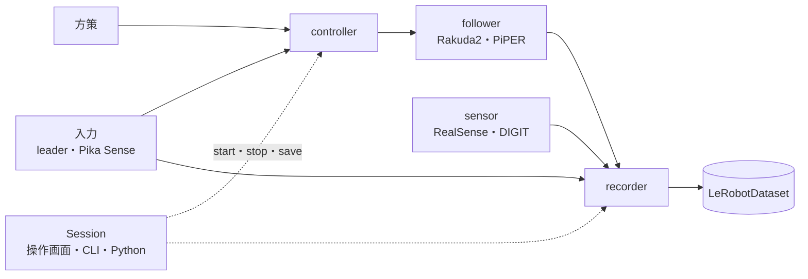

# roboloom

[English](README.md) | **日本語** · Docs: [日本語](https://tetsugo02.github.io/roboloom/ja/) | [English](https://tetsugo02.github.io/roboloom/en/)

[](https://github.com/tetsugo02/roboloom/actions/workflows/test.yml)
[](https://github.com/tetsugo02.github.io/roboloom/)
[](https://github.com/tetsugo02/roboloom/actions/workflows/test.yml)
[](https://github.com/tetsugo02/roboloom/actions/workflows/test.yml)
[](https://github.com/tetsugo02/roboloom/actions/workflows/test.yml)
[](https://github.com/tetsugo02/roboloom/releases)
[](LICENSE)

[dora-rs](https://github.com/dora-rs/dora) 上で遠隔操作・multimodal data収集・方策推論を行い，**LeRobotDataset (0.7.0)** へ直接保存する Python packageです．

## 主な特徴

- **process分離されたdataflow**: 入力・controller・follower・sensor・方策・recorder を独立した dora-rs (`1.0.1`) nodeとして実行します．
- **LeRobotDataset 0.7.0**: 関節状態・行動・RGB camera・DIGIT 触覚・音声を同期して記録し，そのまま `lerobot-train` で学習できます．
- **実機安全機構と重力補償**: 関節ごとの速度制限・jump拒否・EEPROM 照合・watchdog・leader 重力補償を備えます．
- **対話 UI・CLI・Python API**: Textual のlauncher／操作画面，非対話 CLI（`--plain`），`Session` / `InProcessSession` Python API を提供します．
- **Live view（Rerun）** *(模擬のみ)*: 任意の独立した `viewer` node で，観測・行動・取得からの経過時間・session の event を Rerun に表示できます（`--with viewer`，`viz` extra）．
- **高い拡張性**: roboloom 本体を変更せず，`module:Class` 指定で独自のrobot・入力・sensor・controller・方策を追加できます．



## 対応機器と検証状況

| 機能・機体 | 状態 | 備考 |
| --- | --- | --- |
| **Rakuda2**（leader 遠隔操作，重力補償，RealSense，DIGIT，自作方策と介入） | 実機検証済み | 実機modeが既定 |
| **LeRobot 方策**（`policy.lerobot`，`lerobot-train`），再生，`serve-policy`，非同期推論 | 模擬のみ | 模擬dataflowで検証．`policy` / `train` は Python 3.12〜3.13 |
| **PiPER**，**Pika**（Gripper，Sense，手首camera），Web camera，音声 | 開発中 | 実機未検証．`pika` 実機trackerは Linux x86_64 / Python 3.12 専用 |

詳細は [対応表](https://tetsugo02.github.io/roboloom/ja/get-started/support-matrix/) および [状態label](https://tetsugo02.github.io/roboloom/ja/reference/status-labels/) を参照してください．実機で動かす前に必ず各機体の関節範囲・EEPROM・停止動作を確認し，模擬設定の安全値を実機に流用しないでください．

## Installation

**Python 3.12〜3.14**，[uv](https://docs.astral.sh/uv/)，Git が必要です．自分のprojectに依存として追加します．

```bash
uv init --python '>=3.12,<3.15' my-robot
cd my-robot
uv add git+https://github.com/tetsugo02/roboloom.git --tag v0.2.2 --extra rakuda2 --extra record --extra hardware --extra digit
```

| Extra | 用途 |
| --- | --- |
| *(基本)* | dora 実行基盤，設定検証，CLI，模擬device |
| `rakuda2` | Rakuda2 follower・Rakuda-mini leader 用の Dynamixel SDK |
| `record` | LeRobotDataset への保存（`lerobot[dataset]==0.7.0`） |
| `hardware` | RealSense（`pyrealsense2`）および音声入力（`sounddevice`） |
| `digit` | DIGIT 触覚sensor |
| `piper`, `pika` | PiPER SDK，Pinocchio IK，Pika tracker／手首camera *(開発中)* |
| `viz` | Rerun での live 表示（`lerobot[viz]==0.7.0`：`rerun-sdk`, `foxglove-sdk`．*模擬のみ*） |
| `policy`, `train` | LeRobot 方策checkpoint読み込みと `lerobot-train` *(Python 3.12〜3.13)* |

`record`・`viz`・`policy`・`train` を使う場合は，projectの `pyproject.toml` に次の NumPy override を追記してください（Python 3.14 では必須，3.12〜3.13 では NumPy 2.3 以上を許可します）：

```toml
[tool.uv]
override-dependencies = [
    "numpy>=2.0,<3; python_version < '3.14'",
    "numpy>=2.3.3,<3; python_version >= '3.14'",
]
```

coding agent向けの [Agent Skill](https://agentskills.io) も同梱しています（`uv run roboloom skills install`）．各release tagのbuild済み wheel と `SHA256SUMS.txt` は [GitHub Releases](https://github.com/tetsugo02/roboloom/releases) に添付しています．詳細は [Installation](https://tetsugo02.github.io/roboloom/ja/get-started/installation/) を参照してください．

## Quick Start

### CLI

```bash
uv run roboloom init rakuda2          # .roboloom/rakuda2/ を生成
uv run roboloom validate --mock       # 実機を開かず設定を検査
uv run roboloom run --mock            # 対話操作画面を起動
```

一定時間のepisodeを非対話で記録する場合：

```bash
uv run roboloom record --mock --task "handover" --seconds 10
```

repositoryを clone して動かす手順は [装置なしで一周する](https://tetsugo02.github.io/roboloom/ja/tutorials/first-run-mock/)，実機での準備は [Rakuda2：機体設定と読み取り確認](https://tetsugo02.github.io/roboloom/ja/tutorials/rakuda2-setup/) を参照してください．

### Python API

```python
from roboloom import Session

with Session.launch("rakuda2", options=["gravity"], mock=True) as s:
    s.wait_ready()
    s.record("pick up the cup", seconds=20)
```

setup・計測用 API（`roboloom.setup`）や 1 process実行の `InProcessSession` については [Python API reference](https://tetsugo02.github.io/roboloom/ja/reference/python-api/) を参照してください．

## Documentation

日英bilingualのdocumentationを GitHub Pages で公開しています（[日本語](https://tetsugo02.github.io/roboloom/ja/) / [English](https://tetsugo02.github.io/roboloom/en/)）：

- [Get started](https://tetsugo02.github.io/roboloom/ja/get-started/installation/) — install，[しくみ](https://tetsugo02.github.io/roboloom/ja/get-started/concepts/)，[対応表](https://tetsugo02.github.io/roboloom/ja/get-started/support-matrix/)
- [Tutorials](https://tetsugo02.github.io/roboloom/ja/tutorials/) — 模擬での動作確認，Rakuda2 setup・重力補償・収集・学習・独自機体／方策の追加
- [Robots](https://tetsugo02.github.io/roboloom/ja/robots/) · [Controllers](https://tetsugo02.github.io/roboloom/ja/controllers/) · [Sensors](https://tetsugo02.github.io/roboloom/ja/sensors/)
- [Policy](https://tetsugo02.github.io/roboloom/ja/policy/) · [Data](https://tetsugo02.github.io/roboloom/ja/data/format/) — 方策の実行・介入・評価とdata形式
- [Reference](https://tetsugo02.github.io/roboloom/ja/reference/configuration/) — 設定key，[CLI](https://tetsugo02.github.io/roboloom/ja/reference/cli/)，[Python API](https://tetsugo02.github.io/roboloom/ja/reference/python-api/)，[操作画面](https://tetsugo02.github.io/roboloom/ja/reference/operator-screen/)

## 開発

```bash
git clone https://github.com/tetsugo02/roboloom.git
cd roboloom
uv sync --extra rakuda2 --extra test --group dev --group docs
uv run ruff check .
uv run mypy src
uv run pytest -m "not e2e"
```

新しい機体の追加方法，E2E testの実行，documentationのbuild手順は [Contribution](https://tetsugo02.github.io/roboloom/ja/contribution/) を参照してください．

## License

[MIT License](LICENSE) のもとで公開しています．同梱しているthird-party製のrobot modelはそれぞれのlicenseに従います（`src/roboloom/robots/piper/model/LICENSE.piper_ros` を参照）．
