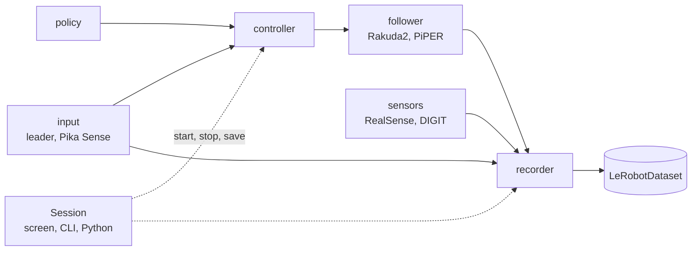

# roboloom

**English** | [日本語](README.ja.md) · Docs: [English](https://tetsugo02.github.io/roboloom/en/) | [日本語](https://tetsugo02.github.io/roboloom/ja/)

[](https://github.com/tetsugo02/roboloom/actions/workflows/test.yml)
[](https://github.com/tetsugo02/roboloom/actions/workflows/docs.yml)
[](https://github.com/tetsugo02/roboloom/actions/workflows/test.yml)
[](https://github.com/tetsugo02/roboloom/actions/workflows/test.yml)
[](https://github.com/tetsugo02/roboloom/actions/workflows/test.yml)
[](https://github.com/tetsugo02/roboloom/releases)
[](LICENSE)

Teleoperation, multimodal data collection, and policy inference on [dora-rs](https://github.com/dora-rs/dora), saving directly to **LeRobotDataset (v3.0)**.

## Features

- **Process-isolated dataflow**: Runs inputs, controllers, followers, sensors, policy, and recorder as separate dora-rs (`1.x`) nodes.
- **LeRobotDataset v3.0**: Records synchronized robot state, actions, RGB cameras, DIGIT tactile sensors, and audio ready for `lerobot-train`.
- **Hardware safety & gravity compensation**: Enforces per-joint speed clamping, jump rejection, EEPROM verification, watchdogs, and leader gravity compensation.
- **Interactive UI, CLI & Python API**: Textual operator screen and launcher, `--plain` non-interactive CLI, and `Session` / `InProcessSession` Python APIs.
- **Live view (Rerun)** *(mock only)*: Optional isolated `viewer` node streams observations, actions, capture ages, and session events to Rerun (`--with viewer`, `viz` extra).
- **Extensible**: Add custom robots, inputs, sensors, controllers, or policies via `module:Class` without modifying roboloom.



## Hardware & Feature Status

| Component | Status | Notes |
| --- | --- | --- |
| **Rakuda2** (leader teleop, gravity compensation, RealSense, DIGIT, custom policy & interventions) | Hardware-verified | Real hardware default |
| **[Local hooks](https://tetsugo02.github.io/roboloom/en/policy/hooks/)** (policy actions, policy teleop, lifecycle events, `action.filtered`) | Mock only | Explicit YAML write claims; existing speed and safety limits still apply |
| **LeRobot policies** (`policy.lerobot`, `lerobot-train`), replay, `serve-policy`, async inference | Mock only | Verified on mock dataflows; `policy`/`train` require Python 3.12–3.13 |
| **PiPER**, **Pika** (Gripper, Sense, wrist cameras), webcam, audio | In development | Not verified on hardware; `pika` tracking requires Python 3.12 on Linux x86_64 |

See the full [Support matrix](https://tetsugo02.github.io/roboloom/en/get-started/support-matrix/) and [Status labels](https://tetsugo02.github.io/roboloom/en/reference/status-labels/). Always verify joint limits, EEPROM, and stop behavior on your robot before hardware runs; never reuse mock limits on hardware.

## Installation

Requires **Python 3.12+** (tested on 3.12–3.14), [uv](https://docs.astral.sh/uv/), and Git. Add roboloom to your project:

```bash
uv init --python '>=3.12' my-robot
cd my-robot
uv add git+https://github.com/tetsugo02/roboloom.git --tag v0.2.2 --extra rakuda2 --extra record --extra hardware --extra digit
```

| Extra | Purpose |
| --- | --- |
| *(base)* | Core dora runtime, config validation, CLI, mock devices |
| `rakuda2` | Dynamixel SDK for Rakuda2 follower & Rakuda-mini leader |
| `record` | LeRobotDataset recording (`lerobot[dataset]>=0.6.1,<0.8`) |
| `hardware` | RealSense (`pyrealsense2`) and audio input (`sounddevice`) |
| `digit` | DIGIT tactile sensors |
| `piper`, `pika` | PiPER SDK, Pinocchio IK, and Pika tracker/cameras *(in development)* |
| `viz` | Live view in Rerun (`lerobot[viz]>=0.6.1,<0.8`: `rerun-sdk`, `foxglove-sdk`; *mock only*) |
| `policy`, `train` | LeRobot policy checkpoints and `lerobot-train` *(Python 3.12–3.13)* |

When using `record`, `viz`, `policy`, or `train`, add the NumPy override below to your project's `pyproject.toml` (required on Python 3.14; allows NumPy 2.3+ on 3.12–3.13):

```toml
[tool.uv]
override-dependencies = [
    "numpy>=2.0,<3; python_version < '3.14'",
    "numpy>=2.3.3,<3; python_version >= '3.14'",
]
```

roboloom also ships an [Agent Skill](https://agentskills.io) for coding agents (`uv run roboloom skills install`). Prebuilt wheels and `SHA256SUMS.txt` for each release tag are attached on [GitHub Releases](https://github.com/tetsugo02/roboloom/releases). See [Installation](https://tetsugo02.github.io/roboloom/en/get-started/installation/) for details.

## Quick Start

### CLI

```bash
uv run roboloom init rakuda2          # generate .roboloom/rakuda2/
uv run roboloom validate --mock       # check config without opening devices
uv run roboloom run --mock            # launch the interactive operator screen
```

To record fixed-length episodes non-interactively:

```bash
uv run roboloom record --mock --task "handover" --seconds 10
```

See [First run without devices](https://tetsugo02.github.io/roboloom/en/tutorials/first-run-mock/) (from a repository clone) or [Rakuda2 setup](https://tetsugo02.github.io/roboloom/en/tutorials/rakuda2-setup/) for real hardware.

### Python API

```python
from roboloom import Session

with Session.launch("rakuda2", options=["gravity"], mock=True) as s:
    s.wait_ready()
    s.record("pick up the cup", seconds=20)
```

For setup/calibration helpers (`roboloom.setup`) and the single-process `InProcessSession` API, see the [Python API reference](https://tetsugo02.github.io/roboloom/en/reference/python-api/).

## Documentation

Full bilingual documentation is hosted on GitHub Pages ([English](https://tetsugo02.github.io/roboloom/en/) / [日本語](https://tetsugo02.github.io/roboloom/ja/)):

- [Get started](https://tetsugo02.github.io/roboloom/en/get-started/installation/) — installation, [concepts](https://tetsugo02.github.io/roboloom/en/get-started/concepts/), and [support matrix](https://tetsugo02.github.io/roboloom/en/get-started/support-matrix/)
- [Tutorials](https://tetsugo02.github.io/roboloom/en/tutorials/) — mock walkthrough, Rakuda2 setup, gravity compensation, collection, training, and custom robots/policies
- [Robots](https://tetsugo02.github.io/roboloom/en/robots/), [Controllers](https://tetsugo02.github.io/roboloom/en/controllers/), & [Sensors](https://tetsugo02.github.io/roboloom/en/sensors/)
- [Policy](https://tetsugo02.github.io/roboloom/en/policy/) & [Data](https://tetsugo02.github.io/roboloom/en/data/format/) — running policies, interventions, evaluation, and training
- [Reference](https://tetsugo02.github.io/roboloom/en/reference/configuration/) — configuration keys, [CLI](https://tetsugo02.github.io/roboloom/en/reference/cli/), [Python API](https://tetsugo02.github.io/roboloom/en/reference/python-api/), and [operator screen](https://tetsugo02.github.io/roboloom/en/reference/operator-screen/)

## Development

```bash
git clone https://github.com/tetsugo02/roboloom.git
cd roboloom
uv sync --extra rakuda2 --extra test --group dev --group docs
uv run ruff check .
uv run mypy src
uv run pytest -m "not e2e"
```

See [Contribution](https://tetsugo02.github.io/roboloom/en/contribution/) for adding robots, running E2E tests, and building the documentation.

## License

Released under the [MIT License](LICENSE). Bundled third-party robot models retain their own licenses (see `src/roboloom/robots/piper/model/LICENSE.piper_ros`).
