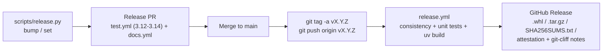

# Contribution

## Development environment and checks

For normal use, follow `uv add git+https://github.com/tetsugo02/roboloom.git --tag v0.2.0` in [Installation](../get-started/installation.md). The following is for developers changing roboloom itself or its docs. Use Python 3.12–3.14 and uv, clone the repository, and run commands from its root.

```bash
git clone https://github.com/tetsugo02/roboloom.git
cd roboloom
uv sync --extra rakuda2 --extra test --group dev --group docs
uv run ruff format .
uv run ruff check .
uv run mypy src
uv run pyright
uv run pytest                # all tests (unit + e2e)
uv run pytest -m "not e2e"   # unit tests only (no dora dataflow startup)
uv run pytest -m e2e         # e2e tests launching dora dataflows with mock devices
uv run --group docs python scripts/docs.py build
```

On pull requests, GitHub Actions (`.github/workflows/test.yml`) checks changed files and runs `ruff check .`, `mypy src`, and unit tests (`pytest -m "not e2e"`) across Python 3.12–3.14 only when source code, tests, runtime dependencies, or test CI files change, reporting the single required status check `Tests status` (changes limited to `docs/**`, `README*.md`, `LICENSE`, cosmetic `pyproject.toml` metadata, and similar non-code files skip the Python matrix and pass `Tests status` immediately so required checks never block non-code PRs). After a PR is merged to `main`, tests are not re-run; instead, `.github/workflows/badges.yml` reads the merged PR's test results and updates the status badge JSON files on the `badges` branch (manual `workflow_dispatch` runs on `main` also update them). The E2E tests that start dora processes with mock devices (`.github/workflows/e2e.yml`, 3 sharded jobs) run manually via `workflow_dispatch`; no hardware is used.

Check the checkout's mock dataflow with `uv run roboloom validate examples/mock/config.yaml` and `uv run roboloom run examples/mock/config.yaml`. Saving requires the `record` or `test` extra. `examples/` and `scripts/` are for the checkout; users of the Git dependency use their own configuration and Python scripts.

The mock configuration saves to `datasets/rakuda-mock` (`datasets/rakuda-mock-bilateral` with the option `bilateral`). After a change to the recorded layout (feature names or shapes), old data cannot be appended to; move it or change `output`. Do not delete existing data to check the screen.

Do not include formatting changes unrelated to your change. Report mock tests, real-data checks, and hardware verification separately.

Package authors, keywords, and project URLs are managed in `project.authors`, `project.keywords`, and `project.urls` in `pyproject.toml`. The documentation author and repository link are configured through `site_author`, `repo_name`, and `repo_url` in `docs/base.yml`. Keep both files consistent when changing author information or published URLs.

## Update features and docs together

Update the affected pages in `docs/` in the same change that adds a feature or changes behavior. Update both Japanese (`docs/ja/`) and English (`docs/en/`) in that change, and keep page structure, headings, code examples, and link targets identical. Keep configuration, defaults, CLI, Python API, and limitations consistent with the implementation.

| Change | Pages to update |
| --- | --- |
| Installation or first-time operation | Get started and the related tutorials |
| Robots or supported combinations | The pages under `robots/<robot>/`, the support matrix (`get-started/support-matrix.md`), and the robot's tutorials |
| Sensor configuration or formats | Sensors and the robot's `sensors.md` |
| Operator input or start conditions | Controllers and the robot's `controllers.md` |
| Policies or inference | Policy |
| Recording format or datasets | Data and `reference/dataset-features.md` |
| API, CLI, or configuration changes | Reference (as tables) and related examples |
| A feature's verification status | `reference/status-labels.md` and the pages carrying that label |
| Public API, CLI, configuration, or supported devices | The agent skill in `src/roboloom/agent_skills/roboloom/` (`SKILL.md` and `references/`) |

Put a new page at the same path in both languages and register it in the `nav` of `mkdocs.yml` (Japanese) and `mkdocs.en.yml` (English). When instructions are affected, also update `README.md`, `README.ja.md`, and the README of the template that `roboloom init` distributes. If the existing code and the docs disagree, fix the docs to follow the code's conventions and list the disagreement in your change report.

When you move or remove a page, register the old path in `redirect_maps` in `docs/base.yml`. Tutorials give steps, Reference only describes (in tables), and Explanation gives background and reasons. Features not verified on hardware are documented too, with a [status label](../reference/status-labels.md) at the top of the page or in the table row. Do not present design proposals or past investigation notes as hardware-verified behavior.

## Editing and previewing the docs

The docs use [Zensical's MkDocs compatibility](https://zensical.org/docs/compatibility/mkdocs/). Each language has its own config; shared settings live in `docs/base.yml`.

| Language | Markdown | Config | Output |
| --- | --- | --- | --- |
| Japanese | `docs/ja/` | `mkdocs.yml` | `site/ja/` |
| English | `docs/en/` | `mkdocs.en.yml` | `site/en/` |

```bash
uv run --group docs python scripts/docs.py build   # strict build of both languages
uv run --group docs python scripts/docs.py serve   # build both and serve at http://127.0.0.1:8000
uv run --group docs zensical serve                 # Japanese only, with live reload
uv run --group docs zensical serve -f mkdocs.en.yml  # English only, with live reload
```

The language switcher at the top right moves to the selected language's home page when both languages are built side by side under `site/`. When only one language is open with `zensical serve`, the other language is not available. `site/index.html` redirects to `ja/` or `en/` according to the browser language. Do not commit build output.

Fonts and colors are set in `docs/overrides/` (`main.html` and `assets/stylesheets/roboloom.css`).

`docs/ja/yam-safety-and-smoothness.md` is kept as a past investigation and design note and is excluded from the guide build. Design proposals for unimplemented features, such as the [bilateral control design](bilateral.md), go under Contribution and state at the top that they are not implemented.

### Japanese notation { #japanese-notation }

In the Japanese pages (`docs/ja/`, `README.ja.md`, and the Japanese `nav` titles), write English-derived technical terms in English, not katakana, matching the spelling of the code identifier or API term (`follower` in prose, `Follower` only for the class).

| Area | Examples |
| --- | --- |
| Robots, control, hardware | follower, sensor, gripper, tracker, motor, torque, camera, arm, bus, serial, port, driver, firmware, interface, watchdog, encoder, gain, latch |
| Software, CLI, configuration | node, option, key, file, path, command, directory, process, thread, class, module, package, repository, template, project, session, log, build, test, error, flag, trigger, timeout |
| Data and learning | dataset, data, metadata, episode, checkpoint, chunk, epoch, model, sample, task, label, schema, vector, norm, skill, agent, coding agent |
| Audio and video | mel, mel power, mono, mic, sampling, stereo, channel, color, frame |
| Screen concepts | tab, pane, panel, focus, menu, dialog, shortcut, tooltip, cursor, drag, scroll, layout, font |

- Everyday loanwords stay in katakana: ページ, ボタン, リスト, コピー, チェック, メモ, ガイド, ホーム, カード, サイズ, ゼロ, オン.
- Kanji terms (方策, 入力, 記録, 校正, 遠隔操作) and product names (PiPER, Pika, Rakuda2, LeRobot, RealSense, DIGIT) are unchanged.
- Do not introduce new katakana technical terms or long-vowel variants (`センサ`/`センサー`, `グリッパ`/`グリッパー`); the English spelling unifies them.
- Keep code examples and placeholders identical to the English pages (`<follower>`, `<node>`, `{name: path}`, `logs/<dataset name>-<time>/`).
- Headings may mix English terms with Japanese; links keep using the explicit anchors (`{ #... }`).

## Publishing to GitHub Pages

`.github/workflows/docs.yml` builds both languages in strict mode and publishes the entire `site/` directory to GitHub Pages. The published URLs are [Japanese](https://tetsugo02.github.io/roboloom/ja/) and [English](https://tetsugo02.github.io/roboloom/en/). The root URL redirects according to the browser language.

- Push to `main`: changes to `docs/**`, `src/**` (the Python API pages are generated from docstrings), `mkdocs*.yml`, `scripts/docs.py`, `uv.lock`, or the workflow itself trigger a build and deployment.
- Pull request targeting `main`: changes to the same files trigger build validation only.
- Actions → `Documentation` → `Run workflow`: starts a manual build. Deployment runs only when `main` is selected.

The workflow uses Python 3.12 and uv, installing only the locked documentation dependencies with `uv sync --locked --only-group docs`. It then runs `uv run --no-sync python scripts/docs.py build` and publishes the successful output. Robot and sensor dependencies and hardware connections are not required.

For the initial setup, set the repository's **Settings → Pages → Build and deployment → Source** to **GitHub Actions** ([GitHub setup instructions](https://docs.github.com/en/pages/getting-started-with-github-pages/configuring-a-publishing-source-for-your-github-pages-site#publishing-with-a-custom-github-actions-workflow)). Once the workflow reaches `main`, it publishes the site; the URL appears in the `github-pages` environment and the Actions deployment result. Failed builds are not deployed.

## Adding a follower { #adding-a-follower }

A follower model (a `Follower` subclass) must declare its safety traits, `safety_traits` (or `declared_traits()` when they depend on the configuration). A class without them raises TypeError on import. The values are explained in "Behaviour without torque and when left alone" in [Configuration](../reference/configuration/index.md). Declare what has not been established as `unknown`. Input models that run control laws (`JointInput` subclasses) declare `safety_traits` too. An arm driven by poses (`pose_ik`) returns its URDF chain from `kinematics()` (a `KinematicSpec`: the URDF, base, tip and joints).

### From your own package, without changing roboloom { #own-types }

A robot, input device, sensor, controller or estimator roboloom does not ship can stay in your own code.

- Write the class as `module:Class` in the node YAML's `type`. It is imported from the installed packages first, then from the robot's directory (`.roboloom/<robot>/`).
- Every node runs as a process of its own and loads the configuration again. That is why a class is named by reference (`module:Class`): registering it in a registry inside one process is not seen by the other nodes.
- The class subclasses the base class of its role (`roboloom.robots.base.Follower`, `roboloom.inputs.base.JointInput` and `PoseInput`, `roboloom.core.source.Source`, `roboloom.controllers.base.Controller`, `roboloom.estimators.base.Estimator`). A class that does not is refused on loading.
- List the YAML keys the class reads in `keys`, and any other key is refused on loading (a misspelled key is not ignored in silence). A class without `keys` is not checked.

    ```python
    from roboloom.robots.base import FOLLOWER_KEYS, Follower

    class MyArm(Follower):
        keys = (*FOLLOWER_KEYS, "address")
    ```

- A follower needs its joint names and unit, `safety_traits`, and the bus `open_bus(mock)` returns (`read_positions`, `write_positions`, `enable_torque`, `close`; `roboloom.drivers.base.JointBus`). With `mock` true it returns a mock bus.
- A simulator is another bus behind the same follower class. Speak the real robot's unit and the datasets and policies are shared.
- The `control:` laws (`roboloom.control`) assume a Dynamixel-like bus (counts, mA, operating modes). A robot with its own position control does not use them.

The template can live on your side too. Put `config.yaml`, the node YAML, the module with the class and `mock.yaml` in one directory (or in a package's `template/`) and make a project from it:

```bash
uv run roboloom init lab_arm --template my_lab.robots.arm   # a package's template/
uv run roboloom init lab_arm --template path/to/template    # a directory
uv run roboloom init lab_arm --update                       # after the template changed
```

`examples/own_robot/` in the repository is the smallest working example (the follower class `my_arm.py`, a configuration in which a policy holds the pose, a mock bus).

```bash
uv run roboloom init lab_arm --template examples/own_robot
uv run roboloom infer lab_arm --mock --seconds 5 --plain
```

## Operator UI extensions

For new device kinds, keep device access in the backend and publish standard status fields. Optional explicit kind/role presenters, backend contracts, and Pilot/MockBus verification are described in [Operator screen](../reference/operator-screen.md).

## Release process { #release-process }

Use [`scripts/release.py`](https://github.com/tetsugo02/roboloom/blob/main/scripts/release.py) to update the version across `pyproject.toml`, `uv.lock`, `src/roboloom/agent_skills/roboloom/SKILL.md`, `--tag` snippets in `README*.md` and `docs/`, and `CHANGELOG.md`, then merge the release PR to `main` and push tag `vX.Y.Z`.



| Step | Command / Trigger | What happens |
| --- | --- | --- |
| 1. Prepare | `uv run python scripts/release.py bump minor` (or `set X.Y.Z`) | Updates `pyproject.toml`, `uv.lock`, `SKILL.md`, `--tag` references, and `CHANGELOG.md` (`cliff.toml`) |
| 2. Verify | `uv run python scripts/release.py check` plus test and docs builds | Confirms version consistency and PR checks locally |
| 3. Merge PR | Merge the release PR into `main` | `test.yml` (Python 3.12–3.14) and `badges.yml` complete |
| 4. Publish | `git tag -a vX.Y.Z -m "Release vX.Y.Z" && git push origin vX.Y.Z` | `.github/workflows/release.yml` verifies tag alignment, runs `ruff`/`mypy`/`pytest -m "not e2e"`, builds with `uv build`, smoke-tests the wheel in isolation, generates `SHA256SUMS.txt`, attests provenance, and publishes the GitHub Release |
