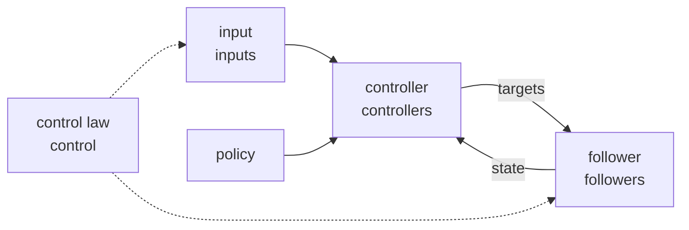

# Controllers

A controller turns the values of an input (a leader, a hand-held device, a policy) into follower targets. The settings come in three parts.

| Setting | Role | Examples |
| --- | --- | --- |
| `inputs` | reads the device the operator moves | Rakuda-mini (`rakuda_mini`), Pika Sense (`pika_sense`) |
| `controllers` | turns the input into follower targets; holds the start condition (alignment), speed limits and the input deadline | `joint`, `pose_ik`, `policy`, `parts` |
| `control` | the control law applied to a device's motors (the leader's spring, gravity compensation, …), run by the follower or leader node itself | `spring`, `gravity_comp`, `position` |

## Types { #types }

| Controller | `type` | Input | Status |
| --- | --- | --- | --- |
| [Leader](leader.md) | `joint` | a leader with the same joints | Hardware-verified |
| [Policy](policy.md) | `policy` | a learned policy (and a `joint` leader for interventions) | Hardware-verified |
| [Pika Sense and IK](pose-ik.md) | `pose_ik` (`parts` to split it per arm) | the pose of a hand-held device | In development |

## Teleop outside an episode { #teleop }

Mock only

| Item | Behavior |
| --- | --- |
| Availability | At least one controller is configured and every controller follows operator input. This includes `joint`, `pose_ik`, `parts` whose inner controllers all follow operator input, and custom controllers that meet the same rule. A policy with `teleop:` uses [teleoperation and interventions](../policy/intervention.md#teleop). |
| Readiness | `teleop` checks controller readiness and alignment as `start` does. |
| `t` / `teleop` | Arm the followers so they follow the input. Nothing is recorded. After stopping an episode on the operator screen, save or discard it before using Teleop. |
| `stop_teleop` | Hold the followers. Accepted outside an episode even when the followers are already holding. During an episode use `stop`. |
| `start` | Begin recording from the current pose. The followers continue to follow the input. |
| `home` | Use `stop_teleop` before moving home. |

## By robot { #by-robot }

| Robot | Leader | Policy | Policy with interventions | Pika Sense and IK |
| --- | --- | --- | --- | --- |
| [Rakuda2](../robots/rakuda2/controllers.md) | Hardware-verified | Hardware-verified | Hardware-verified | In development |
| [PiPER + Pika Gripper](../robots/piper/controllers.md) | — | In development | — | In development |

The table that also covers sensors and kinds of policies is the [Support matrix](../get-started/support-matrix.md). The controller keys are listed in [Controllers configuration](../reference/configuration/controllers.md).
