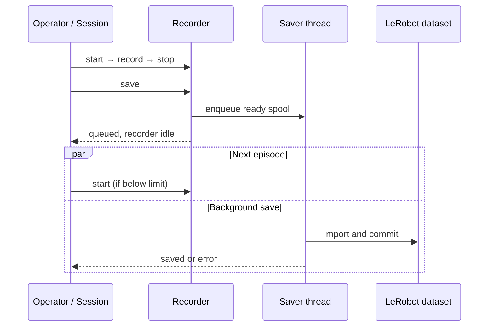

# Recording and resuming

How episodes are saved or discarded, and what a saved dataset keeps. The recorder's keys are in [Recorder configuration](../reference/configuration/recorder.md#recorder) and the command in the [CLI](../reference/cli.md#record).

## Saving and discarding { #save-and-discard }

- An episode begins with `start` and stops with `stop`. A stopped episode is then saved with `save` or dropped with `discard`. `roboloom record` and `Session.record` save it after stopping ([Choosing which episodes to keep](#choosing-episodes)).
- `save` queues the stopped episode by default in a dora dataflow. With `background_save: false`, it waits for the dataset write to finish. `InProcessSession` always saves synchronously.
- An episode in which a controller fails (a policy raising, for example) or a follower latches FAULT or ESTOP is discarded.
- The Python calls are in [Session](../reference/python-api/session.md).

## Background saving { #background-saving }

<span class="status status--mock">Mock only</span> Checked with mock dataflows and synthetic frames. The default applies to `roboloom run`, `roboloom record` and Python `Session`.



| Step | What happens |
| --- | --- |
| `start` → `stop` | The recorder stages the episode under `<dataset root>/roboloom_spool/<seq>/`. During recording it writes PNGs for 2D `uint8` images and `uint8` images with 3 or 4 channels, and `.npy` for other image arrays. `stop` finishes the image writes and writes the buffered non-image features to `rows.npz`. |
| `save` | Publishes `episode.json` with `ready: true` and returns once queued. One saver thread imports episodes in order using the save journal and removes each episode's spool directory after processing it. |
| Next `start` | Can follow immediately if the recorder and controllers are ready and `pending_saves < max_pending_saves`. The count includes the active save. At the limit the message is `N episodes are waiting to be saved (max_pending_saves M); wait, then retry start`. |
| Save failure | The dataset returns to its pre-save state and only that episode is dropped. The error arrives later in the log or as a `Session` error note, possibly during the next recording. Later queued episodes continue saving. |
| `quit` / `Session.close()` | Discards the unfinished episode and waits for queued saves to finish. `Session.close()` reports `saving N queued episodes ...` when it finds saves still pending. |

After a recorder process dies, reopen the same dataset for recording. The recorder rolls back any interrupted dataset write, removes unfinished spool episodes (including stopped episodes that were never queued), and queues the accepted episodes for import. The warning `N episodes left from an interrupted run are being saved` gives the number queued for recovery. An episode that committed before the process died is kept once, even if spool cleanup was interrupted. This recovery also runs with `background_save: false`.

Before uploading or training, finish the session and check `roboloom check-dataset` for an `episode spool:` note. If there are ready or unfinished episodes, reopen the dataset for recording and quit to finish recovery, then check again. `--recover` repairs an interrupted dataset write only. See [Checking a dataset](check-and-train.md#check-dataset).

To save synchronously, set `background_save: false` in [nodes/recorder.yaml](../reference/configuration/recorder.md#recorder). This setting is also required with `streaming_encoding: true`.

### Checking on hardware { #checking-on-hardware }

<span class="status status--mock">Mock only</span> Run these checks from a [roboloom checkout](../contribution/index.md). Use a configured Rakuda2 with RealSense and keep `background_save: true`. To include DIGIT, pass `--with gravity,digit` if you normally use `gravity`. List all the options you want because `--with` replaces the defaults. Use a dedicated test dataset. The default is `datasets/rakuda2-bgsave-check`, and `--root` selects a different directory.

```bash
uv run python scripts/check_background_save.py compare rakuda2 --seconds 30 --episodes 5
uv run python scripts/check_background_save.py limit rakuda2 --seconds 1
uv run python scripts/check_background_save.py crash rakuda2 --seconds 20
```

Align the leader with the follower before each episode. Keep them aligned between episodes because the script attempts the next Start as soon as allowed by the check. For `compare`, use similar movements in both groups.

| Check | Procedure and approximate recording time |
| --- | --- |
| `compare` | Record five episodes after draining the save queue before each Start, then five with an immediate Start after Save. Allow five minutes for recording plus startup and save time. |
| `limit` | Record one-second episodes back to back and try Start at the queue limit. After a refusal, drain the queue and record and save one more episode. Allow up to `max_pending_saves + 3` seconds for recording, plus command and save time. |
| `crash` | Record for 20 seconds, then send `SIGKILL` only to the recorder while a save is pending. The script closes the dataflow and reopens the same dataset to verify recovery. Allow time for confirmation, restart and saving. |

For `crash`, support the leader and follower arms before confirming and keep them supported through shutdown and restart. Recording stops before the kill. Dora and the other nodes may keep running until the script closes the dataflow. On orderly shutdown, the follower stops and can keep holding in position mode. Current-mode joints can lose holding force when their device closes or its watchdog fires.

| Result or metric | What to check |
| --- | --- |
| Missing rates | Compare `missing_rate` per source and `action_missing_rate` per follower. `compare` warns if an overlap mean increases by more than 0.01 or crosses the configured quality limit. |
| Timing | Compare recording `queue_ms` and `latency_ms` p99 and max, and `control_interval_ms` max per follower. Review queue and latency values for slowdowns. The control interval is also checked against the configured quality limit. |
| `PASS` | The check observed the expected behavior, and the dataset passed validation. |
| `WARN` | `compare` could not confirm overlap around Start, or metrics crossed a comparison or quality limit. |
| `SKIP` | The queue did not reach the limit, the save completed before the crash could be induced, or the operator declined the kill. To reproduce more save load, try a longer duration or add sensors. |
| `FAIL` | A command, save, dataset check, or recovery check failed. |

The script prints the path to `background-save-result.json` in the session's log directory next to the robot's other logs (`.roboloom/<robot>/logs/bgsave-check-<time>/`; `recovery/` under it holds the restarted run of `crash`). Keep the JSON with the hardware results. It contains the arguments, roboloom version, timeline, per-episode metrics and verdict.

**Operator screen checklist.** Use a [test experiment](../reference/configuration/index.md#experiments) with its own `dataset.root`, then run:

```bash
uv run roboloom run rakuda2 --experiment ./bgsave-screen.yaml
```

- Align the leader. Record an episode, select Stop and then Save, and check that the recorder row shows `saving 1 queued`. With space in the queue, Start works immediately.
- With `max_pending_saves` queued, try Start and check for `N episodes are waiting to be saved (max_pending_saves M); wait, then retry start`.
- Check that `saved episode N '...'` appears in the log after a queued save completes.
- Quit with a queued save and confirm that saving finishes before the screen closes. Check the test dataset after exit.
- If a save fails, check that the screen reports `episode '...' was not saved: ...` as an error.

## Resuming { #resuming }

You can append further episodes to the same dataset. On resume, FPS and feature compatibility are checked. Give an option that changes the recorded features a `dataset`, so it gets a dataset of its own ([Launch options](../reference/configuration/index.md#launch-options)).

## What happens to a saved episode { #saved-episodes }

- A completed save closes the episode's files. Once reported as saved, the episode stays readable even if the process is killed afterwards.
- So the rows, the episode metadata and each video are one file per episode (the layout LeRobot produces when `resume` is called for every episode). To merge the files before uploading to the Hub, use LeRobot's aggregation tools.
- When a save fails (for example the disk is full), that episode is dropped and the dataset is put back as it was before the save. The earlier episodes stay, and the next episode can be recorded.
- When a process stops during a dataset write, the save journal rolls back the partial write when recording resumes or with `check-dataset --recover`. [Background saving](#background-saving) reimports accepted spool episodes when recording resumes.
- A video that is not as long as the episode's rows (for example a frame could not be written) counts as a failed save.
- This covers a process that dies. It does not cover a power loss (LeRobot does not sync its files to the disk).

## Dataset metadata { #metadata }

`meta/roboloom.json` keeps the roboloom version that created the dataset, the unit of every entry of `action` and `observation.state`, and, for every run that saved an episode, its options and configuration (`meta/roboloom_config/<name>.json`, the nodes' values as loaded). Files a node file points to (gravity models, tuning, calibration) are not copied.

## Episode records { #episode-records }

After the dataset write succeeds, the recorder attempts to append one line (JSON) to `meta/roboloom_episodes.jsonl`. The dataset commit can survive an interrupted or failed append to this file.

| Key | Content |
| --- | --- |
| `episode` | The episode's index in the dataset |
| `saved` | When it was saved |
| `task`, `frames` | The task and the number of rows |
| `metrics` | The recorder's metrics (missing rates, the share of valid actions, the control interval) |
| `controllers` | What each controller reported when `save` was requested. For a policy: `infer_ms` and `infer_max_ms` (inference time), `dropped` (the steps asynchronous inference dropped as late), `error`, and so on |
| `label`, `note` | The evaluation verdict (`success` or `failure`; `null` when none was given) and a note |

- A verdict is given when saving: `save(label=...)` and `record(..., label=...)` in Python ([Recording an evaluation's verdicts](../policy/evaluation.md#labels)), `save success` or `save failure` in the operator screen's command box or the `--plain` line input, `roboloom session save success` from another terminal.
- To set or change it afterwards, use `roboloom label [robot] <episode> success|failure` ([CLI](../reference/cli.md#label)). It appends a `{"episode", "label", "labelled", "note"}` line; reading merges the lines of an episode, later ones winning. No line is ever rewritten.
- `roboloom check-dataset` counts the verdicts.
- LeRobot does not read this file; training is unaffected. An episode whose save failed, or that was discarded, has no line.
- From Python, `roboloom.recording.episodes.read(...)` reads it ([Python API: recording](../reference/python-api/recording.md)). An example that picks the episodes to train on is in [Leaving out bad episodes](check-and-train.md#excluding-episodes).

## Choosing which episodes to keep { #choosing-episodes }

- `record` calls `keep(result)` after stopping and before saving.
  - If it returns `False`, the episode is discarded.
- What `result` contains:
  - `metrics`: recorder metrics. Missing rate, valid action rate, control period distribution.
  - `warnings`: items that exceeded quality limits. `result.ok` is true when there are none.
- Quality limits can be changed in `quality` of `nodes/recorder.yaml` ([Quality limits](../reference/configuration/recorder.md#quality)).
  - `max_missing_rate` (default 0.05)
  - `min_action_valid_rate` (default 0.9)
  - `max_interval_ms` (default 100)
- `control_interval_ms` and `action_missing_rate` (the share of rows without a command) are per follower, and warnings name the follower.

```python
ok = s.record("pick up the cup", 30, keep=lambda ep: ep.ok)
```
