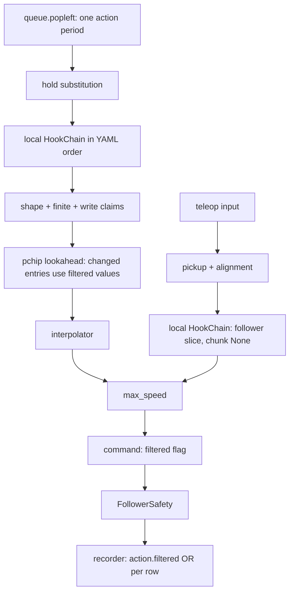

# Hooks in the control loop

Mock only

## Placement and safety { #placement }

The node replaces held entries first, so hooks receive complete finite targets. Each hook sees the preceding output; shape, finite values and bit-identical entries outside its effective writes are checked immediately. A hook may change a held joint only when it explicitly claims that joint. Overlapping writes are allowed, logged at load, and later hooks win. Put a shield last.

A policy step runs once per popped action, never on the lookahead action. Changed lookahead entries use the filtered value, avoiding a pchip slope toward a value the hook already rejected. Interpolated ticks retain the period’s per-follower filtered flag. `max_speed`, command deadlines and FollowerSafety still apply.

Teleop steps in the policy node run after pickup/alignment and before the joint controller’s speed limit. Their context names contain only that follower; `chunk` is None. Other joint controllers have the seam disabled. The seam does not replace follower effort signals, one-follower controllers or input-side current laws; future effort feedback remains possible.

## Local execution and observations { #local }

Steps always execute in the local control thread, including when inference is remote. Sending images/actions over a server connection each action period would couple control latency to network and inference latency. Remote protocol 2 negotiates event capabilities; offered server step hooks refuse connection with instructions to use a local factory or `backend: process`. An older server contributes no events.

At bind, each declared observation key is mapped to the source features or joined parts that produce it. Reading an observation invokes a lazy period builder at most once; each source value is cached. A full observation already built for inference/history is reused. Undeclared keys raise KeyError mentioning `observe`; undeclared images are never decoded for hooks. Arrays are read-only snapshots. Read-only hooks declare no writes; YAML limits may narrow sources and must contain every declared write.

## Threading and barriers { #threading }

Each event-capable hook owns one worker and ordered queue. Its step, event and close methods never run concurrently. EpisodeStarted, ControlChanged and PolicyRestarted are barriers only for hooks with step: start waits up to 60 s; the other barriers wait `budget_ms * 10`. Event-only hooks never delay control. A barrier timeout follows on_error; a start blocked behind an earlier EpisodeEnded is refused after 60 s.

EpisodeEnded is queued without blocking control. Its worker first waits for the episode’s orphaned inferences (SETTLE_S, 10 s cap). The next start barrier queues behind that end event. At shutdown a running episode gets reason shutdown; workers drain for at most 60 s and then close. A worker still draining closes its hook when it finishes; close never races a handler. Event handler exceptions are logged and do not fail the episode.

A policy’s contributed hook can still share state with async `infer`, which is a different object method outside the hook worker lock. Protect that shared state with your own lock. Keep steps short: the default measured budget is `0.5 / rate_hz` ms (teleop: actual input period); exceeding it increments counters and warns, without interrupting Python.

## Lifecycle and failure { #lifecycle }

Only running episodes invoke steps. Takeover emits ControlChanged(takeover), then only hooks whose effective sources include teleop run. Handback emits ControlChanged(handback), then PolicyRestarted(handback). A stale observation pops no action and sends ObservationStale once; recovery resets policy inference and emits PolicyRestarted(stale_recovered). FAULT/ESTOP ticks send no commands or steps. Stop/discard/estop/release/failure/interruption/shutdown deliver EpisodeEnded once, with task, index, dataset root, times, step/command/intervention counts and filtered_steps.

A writing hook defaults to fail: the episode fails and followers hold. Observe-only hooks default to pass. Explicit hold substitutes only the hook’s writable entries with held targets for that period; pass keeps its input. Errors are counted. The replacement decision lives in HookChain’s single error-value function so future failure policies can be added without changing these meanings. V1 has no fallback value or on_overrun setting. Requirements additions must be defaulted; HOOKS_API changes only when an existing meaning changes, and newer requirements are refused at load.
