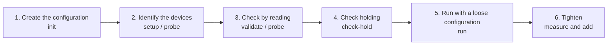

# Stages of bringing up a robot

The work up to the first run on hardware is split into the same six stages on every robot. The per-robot tutorials ([Rakuda2](../tutorials/rakuda2/index.md), [PiPER + Pika](../tutorials/piper-pika/index.md)) follow this order.

| Stage | What you do | Does it move? |
| --- | --- | --- |
| 1. Create the configuration | Copy the template with `roboloom init <robot>`. Values measured per robot unit are left as `SET_` | No |
| 2. Identify the devices | Find which port, CAN interface and tracker is which device, and write them down | No (read only) |
| 3. Check by reading | Check the configuration with `validate`, and the joint angles, temperatures and faults with `probe` | No |
| 4. Check holding | Measure with `check-hold` whether the arm holds when commands stop | Enables the motors |
| 5. Run with a loose configuration | At a low speed, without setting the workspace and the like, first check that teleoperation works | Yes |
| 6. Tighten | Measure and add the tool dimensions, the workspace and the joint ranges, and raise the speed | Yes |

## Why this order

- **Finish what reading alone can tell before moving anything.** Stages 1–3 do not enable any device. Swapped ports and wiring problems are found here.
- **Keep device identification separate from the configuration.** USB ports and CAN names change when the PC or the wiring changes. `roboloom setup` has you move each device by hand (turn a joint of an arm, open and close a Sense), identifies what changed, and writes it to the configuration. After replacing a device, the same command checks it again.
- **Do the first teleoperation with a loose configuration.** The workspace and the tool dimensions are easier to measure once teleoperation works. They can be left out the first time, and only the joint ranges and the IK limit the target. To make up for that, lower the speed and clear the space around the robot.
- **Tighten last.** After checking that the robot moves, narrow the safety limits to fit the hardware.

## What to ask an administrator

Ask an administrator for the work that needs root before stage 2. roboloom does not call sudo.

- Permission to open serial ports (the `dialout` group)
- udev rules for each device (for example, `81-vive.rules` for Vive trackers)
- Bringing the CAN interfaces up at 1 Mbps (`roboloom setup` shows the commands to run)
