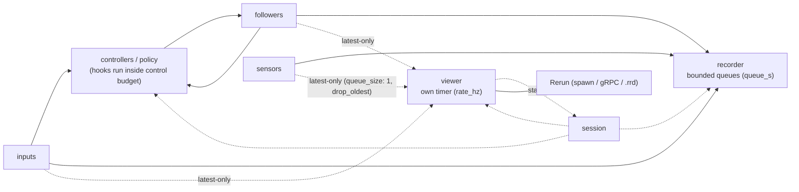

# Why the viewer is a separate node

Mock only

The `viewer` runs as its own dora node process rather than inside a policy hook or the recorder. Every stream into `viewer` (`inputs`, `followers`, `sensors`, `estimators`, and `action_<follower>`) uses `queue_size: 1` with `queue_policy: drop_oldest`, and buffered timer ticks collapse into one redraw per wakeup on its own `rate_hz` timer. Because it never pushes back on upstream queues, slow Rerun rendering, JPEG compression, gRPC network stalls, or even a failed viewer startup never delay device polling, follower control, or `recorder` row alignment (a failed viewer keeps draining inputs and reports its error in `status`). Local [policy hooks](hooks.md), by contrast, run synchronously inside a `policy` node within its control budget (`0.5 / rate_hz` ms by default) and do not exist during teleoperation (`record` / `run`).

Measured in mock (`rakuda2`, `digit` + `viewer`, 20 s): follower control interval p99 was **9.82 ms** with the viewer vs **9.72 ms** without, with no missing samples.

See [Viewer configuration](../reference/configuration/viewer.md) for the keys and targets, and [Live view (Rerun)](../data/recording.md#live-view) for how to run it.
