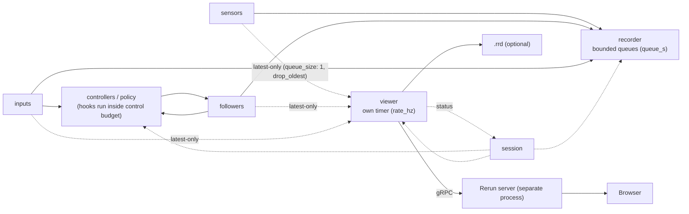

# Why the viewer is a separate node

Mock only

The `viewer` runs as its own dora node process rather than inside a policy hook or the recorder. Every stream into `viewer` (`inputs`, `followers`, `sensors`, `estimators`, and `action_<follower>`) uses `queue_size: 1` with `queue_policy: drop_oldest`, and buffered timer ticks collapse into one redraw per wakeup on its own `rate_hz` timer. Because it never pushes back on upstream queues, slow Rerun rendering, JPEG compression, gRPC network stalls, or even a failed viewer startup never delay device polling, follower control, or `recorder` row alignment (a failed viewer keeps draining inputs and reports its error in `status`). Local [policy hooks](hooks.md), by contrast, run synchronously inside a `policy` node within its control budget (`0.5 / rate_hz` ms by default) and do not exist during teleoperation (`record` / `run`).

An earlier mock run (`rakuda2`, `digit` + `viewer`, 20 s) measured a follower control interval p99 of **9.82 ms** with the viewer and **9.72 ms** without it. Both runs had all samples.

## Image history { #image-history }

Overwriting a static image at 10 Hz froze the Rerun web viewer in live use. The viewer node now logs images with the same `roboloom` timestamp as the scalar samples for each draw. The browser can show earlier frames from the timeline, and Rerun's memory limits bound the retained live history. The node sends the layout on the first draw and updates it when a new image or scalar entity needs to be added to a view.

## Server lifetime { #server-lifetime }

The default server runs in a separate process session on the robot PC. The browser renders the view, so the robot PC can serve it without a display or a native graphics backend. The server buffers recent data for browsers that connect after recording has started. When the dataflow ends, it can still serve buffered samples and accept a connection from the next run.

See [Viewer configuration](../reference/configuration/viewer.md) for the keys and targets, and [Live view (Rerun)](../data/recording.md#live-view) for how to run it.
