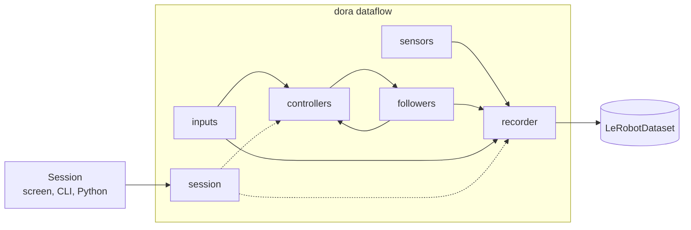
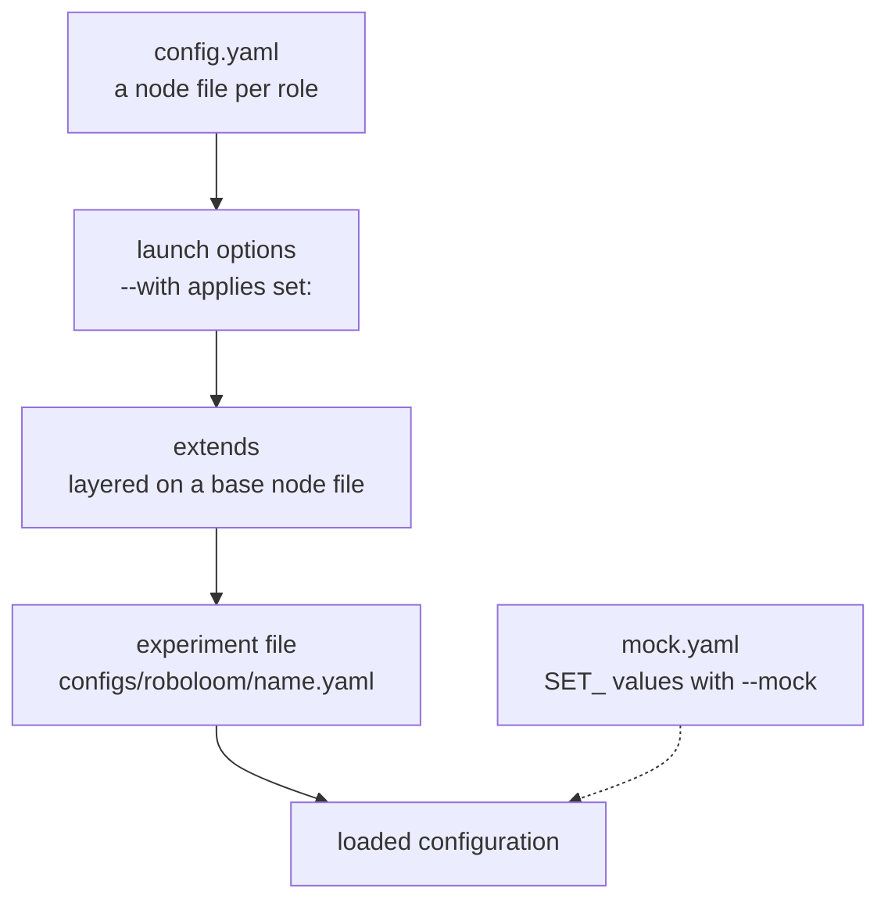
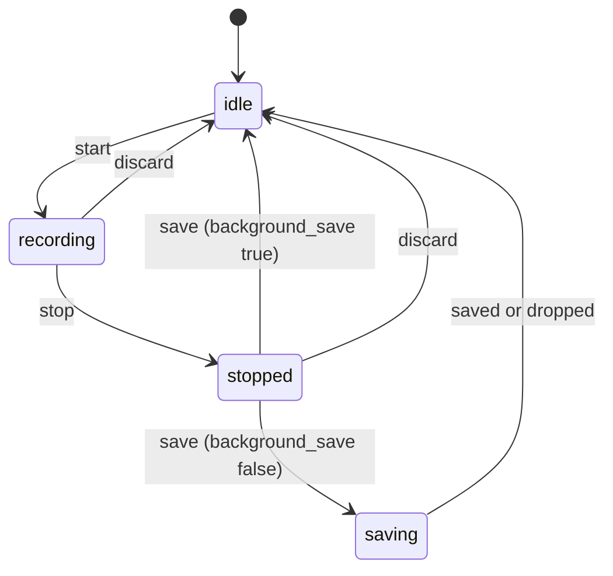
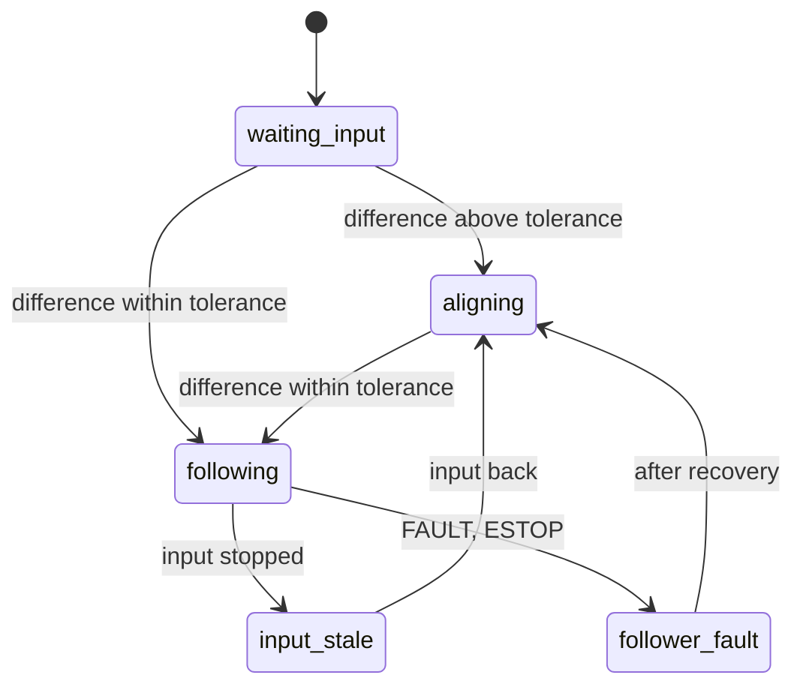

# Concepts

The nodes, configuration, units, Session and episode states that make the rest of these docs easier to read. The keys are listed in [Configuration](../reference/configuration/index.md).

## Nodes { #nodes }

A configuration is a set of nodes, one per role. Each node runs as its own process in a dora-rs dataflow and reads the configuration itself.

| Role (key in `config.yaml`) | What it does | Examples |
| --- | --- | --- |
| `inputs` | reads the device a person moves | Rakuda-mini (leader), Pika Sense |
| `controllers` | turns an input or a policy into follower targets | `joint`, `policy`, `pose_ik` |
| `followers` | moves its motors to the targets and reports its state | Rakuda2, PiPER, Pika Gripper |
| `sensors` | captures observations | RealSense, DIGIT, audio |
| `recorder` | aligns every node's output to dataset rows and saves them | LeRobotDataset |
| `session` | takes operations (start, stop, save, …) and passes them on to the nodes | the operator screen, `roboloom session` |
| `trackers`, `estimators` | pose tracking, external-force estimation | Lighthouse, `effort` |

## How the configuration is put together { #configuration }

Each robot has one `.roboloom/<robot>/config.yaml`. Node settings live in separate files under `nodes/` and are combined into one configuration at launch, in this order.

| Mechanism | What it does | Details |
| --- | --- | --- |
| Launch options (`options`) | replace, add or remove node files; add a suffix to the dataset name when the recording changes | [Launch options](../reference/configuration/index.md#launch-options) |
| `extends` | write only what differs from a base node file | [extends](../reference/configuration/index.md#extends) |
| Experiment file | gather the policy, options, output, task and length in one file | [Experiment files](../reference/configuration/index.md#experiments) |
| `mock.yaml` | stand-ins for `SET_...` values, used with mock devices only | [Unset values and mock](../reference/configuration/index.md#placeholders) |

## Units { #units }

- The followers and inputs declare the unit of their joint positions. Rakuda2 and the Rakuda-mini use raw Dynamixel position counts (`dynamixel_count`); PiPER uses rad.
- Commands carry their unit, and a follower refuses a command in another unit.
- `max_speed` and `home.tolerance` are in the follower's unit (per second) wherever they are written.
- `observation.state` and `action` are recorded in the follower's unit. A policy returns its targets in the same unit.

Details are in [Units](../reference/configuration/index.md#units).

## Session { #session }

`Session` is the Python class that starts the dataflow and sends the episode operations. The CLI and the operator screen are thin layers over it.

| Entry point | Example |
| --- | --- |
| Operator screen | `uv run roboloom run` |
| Another terminal | `uv run roboloom session save` |
| Python | `Session.launch("rakuda2", options=["gravity"])` |

The API is in [Session](../reference/python-api/session.md); the operations are in [run operations](../reference/cli.md#run-operations).

## Episode states { #episode-states }

The recorder takes an episode through these states. The recorder row of the operator screen shows the current one.

- While `stopped`, the next `start` is refused until you choose `save` or `discard`. With `background_save: false`, it is also refused during `saving`.
- Mock only With [background saving](../data/recording.md#background-saving), `save` returns the recorder to `idle` once queued. The recorder reports `pending_saves`, including the active save, and refuses `start` at `max_pending_saves` or above.
- `stop` holds the follower. It does not turn the torque off.

A `joint` controller driven by a leader has its own states, apart from the episode. `start` is refused while it is `aligning`.

- While `aligning`, the screen shows the joint difference (`worst_joint`, `worst_diff`). Move the leader to the follower.
- A policy controller goes `loading` → `ready` → `running` and back to `ready` on `stop` ([When a policy fails](../policy/custom.md#failures)).
