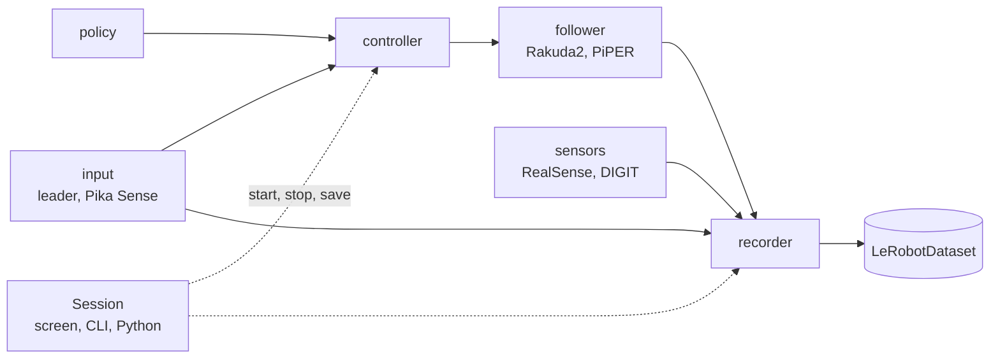

# roboloom

roboloom is a Python package that collects observations and actions by teleoperating a robot, saves them as a LeRobotDataset (0.7.0), and drives the same robot with the policy you train on them.

- **Collect**: drive the follower with a leader or a hand-held device and record it with cameras and tactile sensors.
- **Train**: train on the recording as it is, with `lerobot-train` or your own model.
- **Run and evaluate**: let a policy drive the follower, take over when needed, and keep the verdict.

Each node runs as its own process in a dora-rs dataflow. A `Session` (the operator screen, the CLI, Python) starts the dataflow and sends episode start, stop and save.

-   **[Get started](get-started/installation.md)**

    ---

    Installation, [concepts](get-started/concepts.md), the [support matrix](get-started/support-matrix.md).

-   **[Tutorials](tutorials/index.md)**

    ---

    From a first run without devices to collecting, training and running a policy on Rakuda2.

-   **[Robots](robots/index.md)**

    ---

    Each robot's joints and the controllers and sensors it can use.

-   **[Policy](policy/index.md)**

    ---

    Writing a policy, LeRobot policies, interventions, evaluation.

-   **[Reference](reference/configuration/index.md)**

    ---

    Configuration keys, the CLI, the Python API, dataset columns.

## Status labels { #status }

Each feature carries a label for how far it has been checked: Hardware-verified Mock only In development Design only. They are defined in [Status labels](reference/status-labels.md). Use the hardware commands only after the operator has checked the values and the behaviour on each robot. A successful mock run or docs build is not a hardware check.
