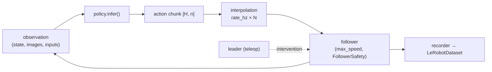

# Policies and inference

A `type: policy` controller drives the followers with a learned policy. Policies you write yourself and LeRobot checkpoints are loaded the same way.

!!! warning "What has been checked"
    The path for your own policies is used with the Rakuda2 configuration and with mock devices. LeRobot policies (`roboloom.policy.lerobot`) have been checked only with the mock PiPER + Pika configuration: an ACT trained briefly on CPU with `lerobot-train` on mock recordings ran the whole path from recording to inference. They have not been checked on hardware or with a well-trained policy.

## How it fits together { #overview }

- The policy node hands the policy an observation: the followers' joint state and the inputs and sensors listed in `observe` ([Your own policy](custom.md)).
- The policy returns one step `[n]` or a chunk `[H, n]`. The policy node takes one action every `1/rate_hz` and interpolates between actions, so commands go out close to the followers' control rate ([Asynchronous inference and interpolation](async.md)).
- Targets are cut to `max_speed`, and `FollowerSafety` checks the joint limits and the deadline, as in teleoperation.
- With `teleop:`, a person can take over with the leader during an episode and hand back to the policy ([Teleoperation and interventions](intervention.md)).
- The recorder writes the commands actually sent to the followers to `action` ([Dataset format](../data/format.md)).

## Pages { #pages }

| Page | Content | Status |
| --- | --- | --- |
| [Running a policy](run.md) | `nodes/policy.yaml`, `roboloom infer`, rate and steps, home, Python, sensor selection | Mock only (sensor selection), In development (PiPER + Pika) |
| [Your own policy](custom.md) | The policy's shape, `bind`, choosing observations, failures, history and `hold`, your own model | — |
| [LeRobot policies](lerobot.md) | Loading a checkpoint, training with `lerobot-train` | Mock only |
| [Policy server](remote.md) | Running the policy in another process or environment (`serve-policy`) | Mock only |
| [Asynchronous inference and interpolation](async.md) | `inference: async`, action interpolation, `pchip` | Mock only (async, `pchip`) |
| [Teleoperation and interventions](intervention.md) | `teleop:`, interventions, what is recorded | — |
| [Evaluation and replay](evaluation.md) | Recording verdicts, replaying a recording | Mock only (replay) |

The labels are defined in [Status labels](../reference/status-labels.md). The keys are listed in [Policy configuration](../reference/configuration/policy.md) and the commands in the [CLI](../reference/cli.md#infer).

## Limitations { #limitations }

- LeRobot's RTC is not supported. Asynchronous inference replaces the queue without blending the chunks.
- ACT's temporal ensembling (`temporal_ensemble_coeff`) works only with `mode: step`.
