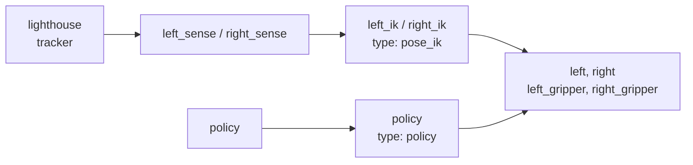

# PiPER controllers

!!! warning "Status: in development"
    <span class="status status--dev">In development</span> None of the PiPER, Pika Gripper and Pika Sense drivers has run on hardware. The configuration here is the repository's mock configuration `.roboloom/piper-mock/`, where it was checked.

The controllers that drive two PiPER arms with two Pika Grippers. There is no `roboloom init` template yet: copy `.roboloom/piper-mock/` ([PiPER + Pika on mock devices](../../tutorials/piper-pika/mock.md)).

| Controller | Input | Options | Status |
| --- | --- | --- | --- |
| [Pika Sense and IK](#pose-ik) | a Pika Sense per arm | none | <span class="status status--dev">In development</span> |
| [Policy](#policy) | a policy | `policy` | <span class="status status--dev">In development</span> |

- A policy with interventions (`teleop:`) is not available. Interventions take only `type: joint` controllers; `pose_ik` is refused on loading ([Teleoperation and interventions](../../policy/intervention.md#teleop)).
- There is no configuration driven by a leader (`joint`).



## Pika Sense and IK { #pose-ik }

<span class="status status--dev">In development</span>

One Sense drives one arm and one gripper. The Sense's pose becomes PiPER joint angles through inverse kinematics, and its jaw angle becomes the gripper's angle.

```yaml
# .roboloom/piper-mock/nodes/left_ik.yaml (excerpt)
type: pose_ik
input: left_sense
followers: [left, left_gripper]
arm: left
gripper: left_gripper
tool_offset: {xyz: [0.0, 0.0, 0.19], rpy: [0.0, -1.5708, 0.0]}  # AgileX's value for its gripper; measure it for the Pika Gripper
workspace: {min: [0.05, -0.45, 0.05], max: [0.6, 0.45, 0.6]}  # m
gripper_map: {scale: 1.0, offset: 0.0}
max_speed: {left: 1.0, left_gripper: 3.0}
home: {left: {pose: ../poses/left/ready.yaml, max_speed: 0.5, tolerance: 0.02}}
command_deadline_ms: 100
input_timeout_ms: 150
```

```bash
uv run roboloom run piper-mock
```

- The arms start folded (all joints 0), where the IK can hardly follow a hand. Move them first with "Move home" to `poses/<arm>/ready.yaml`.
- Shared description: [Pika Sense and IK](../../controllers/pose-ik.md).

## Policy { #policy }

<span class="status status--dev">In development</span>

The option `policy` removes the Sense and IK controllers and adds `controllers.policy`. `roboloom infer` turns it on by itself.

```yaml
# .roboloom/piper-mock/nodes/policy.yaml
type: policy
followers: [left, right, left_gripper, right_gripper]
factory: demo_policy:wave  # the demo policy in the same directory
observe: [camera, left_wrist, right_wrist]
rate_hz: 10
action_horizon: 2
max_speed: {left: 1.0, right: 1.0, left_gripper: 3.0, right_gripper: 3.0}
command_deadline_ms: 300
```

```bash
uv run roboloom run piper-mock --with policy
uv run roboloom infer piper-mock --seconds 20 \
  --policy roboloom.policy.lerobot:load --policy-kwargs '{"path": "<checkpoint>"}'
```

- Observation and action have 14 elements (arms 6 + 6, grippers 1 + 1) in rad ([Observation and action](index.md#observation-and-action)).
- The inference configuration has no Senses, so a policy cannot use `observation.left_sense` and the like.
- Shared description: [Policy (controller)](../../controllers/policy.md), [Running a policy](../../policy/run.md#piper-pika).
