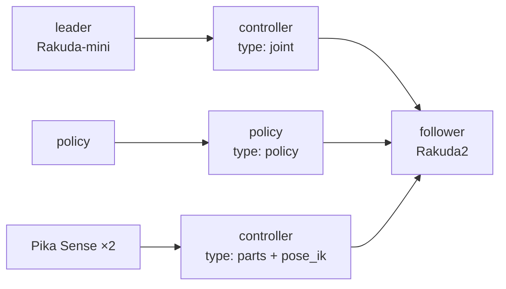

# Rakuda2 controllers

The controllers that drive the Rakuda2 follower. Which one runs is chosen with the launch options of `.roboloom/rakuda2/config.yaml`. What all controllers share is in [Controllers](../../controllers/index.md).

| Controller | Input | Options | Status |
| --- | --- | --- | --- |
| [Leader](#leader) | Rakuda-mini (`leader`) | none | <span class="status status--verified">Hardware-verified</span> |
| [Gravity-compensated leader](#gravity) | Rakuda-mini (`leader`) | `gravity` | <span class="status status--verified">Hardware-verified</span> |
| [Policy](#policy) | a policy | `policy` | <span class="status status--verified">Hardware-verified</span> |
| [Policy with interventions](#policy-teleop) | a policy and the Rakuda-mini | `policy`, `policy_teleop` | <span class="status status--verified">Hardware-verified</span> |
| [Pika Sense and IK](#pika) | a Pika Sense per arm | `pika` | <span class="status status--dev">In development</span> |
| Force feedback | Rakuda-mini (`leader`) | `gravity`, `bilateral` | <span class="status status--mock">Mock only</span> (paused; [Rakuda2](index.md)) |



## Leader { #leader }

<span class="status status--verified">Hardware-verified</span>

The configuration with no option enabled. Each leader joint maps to the follower joint of the same name. The leader's arms, torso and head have the torque off; the trigger is controlled as a spring (`law: spring`).

```yaml
# nodes/controller.yaml (excerpt)
type: joint
input: leader
followers: [follower]
alignment_tolerance: 300
max_speed: 2048
command_deadline_ms: 100
input_timeout_ms: 150
couplings: []
```

- Align the leader with the follower before starting. While `aligning`, a start is refused and the joint difference is shown.
- Locking leader joints (`law: position`) and the torso-yaw compensation (`couplings`) are <span class="status status--mock">Mock only</span>.
- Settings in detail: [Leader](../../controllers/leader.md). Steps: [Rakuda2: teleoperated collection](../../tutorials/rakuda2-collect.md).

## Gravity-compensated leader { #gravity }

<span class="status status--verified">Hardware-verified</span>

The option `gravity` replaces the leader node `nodes/leader.yaml` with `nodes/leader_gravity.yaml`. The controller is still `joint`. Both arms run the `gravity_comp` control law with the identified gravity model, travel and tuning values.

```bash
uv run roboloom run --with gravity
```

- Loading is refused until the measurements (`calibrate-joints`, `measure-travel`, `identify-gravity`, `tune-gravity`) are done. Steps: [Rakuda2: gravity compensation](../../tutorials/rakuda2-gravity.md).
- It cannot be combined with `policy`.

## Policy { #policy }

<span class="status status--verified">Hardware-verified</span>

The option `policy` removes the leader and the controller and adds `controllers.policy`. `roboloom infer` turns it on by itself.

```yaml
# nodes/policy.yaml (excerpt)
type: policy
followers: [follower]
factory: roboloom.policy:hold  # keeps the arms where they are; replace with your policy
kwargs: {}
observe: [camera]  # with the digit option, digit_left and digit_right can be added; [] for state only
rate_hz: 15
action_horizon: 8
max_speed: {follower: 1024}
command_deadline_ms: 300
```

```bash
uv run roboloom infer --seconds 20 --policy my_lab.policies:load
```

- Observation and action are the 17 joints in counts ([Observation and action](index.md#observation-and-action)).
- Shared description: [Policy (controller)](../../controllers/policy.md), [Running a policy](../../policy/run.md). Steps: [Rakuda2: from collection to inference](../../tutorials/rakuda2-train-infer.md).

## Policy with interventions { #policy-teleop }

<span class="status status--verified">Hardware-verified</span>

The option `policy_teleop` adds the leader back to `policy`, so the leader can drive the follower before and during an episode.

```yaml
# nodes/policy_teleop.yaml
extends: policy.yaml
teleop: [controller.yaml]  # the joint controller the leader drives through
```

```bash
uv run roboloom run --with policy,policy_teleop
```

- Rows a person drove have `action.intervention` 1. The dataset name gets `-eval-teleop`.
- Shared description: [Teleoperation and interventions](../../policy/intervention.md). Steps: [Rakuda2: evaluating with interventions](../../tutorials/rakuda2-intervention.md).

## Pika Sense and IK { #pika }

<span class="status status--dev">In development</span>

The option `pika` drives each arm and gripper with its own Pika Sense through inverse kinematics, instead of the leader. Checked with mock devices only.

```yaml
# nodes/controller_pika.yaml
type: parts
followers: [follower]
command_deadline_ms: 100
parts: [pika_right.yaml, pika_left.yaml]  # each one type: pose_ik
```

```bash
uv run roboloom run --with pika --mock
```

- The joint map, zero points and gripper map are all first guesses. What to check before hardware is in [Rakuda2 with Pika Sense and IK](pika-sense-ik.md).
- Shared description: [Pika Sense and IK](../../controllers/pose-ik.md).
