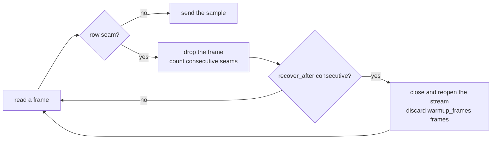

# DIGIT

!!! note "Status: hardware-verified"
    <span class="status status--verified">Hardware-verified</span> Collection with the left and right DIGIT is checked on Rakuda2.

`DigitSensor` uses `digit-interface` to capture tactile images. It requires the `digit` extra ([Installation](../get-started/installation.md)). Set different serial numbers for the left and right sensors.

```yaml
type: digit
serial: SET_DIGIT_LEFT_SERIAL
name: left
resolution: QVGA
height: 320
width: 240
fps: 30
```

| `resolution` | `height` | `width` |
| --- | --- | --- |
| `QVGA` | 320 | 240 |
| `VGA` | 640 | 480 |

Because `digit-interface.get_frame()` returns a transposed image, the configured height and width are in this order. Do not swap them back to the usual QVGA/VGA width/height notation. Choose `fps` from the values the SDK supports for that resolution; unsupported values are rejected on connection.

Captured images are converted from BGR to RGB. When the node names are `digit_left` / `digit_right`, they are recorded in `observation.images.digit_left` / `observation.images.digit_right`.

Each DIGIT node also needs a `max_age_ms` entry in `nodes/recorder.yaml`; see "Recorder entry" in [Sensors](index.md).

The supported Rakuda2 configurations and how to combine DIGIT with gravity compensation are on the [robot page](../robots/rakuda2/index.md).

### Frames with a row seam <span class="status status--mock">Mock only</span> { #row-seam }

A DIGIT stream sometimes delivers frames that start in the middle of the sensor's rows: the image is rolled along the rows, with one seam row where most columns jump at once. It stays so until the stream is reopened. A transient form pastes a band of rows from elsewhere into a single frame. The cause is unknown; the same symptom is reported upstream without a fix ([digit-interface#10](https://github.com/facebookresearch/digit-interface/issues/10), [digit-design#39](https://github.com/facebookresearch/digit-design/issues/39)).

With `seam_check` (default `true`), each frame is checked for one row where most columns jump at once (`find_seam`):



- A seamed frame is dropped: the node sends no sample. In the recorded dataset that row repeats the last valid DIGIT image with `observation.meta.<sensor>.valid` 0 ([Recorder entry](index.md#recorder)).
- After `recover_after` consecutive seamed frames the stream is closed and reopened, and `warmup_frames` frames are discarded (also at the first open). A clean frame resets the consecutive count.
- A reopen that keeps failing for 5 s stops the node with an error.
- `seam_check: false` keeps the previous behaviour: every frame is sent and seams are not counted.

| Key | Default | Meaning |
| --- | --- | --- |
| `seam_check` | `true` | Check every frame; `false` keeps the previous behaviour |
| `recover_after` | `3` | Consecutive seamed frames that trigger a reopen (integer ≥ 1) |
| `warmup_frames` | `10` | Frames discarded after each open (integer ≥ 0) |

The keys are listed in [Configuration](../reference/configuration/sensors.md#digit).

On the operator screen's Status tab, the sensor row shows `seams N  recoveries M` (highlighted) once either count is non-zero. Each reopen adds one line to the node log: `<name>: row seam at <row>, reopening the DIGIT stream (recovery <n>)`.

Validation so far: the thresholds were chosen on 36,524 recorded Rakuda2 DIGIT frames — they flag every rolled frame and the band tears, and no clean frame. The reopen path is tested with a fake device only; until it is checked on the robot, this feature stays Mock only.

### Image storage

Set `storage: video | image` in each image sensor's node YAML (RealSense, DIGIT, V4L2 including Pika wrist cameras). The default is `video`: the existing lossy MP4 encoding. `image` embeds lossless PNG frames in Parquet; use it for DIGIT/background pixel differences. Formats can be mixed in one dataset. Invalid values are refused at configuration load, including `validate`.

PNG generally needs more disk space and PNG compression/write work; actual size and throughput depend on image content and hardware. As an uncompressed RGB reference, 320×240×3 at 30 dataset fps is 6.9 MB/s per sensor (640×480: 27.6 MB/s); these are not measured PNG rates. LeRobot uses PNG compression level 6 for `image`. Changing storage changes the feature dtype: choose a separate dataset `output`; resume into the previous schema is refused.

Live observations remain HWC uint8 RGB, and LeRobot dataset reads return CHW float32 in [0, 1] for either format by default. Checkpoint inputs remain `VISUAL`. Storage was tested with mock/synthetic frames only, without hardware.

The codec of `video` MP4s (H.264 by default, or AV1) is chosen with the recorder's [`video_codec`](../reference/configuration/recorder.md#video-codec).

[Configuration](../reference/configuration/sensors.md#image-storage)
