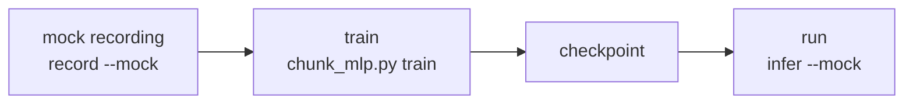

# Running your own policy

<span class="status status--mock">Mock only</span>

- **Goal**: train the sample policy `chunk_mlp.py` on a mock recording and run it with `roboloom infer`, and see where your own model goes.
- **Prerequisites**: Python 3.12–3.14, uv, and a clone of the roboloom repository (next to the project, `../roboloom`). You have read [Installation](../get-started/installation.md). No hardware.
- **Time**: 30 minutes.
- **Result**: the policy drives a mock Rakuda2 and one episode is saved in the evaluation dataset `datasets/rakuda2-eval`.

!!! warning "Use a separate trial project"
    Even with `--mock`, the output is the same `.roboloom/rakuda2/datasets/` as on hardware. Do not try this in a project that holds real data; create a new one.



## 1. Create a trial project

```bash
uv init --python '>=3.12,<3.15' my_policy_trial && cd my_policy_trial
uv add git+https://github.com/tetsugo02/roboloom.git --tag v0.1.0 --extra rakuda2 --extra record --extra policy
uv run roboloom init rakuda2
cp ../roboloom/examples/policies/chunk_mlp.py .roboloom/rakuda2/   # from a clone of the repository
```

- `chunk_mlp.py` is in the repository's `examples/policies/`, not in the installed package. Copy it from a clone of the same version as the roboloom you installed. A policy module in the robot directory (`.roboloom/rakuda2/`) is found without `PYTHONPATH`.
- The `policy` extra brings torch and LeRobot.

## 2. Record with mock devices

```bash
uv run roboloom record --mock --task demo --seconds 20 --episodes 3 --plain
uv run roboloom check-dataset --mock
```

Check `episodes: 3, ... fps: 15` and `problems: none`. Without `--mock`, loading is refused because `SET_...` values are left.

## 3. Train

```bash
uv run python .roboloom/rakuda2/chunk_mlp.py train \
  --dataset .roboloom/rakuda2/datasets/rakuda2 --out outputs/chunk_mlp.pt \
  --history 4 --horizon 8 --stride 3 --exclude torso_yaw head_yaw head_pitch
```

| Argument | Meaning |
| --- | --- |
| `--history 4` | the last 4 frames (one per policy period) are the input |
| `--horizon 8` | 8 steps come out at once |
| `--stride 3` | train on every third row; on a 15 fps recording the policy runs at 5 Hz |
| `--exclude ...` | joints the model does not drive; roboloom holds them (`hold`) |

It prints `saved outputs/chunk_mlp.pt: 14 of 17 joints, 5 Hz`, after a few seconds on a CPU.

## 4. Run it on mock devices

Set `rate_hz` in `.roboloom/rakuda2/nodes/policy.yaml` to `5` (to match `--stride 3`). The history length, the held joints and the steps per chunk come from the policy's `options()`.

```bash
uv run roboloom infer --mock --seconds 10 --plain --task "chunk eval" \
  --policy chunk_mlp:load --policy-kwargs "{\"checkpoint\": \"$PWD/outputs/chunk_mlp.pt\"}"
```

- `saved episode 0: 'chunk eval', ... frames` means it went from recording to inference.
- Pass the checkpoint as an absolute path. A relative path is not resolved from the project root (the dataflow is started from a temporary directory).
- The mock recording hardly moves, so this says nothing about the policy's quality. It checks the path only.

## 5. Replace it with your model

Make the object `load` returns in `chunk_mlp.py` your own model. It needs only `reset()` and `infer(observation)`.

```python
class MyPolicy:
    def __init__(self, checkpoint: str): ...
    def reset(self): ...
    def infer(self, observation):
        return self.model(observation)  # [n] or [H, n]: absolute joint targets


def load(checkpoint: str) -> MyPolicy:
    return MyPolicy(checkpoint)
```

| Step | Where it goes |
| --- | --- |
| normalization, image preprocessing, turning the model's action form back into targets | the policy |
| observation history, held joints, interpolation, speed limits, safety checks | roboloom |

Details are in [Your own policy](../policy/custom.md).

## Next

- Run it on the real Rakuda2: [Rakuda2: from collection to inference](rakuda2-train-infer.md)
- Run the policy in another environment: [In another process](../policy/remote.md)
