# Tutorials

Step-by-step guides, by goal. Most give the goal, prerequisites, time, result and what to do next. The labels are defined in [Status labels](../reference/status-labels.md).

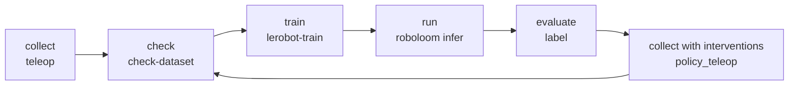

## First steps { #first-steps }

-   [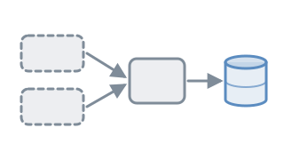](first-run-mock.md)

    **[First run without devices](first-run-mock.md)**

    Start, record and check a dataset with examples/mock.

    mock Rakuda · 15 min · Mock only

-   [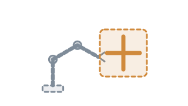](own-robot.md)

    **[Adding your own robot](own-robot.md)**

    Run a mock arm from your own follower class and template.

    your robot · 20 min · Mock only

## Rakuda2 { #rakuda2 }

-   [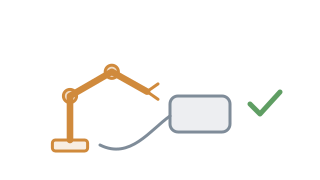](rakuda2-setup.md)

    **[Rakuda2: configuration and read check](rakuda2-setup.md)**

    Create the configuration, read the buses, and go once through with the torque off.

    Rakuda2 · 1–2 h · Hardware-verified

-   [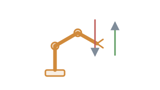](rakuda2-gravity.md)

    **[Rakuda2: gravity compensation](rakuda2-gravity.md)**

    Measure zero points, travel and the gravity model, and tune the leader.

    Rakuda2 · 1–2 h · Hardware-verified

-   [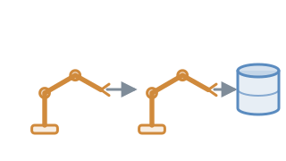](rakuda2-collect.md)

    **[Rakuda2: teleoperated collection](rakuda2-collect.md)**

    Drive with the leader and record with the RealSense and DIGIT.

    Rakuda2 · 30 min+ · Hardware-verified

## Policies { #policy }

-   [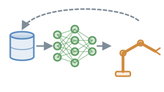](rakuda2-train-infer.md)

    **[Rakuda2: from collection to inference](rakuda2-train-infer.md)**

    Check, train with LeRobot, run the policy and record the verdicts.

    Rakuda2 · training + 1 h · Hardware-verified

-   [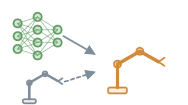](rakuda2-intervention.md)

    **[Rakuda2: evaluating with interventions](rakuda2-intervention.md)**

    Take over from the policy with the leader; intervened rows are marked.

    Rakuda2 · 1 h · Hardware-verified

-   [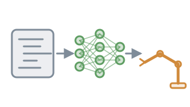](custom-policy.md)

    **[Running your own policy](custom-policy.md)**

    Train the sample chunk_mlp.py on a mock recording and run it with infer.

    mock Rakuda2 · 30 min · Mock only

## Robots in development { #in-development }

-   [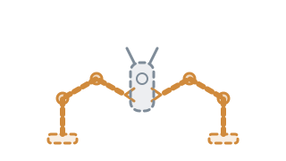](piper-pika-mock.md)

    **[PiPER + Pika on mock devices](piper-pika-mock.md)**

    Record with mock Pika Senses through IK and run a LeRobot policy.

    PiPER + Pika · 30 min · In development

-   [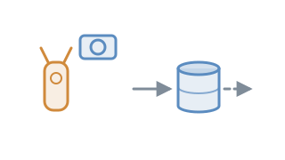](pika-handheld.md)

    **[Hand-held collection with Pika Sense](pika-handheld.md)**

    Collect with Senses in the hand, no robot, and convert for training.

    Pika Sense · 30 min · In development

