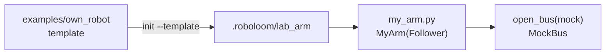

# Adding your own robot

<span class="status status--mock">Mock only</span>

- **Goal**: create a project from your own follower class and template, without changing roboloom, and run a policy on the mock bus.
- **Prerequisites**: a clone of the roboloom repository (`examples/own_robot/` exists only in the clone), set up as in [First run without devices](first-run-mock.md).
- **Time**: 20 minutes.
- **Result**: `.roboloom/lab_arm/` exists, `infer --mock` moves the mock arm, and one episode is saved in `datasets/lab-arm`.



## 1. Look at the template

| File | Content |
| --- | --- |
| `config.yaml` | only the follower `arm` and the policy controller `policy` |
| `my_arm.py` | the follower class `MyArm`: joints `shoulder`, `elbow`, unit `rad` |
| `nodes/follower.yaml` | `type: my_arm:MyArm` (`module:Class`), `address`, `limits` |
| `nodes/policy.yaml` | `factory: roboloom.policy:hold` (stays where it is), `observe: []` |
| `mock.yaml` | the value of `SET_ARM_ADDRESS` with `--mock` |

```python
# examples/own_robot/my_arm.py (excerpt)
class MyArm(Follower):
    model = "my_arm"
    keys = (*FOLLOWER_KEYS, "address")
    safety_traits = SafetyTraits(torque_off="falls", unattended="holds")

    def __init__(self, name: str, cfg: dict):
        super().__init__(name, cfg, JOINTS, "rad")
        self.address = str(cfg.get("address"))

    def open_bus(self, mock: bool) -> JointBus:
        if mock:
            return MockBus(initial=0.0, dimension=len(JOINTS))
        raise NotImplementedError(f"{self.name}: connect to {self.address} here")
```

- `keys` are the YAML keys the class reads; any other key is refused on loading.
- `safety_traits` must be declared: what the joints do without torque (`torque_off`) and when no command comes any more (`unattended`). Use `unknown` for what you have not checked.

## 2. Create the project

```bash
uv run roboloom init lab_arm --template examples/own_robot
```

It prints `created .roboloom/lab_arm (7 files)`. The class module `my_arm.py` is copied into the robot directory too, and every node process imports it from there.

## 3. Run it on mock devices

```bash
uv run roboloom infer lab_arm --mock --seconds 5 --plain
uv run roboloom infer lab_arm --mock --seconds 5 --plain --task hold
uv run roboloom check-dataset lab_arm --mock
```

- The first line saves nothing (`discarded 'inference'`). The second saves, because it has `--task`.
- Check `episodes: 1` and `problems: none` with `check-dataset`.

## 4. Connect the hardware

1. On the non-`mock` side of `open_bus`, return your device's bus (`read_positions`, `write_positions`, `enable_torque`, `close`).
2. Replace `SET_ARM_ADDRESS` in `nodes/follower.yaml` with the real value, and set `limits` to the safe range you measured.
3. To add an input device (a leader), add a class derived from `roboloom.inputs.base.JointInput` and a `joint` controller.

The rules for adding other roles (sensors, controllers) are in [Adding types from your own package](../contribution/index.md#own-types).

## Next

- Write a policy: [Running your own policy](custom-policy.md)
- Add a robot to roboloom itself: [Adding a new follower](../contribution/index.md#adding-a-follower)
