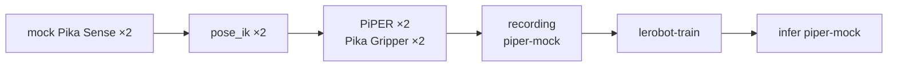

# PiPER + Pika on mock devices

!!! warning "Status: in development"
    <span class="status status--dev">In development</span> None of the PiPER, Pika Gripper and Pika Sense drivers has run on hardware. These steps were checked with mock devices only. Do not reuse the values (`tool_offset` and others) on hardware.

- **Goal**: drive two PiPER arms with two Pika Grippers through mock Pika Senses, record, and run a policy trained with LeRobot.
- **Prerequisites**: a clone of the roboloom repository (`.roboloom/piper-mock/` exists only in the clone). No hardware.
- **Time**: 30 minutes (not counting training).
- **Result**: recordings in `.roboloom/piper-mock/datasets/piper-mock`, and the trained policy's runs saved in `piper-mock-policy`.



## 1. Set up the environment

```bash
git clone https://github.com/tetsugo02/roboloom.git
cd roboloom
uv sync --extra piper --extra pika --extra record --extra policy --extra train
```

The configuration files are described in [PiPER controllers](../robots/piper/controllers.md).

## 2. Run it in the operator screen

```bash
uv run roboloom run piper-mock
```

1. Start with Launch (Ctrl-S).
2. Use "Move home" to bring the arms to `poses/<arm>/ready.yaml`. The arms start folded (all joints 0), where the IK cannot follow a hand.
3. A mock Sense engages 2 s after opening, then repeats 10 s engaged and 2 s disengaged. The controller rows turn `following`.
4. Start recording with Start episode; Stop and Save store it.

## 3. Record episodes of a fixed length

```bash
uv run roboloom record piper-mock --task "pick" --seconds 15 --episodes 5 --home --plain
uv run roboloom check-dataset piper-mock
```

`--home` moves the arms to the start pose before every episode.

## 4. Train with LeRobot

```bash
uv run lerobot-train \
  --dataset.repo_id=local/piper-mock \
  --dataset.root=.roboloom/piper-mock/datasets/piper-mock \
  --policy.type=act --policy.device=cpu --policy.push_to_hub=false \
  --trackio.enable=false --steps=200 --batch_size=8 \
  --output_dir=outputs/train/act_piper_mock
```

This only checks the path, so it trains briefly on a CPU. Before using a GPU, check with `labstatus` that one is free.

## 5. Run a policy

First run the demo policy in the same directory (`demo_policy.py`).

```bash
uv run roboloom infer piper-mock --seconds 10 --plain
```

Then run the trained checkpoint and save the runs for evaluation with `--task`.

```bash
uv run roboloom infer piper-mock --seconds 20 --task "pick" \
  --policy roboloom.policy.lerobot:load \
  --policy-kwargs "{\"path\": \"$PWD/outputs/train/act_piper_mock/checkpoints/last/pretrained_model\"}"
uv run roboloom check-dataset piper-mock --with policy
```

- The inference configuration has no Senses, so a policy cannot use `observation.left_sense` and the like.
- Interventions (`teleop:`) are not available: `pose_ik` does not support them.

## Next

- What to check before hardware: [PiPER follower](../robots/piper/index.md), [Pika Gripper follower](../robots/pika/index.md), [Pika Sense and IK](../controllers/pose-ik.md)
- Collect with a Sense in the hand: [Hand-held collection with Pika Sense](pika-handheld.md)
