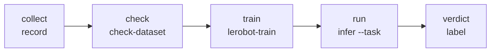

# Rakuda2: from collection to inference

<span class="status status--verified">Hardware-verified</span>

- **Goal**: check the data collected by teleoperation, drive Rakuda2 with a policy trained with LeRobot, and keep each run's verdict.
- **Prerequisites**: you can collect with [Rakuda2: teleoperated collection](rakuda2-collect.md). To train on a GPU, check with `labstatus` that one is free.
- **Time**: about an hour on top of collecting and training.
- **Result**: the evaluation dataset `datasets/rakuda2-eval` holds episodes with verdicts.

!!! note "What has been checked"
    On the real Rakuda2, teleoperated collection and policy inference (`roboloom infer`) are checked. `roboloom.policy.lerobot:load`, which reads LeRobot checkpoints, has been checked only on the mock PiPER + Pika <span class="status status--mock">Mock only</span>. `check-dataset` and `label` are <span class="status status--mock">Mock only</span> too.



## 1. Collect

Collect episodes of one task as in [Rakuda2: teleoperated collection](rakuda2-collect.md).

```bash
uv run roboloom record --task "pick up the cup" --seconds 30 --episodes 20 --with gravity
```

- `gravity` does not change the dataset name. The output is `.roboloom/rakuda2/datasets/rakuda2`.
- To train on the DIGIT too, use `--with gravity,digit`. The output becomes `rakuda2-digit`.

## 2. Check the recording

```bash
uv run roboloom check-dataset
```

- Check that `problems` is `none` and that the `action.valid is 0` share under `notes` is small.
- To leave out bad episodes, see [Excluding episodes](../data/check-and-train.md#excluding-episodes).

## 3. Train with LeRobot

<span class="status status--mock">Mock only</span>

```bash
uv add git+https://github.com/tetsugo02/roboloom.git --tag v0.1.0 --extra policy --extra train
uv run lerobot-train \
  --dataset.repo_id=local/rakuda2 \
  --dataset.root=.roboloom/rakuda2/datasets/rakuda2 \
  --policy.type=act --policy.device=cuda --policy.push_to_hub=false \
  --trackio.enable=false \
  --output_dir=outputs/train/act_rakuda2
```

- `--dataset.repo_id` is the configuration's `repo_id`; `--dataset.root` is `output` seen from the robot directory.
- The checkpoint is written to `outputs/train/act_rakuda2/checkpoints/last/pretrained_model`.
- To try only the path, `--policy.device=cpu --steps=200 --batch_size=8` takes a few minutes ([Training with LeRobot](../policy/lerobot.md#training)).

## 4. Run the policy

First check the inference path with the template's default policy `roboloom.policy:hold`, which keeps the arms where they are. Without `--task` nothing is saved.

```bash
uv run roboloom infer --seconds 10
```

Then run the trained checkpoint. With `--task`, each run is saved to the evaluation dataset.

```bash
uv run roboloom infer --seconds 30 --episodes 10 --task "pick up the cup" \
  --policy roboloom.policy.lerobot:load \
  --policy-kwargs "{\"path\": \"$PWD/outputs/train/act_rakuda2/checkpoints/last/pretrained_model\"}"
```

- `infer` turns on the option `policy` by itself. It uses no leader, so it cannot be combined with `gravity`.
- Pass the checkpoint as an absolute path. A relative path is not resolved from the project root (the dataflow is started from a temporary directory).
- Keep `rate_hz` in `nodes/policy.yaml` (15) equal to the trained dataset's `dataset_fps` (15).
- With the default `mode: step` the policy returns one step at a time, so `action_horizon` has no effect ([LeRobot policies](../policy/lerobot.md#loading)).
- By default the policy observes the joint state and `camera`. If you trained with the DIGIT, add `--with digit` and set `observe` to `[camera, digit_left, digit_right]` ([Choosing observations](../policy/custom.md#observations)).
- To start every run from the same pose, write `home:` in `nodes/policy.yaml` and add `--home` ([home](../policy/run.md#home)).

## 5. Keep the verdicts

Enter `save success` or `save failure` in the operator screen when saving, or set them afterwards.

```bash
uv run roboloom label --with policy 3 failure --note "missed the grasp"
uv run roboloom check-dataset --with policy
```

`check-dataset` shows the counts, like `labels: 7 success, 3 failure, ...`. The verdicts are kept in the dataset's `meta/roboloom_episodes.jsonl` and do not affect LeRobot training ([Evaluation and replay](../policy/evaluation.md)).

## Next

- Let a person take over when the policy is about to fail: [Rakuda2: evaluating with interventions](rakuda2-intervention.md)
- Write your own model: [Running your own policy](custom-policy.md)
