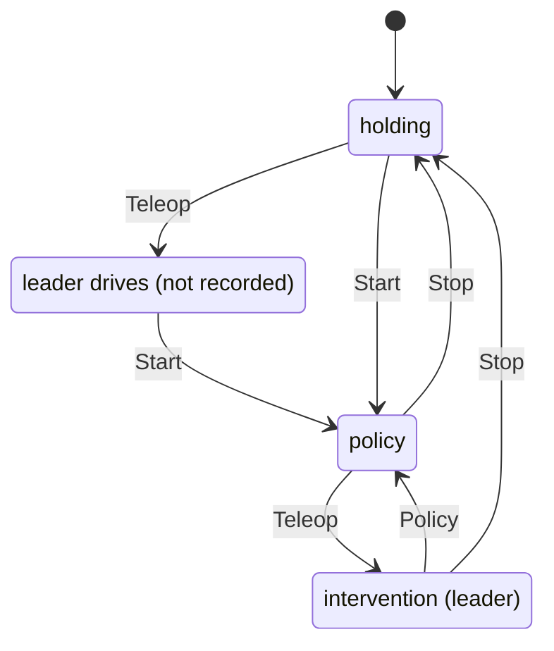

# Rakuda2: evaluating with interventions

<span class="status status--verified">Hardware-verified</span>

- **Goal**: drive Rakuda2 with a policy, take over with the leader when it is about to fail, and hand back to the policy. The rows a person drove are recorded apart.
- **Prerequisites**: a policy runs as in [Rakuda2: from collection to inference](train-infer.md). Someone can support the leader and the follower.
- **Time**: 1 hour.
- **Result**: `datasets/rakuda2-eval-teleop` holds episodes with `action.intervention` and `observation.leader`.

!!! note "What has been checked"
    On the real Rakuda2, policy inference and interventions (`policy_teleop`) are checked. Loading a LeRobot policy (`roboloom.policy.lerobot:load`), used in the example, and experiment files are <span class="status status--mock">Mock only</span>.



## 1. Write an experiment file

Put the policy and the options in your project's `configs/roboloom/<name>.yaml`. `policy_teleop` requires `policy`, so both are enabled.

```yaml
# configs/roboloom/cup-teleop.yaml
help: evaluate the cup policy; the leader can take over
robot: rakuda2
options: [policy_teleop]
nodes:
  controllers.policy:
    factory: roboloom.policy.lerobot:load
    kwargs: {path: /home/me/my_project/outputs/train/act_rakuda2/checkpoints/last/pretrained_model}
task: pick up the cup
```

- Use an absolute path in `kwargs`.
- `nodes/policy_teleop.yaml` is `nodes/policy.yaml` plus `teleop: [controller.yaml]`. During an intervention the leader drives through the `joint` controller of `controller.yaml`.
- The format is in [Experiment files](../../reference/configuration/index.md#experiments).

```bash
uv run roboloom validate --experiment cup-teleop
```

Check that it reports `options: policy, policy_teleop; dataset: local/rakuda2-eval-teleop`.

## 2. Start and evaluate

```bash
uv run roboloom run --experiment cup-teleop
```

| Operation | Key | What happens |
| --- | --- | --- |
| Teleop (outside an episode) | `t` | the leader moves the follower to the start pose; nothing is recorded |
| `start pick up the cup` | — | starts the policy and the recording; after Teleop the policy takes over from there |
| Teleop (during an episode) | `t` | stops the policy and switches to the leader (an intervention) |
| Policy | `p` | hands back from the leader to the policy; the policy starts again from `reset()` |
| `stop`, `save success` | — | stops and saves with a verdict |

- On Teleop every follower joint stops at its current target. Each joint follows the leader once the leader joint comes close or crosses its value. The policy row on the screen shows the joints not yet picked up and their differences (`pickup`).
- The gripper does not move until the trigger is squeezed as far as the follower is open.
- From another terminal, `uv run roboloom session teleop` and `uv run roboloom session policy` send the same operations.
- The behaviour in detail is in [Teleoperation and interventions](../../policy/intervention.md).

## 3. Check the recording

```bash
uv run roboloom check-dataset --experiment cup-teleop
```

| Feature | Content |
| --- | --- |
| `action.intervention` | 1 in the rows a person drove with the leader |
| `observation.leader` | the leader's joint positions (17) |

- Teleop outside an episode is not recorded.
- The first one or two rows of an episode may still carry the person's command from just before `start`, with `action.intervention` 1.
- The leader is recorded too, so this dataset is separate from the `policy`-only one (`rakuda2-eval`).

## Next

- How intervened rows are treated in training: [Dataset format](../../data/format.md#valid)
- Counting the verdicts: [Evaluation and replay](../../policy/evaluation.md)
