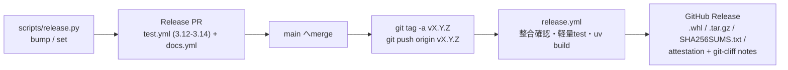

# Contribution

## 開発環境とチェック

通常利用は [Installation](../get-started/installation.md) の `uv add git+https://github.com/tetsugo02/roboloom.git --tag v0.2.2` を使います．以下はroboloom本体やdocsを変更する開発者向けです．Python 3.12以上（CI は 3.12〜3.14 で試験）とuvを使い，repositoryをcloneしてそのrootで実行します．

```bash
git clone https://github.com/tetsugo02/roboloom.git
cd roboloom
uv sync --extra rakuda2 --extra test --group dev --group docs
uv run ruff format .
uv run ruff check .
uv run mypy src
uv run pyright
uv run pytest                # 全test（軽量test + e2e）
uv run pytest -m "not e2e"   # 軽量testのみ（dora dataflowを起動しない）
uv run pytest -m e2e         # mock deviceでdoraを起動するe2eのみ
uv run --group docs python scripts/docs.py build
```

`test` extraには `lerobot[viz]` 経由でRerunが入ります．Rerunがない環境では，Rerunを使うviewerのtestはskipされます．

Pull Request では，GitHub Actions（`.github/workflows/test.yml`）が変更対象を確認し，source codeやtest・実行時依存・CI 設定等が変わっている場合のみ Python 3.12〜3.14 で `ruff check .`・`mypy src`・軽量test（`pytest -m "not e2e"`）を実行して必須チェック用job `Tests status` を報告します（`docs/**`・`README*.md`・`LICENSE`・`pyproject.toml` のmetadataのみ等の変更時はtestをskipして `Tests status` を成功扱いにするため，必須チェックを有効にしてもmergeが詰まりません）．`main` へmergeされた後はtestを再実行せず，`.github/workflows/badges.yml` がmerge元 PR のtest結果から `badges` branch上のstatus badge JSON を更新します（`workflow_dispatch` で手動実行した場合も更新します）．mock deviceでdoraのprocessを起動するE2E test（`.github/workflows/e2e.yml`，3並列）は手動実行（`workflow_dispatch`）で，実機は使いません．

checkout内の模擬dataflowは `uv run roboloom validate examples/mock/config.yaml` と `uv run roboloom run examples/mock/config.yaml` で確認できます．保存には `record` または `test` extraが必要です．`examples/` と `scripts/` はcheckout用で，Git依存の利用者は自身の設定やPython scriptを使います．

模擬の設定の保存先は `datasets/rakuda-mock` です（option `bilateral` では `datasets/rakuda-mock-bilateral`）．記録の形（featureの名前や形）を変えた後は，古いdataへ追記できません．古いdataは移すか，`output` を変えてください．画面確認のために既存dataを削除しないでください．

変更と無関係な整形差分は含めないでください．模擬試験・実data・実機検証は区別して報告します．

packageの著者・keyword・project URLは `pyproject.toml` の `project.authors`，`project.keywords`，`project.urls` で管理します．docsの著者とrepository linkは `docs/base.yml` の `site_author`，`repo_name`，`repo_url` に設定します．著者情報や公開先を変更するときは，両方を揃えて更新してください．

## 機能とdocsを一緒に更新する

機能追加・動作変更と同じ変更で，影響する `docs/` を更新します．日本語（`docs/ja/`）と英語（`docs/en/`）の両方を同じ変更で更新し，ページ構成・見出し・code例・link先を揃えます．設定・既定値・CLI・Python API・制限事項と，実際の実装を揃えます．

| 変更 | 更新するページ |
| --- | --- |
| installや初回操作 | Get started と関係するtutorial |
| 機体や対応する組み合わせ | `robots/<機体>/` のページ，対応表（`get-started/support-matrix.md`），機体のtutorial |
| sensorの設定・形式 | Sensors と対応機体の `sensors.md` |
| 操作入力・開始条件 | Controllers と対応機体の `controllers.md` |
| 方策・推論 | Policy |
| 記録の形式・dataset | Data と `reference/dataset-features.md` |
| API・CLI・設定の変更 | Reference（表の形）と関連するsample |
| 機能の検証の状態 | `reference/status-labels.md` と，そのlabelを付けたページ |
| 公開API・CLI・設定・対応機器の変更 | `src/roboloom/agent_skills/roboloom/` のskill（`SKILL.md` と `references/`） |

新しいページは両言語の同じpathに置き，`mkdocs.yml`（日本語）と `mkdocs.en.yml`（英語）の `nav` に登録します．`README.md`（英語）・`README.ja.md`（日本語）と `roboloom init` が配布するtemplateのREADMEも，手順に影響があれば同時に更新します．現行codeとdocumentationが食い違っていた場合は，codeの規約を基準に修正し，食い違いを変更報告に記載します．

ページを移したり消したりしたら，`docs/base.yml` の `redirect_maps` に旧pathを登録します．Tutorials は手順，Reference は表による記述だけ，Explanation は背景と理由，と書き分けます．実機で確かめていない機能も載せますが，ページの冒頭か表の行に [状態label](../reference/status-labels.md) を付けます．設計案や過去の調査メモを，実機検証済みの仕様として案内しないでください．

## docsの編集とpreview

[ZensicalのMkDocs互換機能](https://zensical.org/docs/compatibility/mkdocs/) を使います．言語ごとに設定を分け，共通設定は `docs/base.yml` に置きます．

| 言語 | Markdown | 設定 | 出力先 |
| --- | --- | --- | --- |
| 日本語 | `docs/ja/` | `mkdocs.yml` | `site/ja/` |
| 英語 | `docs/en/` | `mkdocs.en.yml` | `site/en/` |

```bash
uv run --group docs python scripts/docs.py build   # 両言語をstrictでbuild
uv run --group docs python scripts/docs.py serve   # 両言語をbuildして http://127.0.0.1:8000 で表示
uv run --group docs zensical serve                 # 日本語だけをlive reloadで表示
uv run --group docs zensical serve -f mkdocs.en.yml  # 英語だけをlive reloadで表示
```

右上の言語切り替えは，`site/` に両言語が並んでいるときに選んだ言語のホームへ移ります．片方の言語だけを `zensical serve` で開いているときは，切り替え先が表示されません．`site/index.html` はbrowserの言語に応じて `ja/` か `en/` へ転送します．生成物はGitへ追加しません．

fontと配色は `docs/overrides/`（`main.html` と `assets/stylesheets/roboloom.css`）で調整しています．

`docs/ja/yam-safety-and-smoothness.md` は過去の調査・設計メモとして残し，利用ガイドのbuild対象から除外しています．未実装の機能の設計案は，[bilateral制御の設計](bilateral.md) のように，冒頭で未実装と明示した上でContributionに置きます．

### 日本語の表記 { #japanese-notation }

英語由来の専門用語は，日本語の文中でも英語で書きます（カタカナにしません）．綴りはcodeの識別子・APIの用語に揃えます（文中は `follower`，class名は `Follower`）．

| 分野 | 例 |
| --- | --- |
| robot・制御・hardware | follower, sensor, gripper, tracker, motor, torque, camera, arm, bus, serial, port, driver, firmware, interface, watchdog, encoder, gain, latch |
| software・CLI・設定 | node, option, key, file, path, command, directory, process, thread, class, module, package, repository, template, project, session, log, build, test, error, flag, trigger, timeout |
| data・学習 | dataset, data, metadata, episode, checkpoint, chunk, epoch, model, sample, task, label, schema, vector, norm, skill, agent, coding agent |
| 音声・映像 | mel, mel power, mono, mic, sampling, stereo, channel, color, frame |
| 画面の概念 | tab, pane, panel, focus, menu, dialog, shortcut, tooltip, cursor, drag, scroll, layout, font |

- 一般的な外来語はカタカナのまま：ページ，ボタン，リスト，コピー，チェック，メモ，ガイド，ホーム，カード，サイズ，ゼロ，オン．
- 漢字の用語（方策，入力，記録，校正，遠隔操作）と製品名（PiPER, Pika, Rakuda2, LeRobot, RealSense, DIGIT）はそのまま．
- 新しいカタカナ用語や長音の揺れ（`センサ`/`センサー`，`グリッパ`/`グリッパー`）を足さないでください．英語表記で統一します．
- code例とplaceholderは英語ページと揃えます（`<follower>`，`<node>`，`{name: path}`，`logs/<dataset name>-<time>/`）．
- 見出しに英語を使っても，linkは既存の明示anchor（`{ #... }`）を使います．

## GitHub Pagesへの公開

`.github/workflows/docs.yml` が両言語をstrictでbuildし，`site/` 全体をGitHub Pagesへ公開します．公開先は [日本語](https://tetsugo02.github.io/roboloom/ja/) と [English](https://tetsugo02.github.io/roboloom/en/) です．root URLではbrowserの言語に応じて転送します．

- `main` へのpush：`docs/**`，`src/**`（Python APIのページはdocstringから作る），`mkdocs*.yml`，`scripts/docs.py`，`uv.lock`，workflow自身の変更でbuild・公開します．
- `main` 向けのpull request：同じfile群の変更でbuildだけを検証します．
- Actionsの `Documentation` → `Run workflow`：手動buildできます．公開するのは `main` を選んだ場合だけです．

Python 3.12とuvを使い，`uv sync --locked --only-group docs` でlock済みのdocs依存だけをinstallします．続いて `uv run --no-sync python scripts/docs.py build` を実行し，成功した成果物を公開します．robot・sensor用の依存や実機接続は不要です．

初回はrepositoryの **Settings → Pages → Build and deployment → Source** を **GitHub Actions** に設定します（[GitHubの設定手順](https://docs.github.com/en/pages/getting-started-with-github-pages/configuring-a-publishing-source-for-your-github-pages-site#publishing-with-a-custom-github-actions-workflow)）．workflowを `main` に反映すると公開され，URLは `github-pages` environmentとActionsのdeploy結果に表示されます．buildが失敗した場合は公開しません．

## 新しいfollowerを足す { #adding-a-follower }

followerの機種（`Follower` のsubclass）は，安全に関わる性質 `safety_traits`（設定で変わる場合は `declared_traits()`）を必ず宣言します．宣言のないclassはimportの時点でTypeErrorになります．値の意味は [設定](../reference/configuration/index.md) の「脱力したときと放置したときの性質」にあります．確かめていない性質は `unknown` にします．制御則で動く入力機器（`JointInput` のsubclass）も `safety_traits` を宣言します．姿勢で動かす（`pose_ik`）腕は，`kinematics()` でURDFの鎖（`KinematicSpec`：URDF，base，tip，関節）を返します．

### roboloomを変えずに，自分のpackageから足す { #own-types }

roboloomに入っていないrobot，入力機器，sensor，controller，estimatorは，自分のcodeに置いたまま使えます．

- nodeのYAMLの `type` に，classを `module:Class` で書きます．importは，install済みのpackage，次に機体のdirectory（`.roboloom/<robot>/`）の順に探します．
- nodeは1つずつ別のprocessで動き，それぞれが設定を読み直します．そのため，classは参照（`module:Class`）で指定します．1つのprocessの中でregistryに登録しても，ほかのnodeからは見えません．
- classは，その役割の基底class（`roboloom.robots.base.Follower`，`roboloom.inputs.base.JointInput` と `PoseInput`，`roboloom.core.source.Source`，`roboloom.controllers.base.Controller`，`roboloom.estimators.base.Estimator`）を継承します．継承していないclassは，読み込みのときに拒否します．
- classが読むYAMLのkeyを `keys` に書くと，それ以外のkeyは読み込みのときに拒否されます（綴りの誤りが黙って無視されません）．`keys` を書かないclassは検査しません．

    ```python
    from roboloom.robots.base import FOLLOWER_KEYS, Follower

    class MyArm(Follower):
        keys = (*FOLLOWER_KEYS, "address")
    ```

- 1つの操作者入力に従う `Controller` の派生class（`uses_input` の既定値は `True`）は，[episodeの外でのteleop](../controllers/index.md#teleop) に対応します．他のcontrollerを内包するcontrollerは，その動作に合わせて `follows_operator()` をoverrideします．<span class="status status--mock">Mock only</span>

- followerに要るものは，関節名と単位，`safety_traits`，`open_bus(mock)` が返すbus（`read_positions`，`write_positions`，`enable_torque`，`close`．`roboloom.drivers.base.JointBus`）です．`mock` がTrueのときは模擬のbusを返します．
- simulatorは，同じfollowerのclassの後ろに別のbusを置きます．実機と同じ単位で話せば，datasetと方策を共有できます．
- `control:` の制御則（`roboloom.control`）はDynamixel系のbus（count，mA，Operating Mode）を前提にしています．自前の位置制御を持つrobotでは使いません．

templateも自分の側に置けます．`config.yaml`，nodeのYAML，classのmodule，`mock.yaml` を1つのdirectory（またはpackageの `template/`）にまとめ，次のようにprojectを作ります．

```bash
uv run roboloom init lab_arm --template my_lab.robots.arm   # packageの template/
uv run roboloom init lab_arm --template path/to/template    # directory
uv run roboloom init lab_arm --update                       # templateが変わったあと
```

repositoryの `examples/own_robot/` が，動く最小の見本です（followerのclass `my_arm.py`，方策で保持するだけの構成，模擬のbus）．

```bash
uv run roboloom init lab_arm --template examples/own_robot
uv run roboloom infer lab_arm --mock --seconds 5 --plain
```

## 操作画面の拡張

新しい機種の機器accessはBackendへ置き，標準の状態項目を通知します．任意の機種別・役割別Presenterの明示登録，Backend契約，Pilot/MockBusでの検証は [操作画面](../reference/operator-screen.md) を参照してください．

## release手順 { #release-process }

version番号（`pyproject.toml`・`uv.lock`・`src/roboloom/agent_skills/roboloom/SKILL.md`・`README*.md`・`docs/` の `--tag`）と `CHANGELOG.md` は [`scripts/release.py`](https://github.com/tetsugo02/roboloom/blob/main/scripts/release.py) でまとめて更新し，Release PR を `main` へmergeした後にtag `vX.Y.Z` を push して公開します．



| 段階 | command / trigger | 内容 |
| --- | --- | --- |
| 1. 準備 | `uv run python scripts/release.py bump minor`（または `set X.Y.Z`） | `pyproject.toml`・`uv.lock`・`SKILL.md`・`--tag` 参照・`CHANGELOG.md`（`cliff.toml`）を更新 |
| 2. 検証 | `uv run python scripts/release.py check` ＋test・docs build | 全fileのversion一致と PR 向けチェックを確認 |
| 3. PR merge | Release PR を `main` へmerge | `test.yml`（Python 3.12〜3.14）と `badges.yml` が通過 |
| 4. 公開 | `git tag -a vX.Y.Z -m "Release vX.Y.Z" && git push origin vX.Y.Z` | `.github/workflows/release.yml` がtag整合・`ruff`/`mypy`/`pytest -m "not e2e"`・`uv build`・wheel 隔離検証・`SHA256SUMS.txt`・build provenance attestation を実行し，GitHub Release を公開 |
