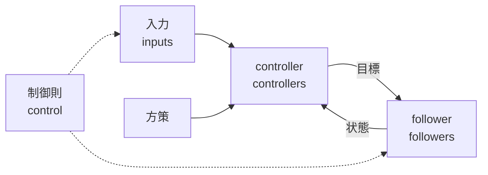

# Controllers

controllerは，入力（leader，手に持つ機器，方策）の値をfollowerの目標に変えるnodeです．設定は3つに分かれます．

| 設定 | 役割 | 例 |
| --- | --- | --- |
| `inputs` | 操作する機器を読む | Rakuda-mini（`rakuda_mini`），Pika Sense（`pika_sense`） |
| `controllers` | 入力をfollowerの目標に変える．開始の条件（姿勢合わせ），速度の制限，入力の期限を持つ | `joint`，`pose_ik`，`policy`，`parts` |
| `control` | 機器のmotorに当てる制御則（leaderのばね，重力補償など）．followerやleaderのnode自身が動かす | `spring`，`gravity_comp`，`position` |

## 種類 { #types }

| Controller | `type` | 入力 | 状態 |
| --- | --- | --- | --- |
| [Leader](leader.md) | `joint` | 同じ関節を持つleader | 実機検証済み |
| [方策](policy.md) | `policy` | 学習した方策（介入には `joint` のleaderも） | 実機検証済み |
| [Pika SenseとIK](pose-ik.md) | `pose_ik`（腕ごとに分けるときは `parts`） | 手に持つ機器の姿勢 | 開発中 |

## episodeの外でのteleop { #teleop }

Mock only

| 項目 | 動作 |
| --- | --- |
| 利用条件 | controllerが1つ以上あり，すべてのcontrollerが操作者の入力に従う構成で使えます．`joint`，`pose_ik`，内部のcontrollerがすべて操作者の入力に従う `parts`，同じ条件を満たす自作controllerが対象です．方策に `teleop:` がある場合は [teleopと介入](../policy/intervention.md#teleop) を使います． |
| 準備状態 | `teleop` は `start` と同じように，controllerの準備状態と姿勢合わせを確認します． |
| `t` / `teleop` | followerを入力に従わせます．何も記録しません．操作画面でepisodeを停止したあとは，保存か破棄を済ませてからteleopします． |
| `stop_teleop` | followerを保持します．episode中は `stop` を使います． |
| `start` | 現在の姿勢から記録を始めます．followerは引き続き入力に従います． |
| `home` | 初期姿勢へ動かす前に `stop_teleop` を使います． |

## 機体ごとの対応 { #by-robot }

| 機体 | Leader | 方策 | 方策＋介入 | Pika SenseとIK |
| --- | --- | --- | --- | --- |
| [Rakuda2](../robots/rakuda2/controllers.md) | 実機検証済み | 実機検証済み | 実機検証済み | 開発中 |
| [PiPER＋Pika Gripper](../robots/piper/controllers.md) | — | 開発中 | — | 開発中 |

sensorと方策の種類まで含めた表は [対応表](../get-started/support-matrix.md) にあります．controllerのkeyの一覧は [Controllersの設定](../reference/configuration/controllers.md) にあります．
