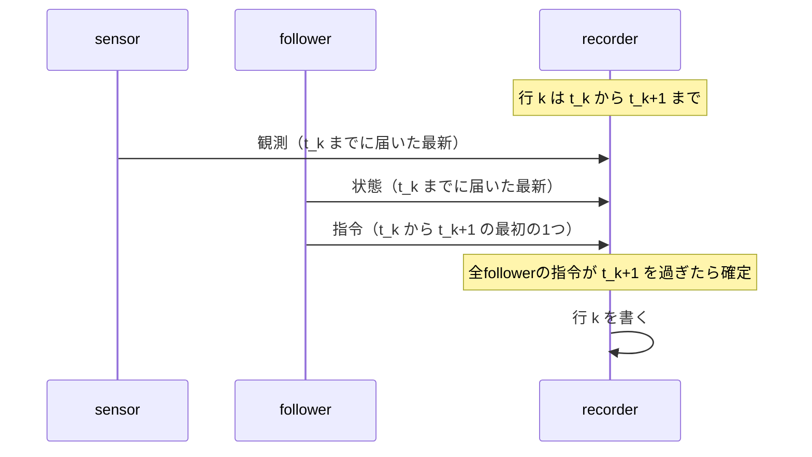

# dataの形式

`record` extraでLeRobotDataset 0.7.0に保存します．取得・利用可能・受信・指令送信の単調時計時刻を区別して整列し，欠損は直前の有効な値と有効flagで表します．`task` はframeに記録されます．列名・dtype・shapeの一覧は [datasetの特徴量](../reference/dataset-features.md) にあります．

## 記録するもの { #features }

followerが複数あるとき，`observation.state`，`observation.effort`，`action` は全followerを設定の順につなげた1本のvectorです．`names` が各要素の持ち主を `<follower>.<joint>` で示します（例：`follower.r_arm_sh_pitch1`）．ほかのfeatureはnodeごとで，node名が付きます．

| feature | 中身 |
| --- | --- |
| `observation.state` | 各followerの関節の位置 |
| `observation.effort` | `record_effort: true` のfollowerの力の量．単位の違うfollowerは混ぜられません |
| `observation.<input名>` | 各inputの読み値．inputのnode名が付きます（例：`observation.leader`）．leader armのような関節のinputは，関節の位置をそのinputの単位で，関節名（接頭辞なし）を付けて記録します．姿勢のinputは `x`，`y`，`z`，`qx`，`qy`，`qz`，`qw`，`gripper`，`tracking`，`engaged` を記録します |
| `observation.images.<sensor>` などsensorのfeature | 各sensorが記録するもの．[Sensors](../sensors/index.md) の各ページを参照 |
| `observation.meta.<node>.valid` / `capture_age_ms` / `ready_age_ms`（float32），`seq` / `capture_ns` / `ready_ns` / `receive_ns`（int64） | 記録するnode（input，follower，sensor）ごとに1組．その行でそのnodeのsampleを使ったか，取得からと使えるようになってからの経過時間（ms），通し番号，取得・使用可能・受信の時刻（単調時計のns） |
| `action` | 各followerがその行の区間に送った最初の指令．`observation.state` と同じ並び |
| `action.valid` | 全followerが指令を送った行で1 |
| `action.clamped` | どれかのfollowerが制限した行で1 |
| `action.meta.<follower>.valid` / `clamped` / `seq` / `sent_ns` | followerごとの指令の有無，制限，指令の番号，送信時刻 |

詳しくは [観測](../reference/dataset-features.md#observation)，[行動](../reference/dataset-features.md#action)，[meta情報](../reference/dataset-features.md#meta) の各表にあります．`action` の各要素の単位は，datasetの `meta/roboloom.json` に残ります（[datasetのmetadata](recording.md#metadata)）．

## 構成で変わる特徴量 { #by-configuration }

どの特徴量があるかは，その記録で動いていたnodeで決まります．

- `observation.<input名>` は，その input が構成にあるときだけあります．Rakuda2 のtemplateのoption `policy` は leader を外すので（`inputs.leader: null`），評価のdatasetに `observation.leader` はありません．`policy_teleop` は leader を戻すので，`observation.leader` があります．
- `action.intervention` は，`teleop:` のある方策の controller があるときだけあります（[teleopと介入](../policy/intervention.md#recording)）．
- 方策の `hold` に挙げた関節も `action` にあり，その要素にはfollowerが保持している目標が入ります（[履歴，動かさない関節，新しい観測](../policy/custom.md#hold)）．
- 方策の `observe` は，方策に渡す観測を選ぶだけです．起動したsensorはすべて記録します（[sensor選択](../policy/run.md#sensor-selection)）．
- followerのない構成（手に持った装置，sensorだけ）には `action*` の特徴量はありません．
- 記録する特徴量を変えるoptionには `dataset` を付け，datasetを分けます（[起動option](../reference/configuration/index.md#launch-options)）．

## 行の割り当て { #row-assignment }

recorderは，episodeを `dataset_fps` の周期の行に区切り，各nodeの出力を因果的に（その時刻までに届いたものだけで）割り当てます．

- 行 k は `[t_k, t_{k+1})`，`t_k = t0 + k / dataset_fps` です．
- 観測は，recorderが `t_k` までに受け取ったものから選びます．`max_age_ms` より古いものは使わず，直前の有効な値を繰り返して `observation.meta.<node>.valid` を0にします．
- `action[k]` は，followerごとに `[t_k, t_{k+1})` で最初に送った指令です．送らなかったfollowerは保持している目標で埋め，`action.meta.<follower>.valid` を0にします．
- 行は，全followerの指令の流れが `t_{k+1}` を過ぎたとき（黙っているfollowerがあれば `t_{k+1}` から `grace_ms` 後）に確定します．
- `start` の直前に届いた最新のsampleを残しておくので，行0は空になりません．
- followerのない構成（手に持つ機器，sensorだけ）では `action*` がなく，`t_{k+1}` を過ぎた行から確定します．

## 有効flag { #valid }

| 列 | 1の意味 | 0の意味 |
| --- | --- | --- |
| `observation.meta.<node>.valid` | その行で，そのnodeの新しいsampleを使った | `max_age_ms` 以内のsampleがなかった．値は直前の有効なsampleのもの（[欠損の扱い](#missing-data)）．`seq` は-1 |
| `action.valid` | 全followerがその行の区間に指令を送った | どれかのfollowerが指令を送らなかった |
| `action.meta.<follower>.valid` | そのfollowerが指令を送った | そのfollowerは指令を送らず，その部分は保持していた目標で埋めた |
| `action.clamped`，`action.meta.<follower>.clamped` | どれかのfollower（またはそのfollower）の安全の検査が，指令を可動域か速度の上限に収めた | 制限しなかった |
| `action.intervention` | 人がleaderで動かした行（`teleop:` のある構成だけ） | 方策が動かした行 |

## 欠損の扱い { #missing-data }

- **古い観測**：`nodes/recorder.yaml` のそのnodeの `max_age_ms` より古いsampleは使いません．その行は `observation.meta.<node>.valid` を0，`seq` を-1にし，featureにはそのnodeの直前の有効なsampleの値を入れます（まだ一度も届いていないときだけ0）．0で埋めると，統計の最小値と平均が0に引かれるためです．input，follower，sensorのどれにも `max_age_ms` の項目が必要です（[recorderの設定](../reference/configuration/recorder.md#recorder)）．
- **指令のない行**：指令を送らなかったfollowerの部分は，そのfollowerが保持していた目標（状態の `target`．なければ位置）で埋めます．ゼロで埋めると，学習した方策が0への跳びを覚えるためです．その行の `action.meta.<follower>.valid` と `action.valid` は0です．
- **行の確定**：行は，全followerの指令がその区間を過ぎたとき，または `grace_ms`（既定500 ms）が過ぎたときに確定します．
- **LeRobotの学習は `valid` を見ません**：`lerobot-train` は `*.valid` の列で行を選ばず，ほかの列と同じく入力・出力に数えるだけです．LeRobotが学習から外すのは，episodeの終わりを越えた分（`action_is_pad`）だけです．有効な行だけを使う場合は，`action.valid` や `observation.meta.<node>.valid` で自分で選んでください．どれだけの行が0かは `roboloom check-dataset` が表示します（[検査と学習](check-and-train.md)）．
