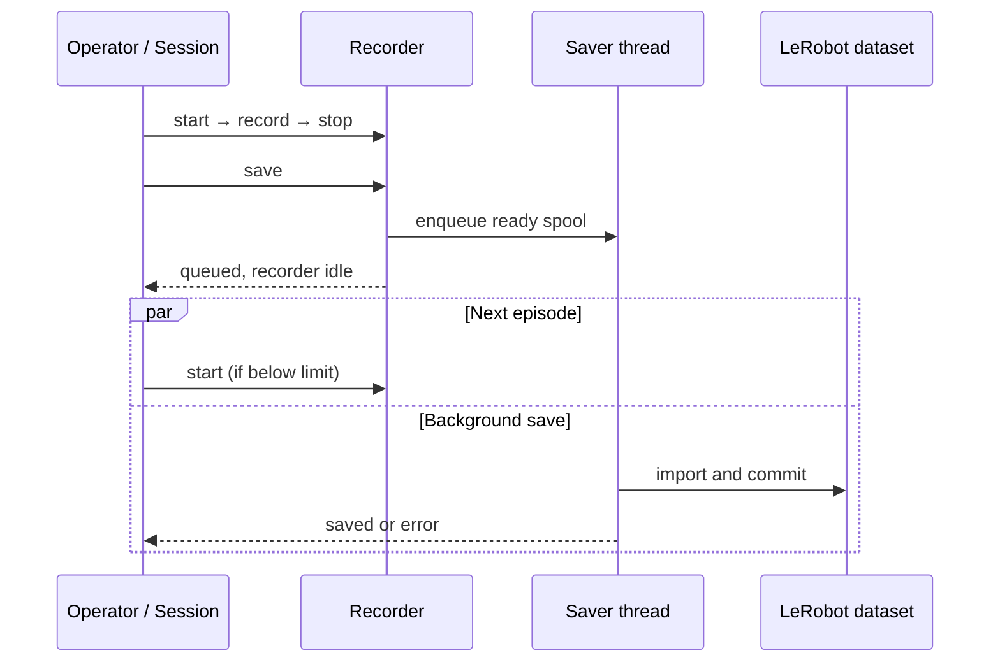

# 記録と再開

episodeを保存・破棄する流れと，保存したdatasetに残るものです．recorderの設定keyは [recorderの設定](../reference/configuration/recorder.md#recorder)，commandは [CLI](../reference/cli.md#record) にあります．

## 保存と破棄 { #save-and-discard }

- episodeは `start` で始まり，`stop` で止まります．止めたepisodeは，`save` で保存するか `discard` で捨てます．`roboloom record` と `Session.record` は，止めたあと保存します（[残すepisodeを選ぶ](#choosing-episodes)）．
- dora dataflowでは，既定で `save` は停止したepisodeを保存待ちにします．`background_save: false` ではdatasetへの書き込み完了を待ちます．`InProcessSession` は常に同期保存します．
- episodeの途中でcontrollerが失敗したとき（方策の例外など）と，followerがFAULT・ESTOPになったときは，そのepisodeを破棄します．
- Pythonの操作は [Session](../reference/python-api/session.md) にあります．

## Live view（Rerun） { #live-view }

<span class="status status--mock">模擬のみ</span> `viz` extra を install すると，`viewer` option で観測，follower ごとの行動（`action.<follower>`），取得からの経過時間（`meta/<stream>/capture_age_ms`），session の event（`start`，`stop`，`save`，`discard`）を live 表示できます．`run`，`record`，`infer` のどれでも使え，dataset 名は同じです．[Installation](../get-started/installation.md)

```bash
uv run roboloom record <robot> --with digit,viewer --task "pick" --seconds 30
uv run roboloom infer <robot> --seconds 20 --with viewer
```

1. `viewer` を有効にして実行します．既定では node が robot 側 PC の Rerun server を自動で起動または再利用します．対話画面と `--plain` 出力の両方に，共有用の URL と localhost の URL が表示されます．
2. 手元の PC の browser で共有用の URL を開きます．robot 側 PC の host 名を解決できない場合は，`nodes/viewer.yaml` の `public_host` に手元から接続できる host 名または IP を設定し，改めて実行します．firewall により web viewer や gRPC の port に接続できない場合があります．
3. SSH や Orca などの IDE からは，両方の port を同じ番号で手元に転送し，表示された localhost の URL を開きます．既定では viewer のページが `9090`，data stream が `9876` です．

```bash
ssh -N -L 9090:127.0.0.1:9090 -L 9876:127.0.0.1:9876 <robot-host>
```

- ページが開いても `Failed to fetch` と表示される場合は，gRPC server がページの origin（scheme・host・port）を許可しているか確認します．新しく起動する server は共有 URL の origin を自動で許可します．ほかのページの origin や glob pattern は `nodes/viewer.yaml` の `cors_allow_origins` に追加します．
- robot 側 PC の画面でも web viewer を開く場合は，`nodes/viewer.yaml` に `open_browser: true` を設定します．
- `roboloom` timeline をさかのぼると過去の画像や scalar sample を確認できます．Rerun は memory 上限に達すると古い live data から破棄します．`.rrd` file に残すには `save` を設定します．
- 実行終了後も server は動き続けるため，browser での閲覧を続けられ，次の実行でも再利用できます．再利用した server は起動時の CORS 設定を使います．新しい設定を適用する場合は，次の実行前に server を停止します．node が起動した server を止めるには，robot 側 PC で `kill -INT -- -12345` を実行し，`12345` を viewer node の起動 log にある server の PID に置き換えます．先頭の負号により server の process group に signal を送ります．

設定 key，出力 mode，entity path，status は [Live viewer（viewer）](../reference/configuration/viewer.md) に，process と timeline の設計は [viewer を独立した node にする理由](../explanation/viewer.md) にあります．

## background保存 { #background-saving }

<span class="status status--mock">模擬のみ</span> mock dataflowと合成frameで確かめています．`roboloom run`，`roboloom record`，Pythonの `Session` で既定で使います．



| 手順 | 動作 |
| --- | --- |
| `start` → `stop` | recorderは `<dataset root>/roboloom_spool/<seq>/` にepisodeを一時保存します．記録中に，2次元または3・4 channelの `uint8` 画像をPNGで，それ以外の画像配列を `.npy` で書きます．`stop` は画像の書き込み完了を待ち，保持していた画像以外のfeatureを `rows.npz` に書きます． |
| `save` | `ready: true` を含む `episode.json` を書き，保存待ちに入れた時点で戻ります．1本の保存threadが順にepisodeを取り込み，保存journalを使って書き込みます．処理後に各episodeのspool directoryを取り除きます． |
| 次の `start` | recorderとcontrollerの準備ができており，`pending_saves < max_pending_saves` ならすぐ開始できます．保存中の1件も数えます．上限に達すると `N episodes are waiting to be saved (max_pending_saves M); wait, then retry start` が出ます． |
| 保存の失敗 | datasetを保存前の状態に戻し，そのepisodeだけを破棄します．errorは後からlogや `Session` のerror通知に出ます．その時点で次のepisodeを記録中の場合もあります．後続の保存は続きます． |
| `quit` / `Session.close()` | 未確定のepisodeを破棄し，保存待ちの処理が終わるまで待ちます．`Session.close()` は保存待ちがあれば `saving N queued episodes ...` と通知します． |

recorderのprocessが異常終了したら，同じdatasetを記録用に開き直します．recorderは途中の書き込みを戻し，未確定のspool内のepisode（停止したまま保存を指示しなかったものを含む）を取り除き，受け付け済みのepisodeを再び保存待ちに入れます．警告 `N episodes left from an interrupted run are being saved` に復旧対象の数が出ます．書き込みの確定後にspoolの削除が中断しても，保存済みのepisodeは1件だけ残ります．`background_save: false` でもこの復旧処理は動きます．

uploadや学習の前にsessionを終了し，`roboloom check-dataset` に `episode spool:` の通知がないか確認します．保存待ち・未確定のepisodeが残っていたら，同じdatasetを記録用に開き直して `quit` で復旧を完了し，再検査します．`--recover` が修復するのは途中のdataset書き込みです．[datasetの検査](check-and-train.md#check-dataset) を参照してください．

同期保存にするには，[nodes/recorder.yaml](../reference/configuration/recorder.md#recorder) に `background_save: false` を指定します．`streaming_encoding: true` を使う場合もこの指定が必要です．

### 実機での確かめ方 { #checking-on-hardware }

<span class="status status--mock">模擬のみ</span> [roboloomのcheckout](../contribution/index.md) から実行します．RealSenseを設定したRakuda2を使い，`background_save: true` にします．普段 `gravity` を使い，DIGITも含める場合は `--with gravity,digit` を渡します．`--with` は既定のoptionを置き換えるので，使うoptionをすべて指定します．検査専用のdatasetを使います．既定は `datasets/rakuda2-bgsave-check` で，`--root` で別のdirectoryを選べます．

```bash
uv run python scripts/check_background_save.py compare rakuda2 --seconds 30 --episodes 5
uv run python scripts/check_background_save.py limit rakuda2 --seconds 1
uv run python scripts/check_background_save.py crash rakuda2 --seconds 20
```

各episodeの前にleaderをfollowerに合わせます．次のStartは各checkの条件を満たすとすぐ実行するので，episodeの間も両者を合わせておきます．`compare` では両方のgroupで同じように動かします．

| Check | 手順と記録時間の目安 |
| --- | --- |
| `compare` | Start前に保存待ちをすべて処理するepisodeを5回，Save直後にStartするepisodeを5回記録します．記録に5分かかり，起動と保存の時間が加わります． |
| `limit` | 1秒のepisodeを続けて記録し，保存待ちが上限に達したときのStartを確認します．拒否されたら保存完了を待ち，もう1 episodeを記録して保存します．記録は最大 `max_pending_saves + 3` 秒で，commandと保存の時間が加わります． |
| `crash` | 20秒間記録したあと，保存待ちがある間にrecorderだけを `SIGKILL` で強制終了します．scriptはdataflowを閉じ，同じdatasetを開き直して復旧を確かめます．確認，再起動，保存の時間が加わります． |

`crash` では確認を入力する前にleaderとfollowerの腕を支え，終了から再起動まで支え続けます．記録は強制終了の前に停止します．scriptがdataflowを閉じるまで，Doraと他のnodeが動き続ける場合があります．通常の終了処理ではfollowerは停止し，位置制御の関節は保持を続けることがあります．電流制御の関節はdeviceを閉じたときやwatchdogが作動したときに保持力を失うことがあります．

| 結果・指標 | 確認すること |
| --- | --- |
| 欠損率 | sourceごとの `missing_rate` とfollowerごとの `action_missing_rate` を比べます．重複ありのgroupの平均が0.01より大きく増えるか，設定の品質上限を超えると，`compare` は警告を出します． |
| 処理時間 | 記録の `queue_ms` と `latency_ms` のp99・最大値，followerごとの `control_interval_ms` の最大値を比べます．queueとlatencyの増加を確認します．制御周期は設定の品質上限とも照合します． |
| `PASS` | 期待した動作を観測し，datasetの検査を通過しました． |
| `WARN` | `compare` はStart時の保存との重なりを確認できなかったか，指標が比較または品質の上限を超えました． |
| `SKIP` | 保存待ちが上限に達しなかったか，強制終了の前に保存が完了したか，操作者が強制終了を取りやめました．保存の負荷を上げるには，記録時間を延ばすかsensorを増やします． |
| `FAIL` | command，保存，datasetの検査，または復旧の確認に失敗しました． |

scriptは，robotのほかのlogと同じ場所にあるsessionのlog directory（`.roboloom/<robot>/logs/bgsave-check-<時刻>/`．`crash` の再起動分はその下の `recovery/`）に `background-save-result.json` を書き，そのpathを表示します．JSONは実機での結果と一緒に残してください．引数，roboloomのversion，時系列，episodeごとの指標，判定を含みます．

**操作画面のチェック項目**．専用の `dataset.root` を持つ [検査用experiment](../reference/configuration/index.md#experiments) を用意して実行します．

```bash
uv run roboloom run rakuda2 --experiment ./bgsave-screen.yaml
```

- leaderを合わせます．episodeを記録してStop，Saveを選び，recorder行に `saving 1 queued` が出ることを確かめます．保存待ちに空きがあれば，すぐStartできます．
- 保存待ちが `max_pending_saves` 件の状態でStartし，`N episodes are waiting to be saved (max_pending_saves M); wait, then retry start` が出ることを確かめます．
- 保存待ちの処理が終わるとlogに `saved episode N '...'` が出ることを確かめます．
- 保存待ちがある間に終了し，保存が終わってから操作画面が閉じることを確かめます．終了後に検査用datasetを調べます．
- 保存に失敗した場合は，操作画面に `episode '...' was not saved: ...` がerrorとして出ることを確かめます．

## 再開 { #resuming }

同じdatasetに次のepisodeを追記できます．再開時はFPSとfeatureの互換性を検査します．記録するfeatureを変えるoptionには `dataset` を付け，datasetを分けます（[起動option](../reference/configuration/index.md#launch-options)）．

## 保存したepisodeの扱い { #saved-episodes }

- 保存が完了すると，そのepisodeのfileを閉じます．保存済みと報告されたepisodeは，そのあとprocessが強制終了されても読めます．
- そのため，data・episodeのmetadata・動画は1 episodeにつき1 fileです（LeRobotで `resume` を繰り返したときと同じ配置）．Hubに上げる前にfileをまとめたい場合は，LeRobotの集約toolを使います．
- 保存が失敗した場合（diskの空きがないなど）は，そのepisodeを破棄し，datasetを保存前の状態に戻します．それまでのepisodeは残り，次のepisodeを記録できます．
- datasetへの書き込みの途中でprocessが止まった場合は，記録再開時または `check-dataset --recover` で保存journalを使って途中の書き込みを戻します．[background保存](#background-saving) で受け付け済みのepisodeは，記録再開時にspoolから取り込み直します．
- 動画の長さがepisodeの行数と合わない場合（画像を書けなかったなど）は，保存の失敗として扱います．
- 対象はprocessの異常終了です．電源断までは保証しません（LeRobotがfileをdiskへ同期しないため）．

## datasetのmetadata { #metadata }

`meta/roboloom.json` に，datasetを作ったroboloomの版，`action` と `observation.state` の各要素の単位，episodeを保存した起動ごとのoptionと設定（`meta/roboloom_config/<名前>.json`．nodeの値をそのまま写したもの）を残します．nodeのfileが指す別のfile（重力model，調整値，校正）は写しません．

## episodeごとの記録 { #episode-records }

datasetへの書き込みが成功すると，recorderは `meta/roboloom_episodes.jsonl` への1行（JSON）の追記を試みます．このfileへの追記が中断・失敗した場合も，datasetへの書き込みは確定したままです．

| key | 内容 |
| --- | --- |
| `episode` | datasetの中のepisodeの番号 |
| `saved` | 保存した時刻 |
| `task`，`frames` | task と行数 |
| `metrics` | recorderの指標（欠損率，有効な行動の割合，制御周期の分布） |
| `controllers` | `save` を指示したときの各controllerの状態．方策では `infer_ms`・`infer_max_ms`（推論時間），`dropped`（非同期の推論で遅れて捨てた手数），`error` など |
| `label`，`note` | 評価の成否（`success`・`failure`．付けなければ `null`）とメモ |

- 成否は保存のときに付けます：Pythonの `save(label=...)`・`record(..., label=...)`（[評価の成否を残す](../policy/evaluation.md#labels)），操作画面のcommand欄や `--plain` の行入力で `save success`・`save failure`，別端末から `roboloom session save success`．
- あとから付ける・付け直すときは `roboloom label [robot] <episode> success|failure` を使います（[CLI](../reference/cli.md#label)）．`{"episode", "label", "labelled", "note"}` の行を追記し，読むときは同じepisodeの行をあとのものを優先して重ねます．行を書き換えることはありません．
- `roboloom check-dataset` が，成否の数を表示します．
- LeRobotはこのfileを読みません．学習には影響しません．保存に失敗したepisodeと破棄したepisodeの行はありません．
- Pythonからは `roboloom.recording.episodes.read(...)` で読めます（[Python API：記録](../reference/python-api/recording.md)）．学習から除くepisodeを選ぶ例は [悪いepisodeを除く](check-and-train.md#excluding-episodes) にあります．

## 残すepisodeを選ぶ { #choosing-episodes }

- `record` は，停止したあと，保存する前に `keep(result)` を呼びます．
  - `False` を返すと，そのepisodeを破棄します．
- `result` に入っているもの：
  - `metrics`：recorder の指標．欠損率，有効な行動の割合，制御周期の分布．
  - `warnings`：品質の上限を超えた項目．`result.ok` は警告がないときに真です．
- 品質の上限は，`nodes/recorder.yaml` の `quality` で変えられます（[品質の上限](../reference/configuration/recorder.md#quality)）．
  - `max_missing_rate`（既定 0.05）
  - `min_action_valid_rate`（既定 0.9）
  - `max_interval_ms`（既定 100）
- `control_interval_ms` と `action_missing_rate`（指令のなかった行の割合）はfollowerごとで，警告にはfollowerの名前が出ます．

```python
ok = s.record("pick up the cup", 30, keep=lambda ep: ep.ok)
```
