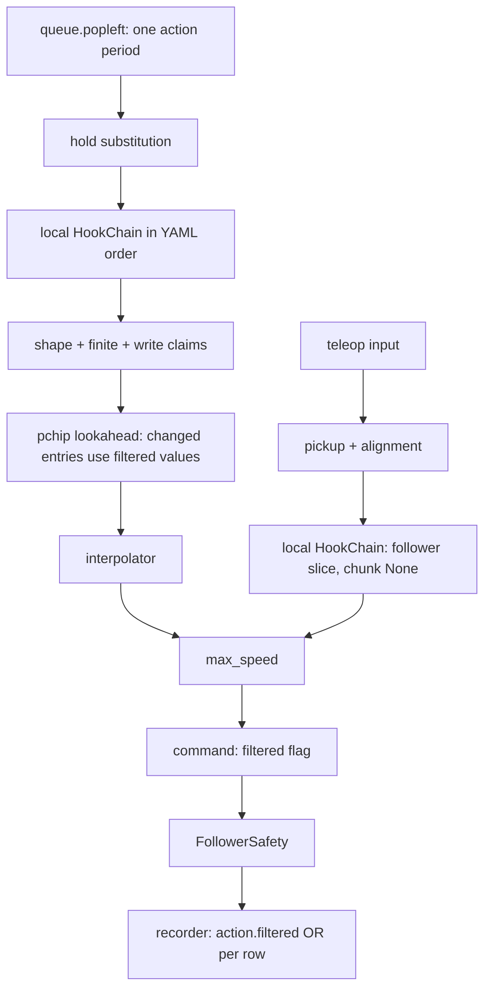

# Hooks in the control loop

Mock only

## Placement and safety { #placement }

node は先に hold を置換し，hook に完全で有限な target を渡します．hook は直前の output を受け取り，shape，finite，effective writes 外の bit-identical を毎回検査します．held joint を変える場合も明示的な write claim が必要です．writes の重なりは load 時に log へ出し，後の hook が優先します．shield は最後に置きます．

policy step は pop した action に 1 回だけ実行し，lookahead action には実行しません．変えた entry の lookahead は filtered value にそろえ，拒否した値に向かう pchip slope を避けます．interpolation 中の tick にもその周期の follower 別 filtered flag を渡します．`max_speed`，command deadline，FollowerSafety はその後も適用されます．

policy node 内の teleop step は pickup/alignment の後，joint controller の speed limit の前です．context の names はその follower だけで，`chunk` は None です．他の joint controller の seam は無効です．follower effort signal，one-follower controller，input-side current law は置き換えず，将来の effort feedback の経路を残しています．

## Local execution and observations { #local }

inference が remote でも step は local control thread で実行します．action period ごとに画像や action を server に送ると，control latency が network と inference の latency に依存するためです．remote protocol 2 で event capability を確認し，server が step hook を提供したら local factory または `backend: process` を案内して拒否します．古い server は event を提供しません．

bind 時に declare した observation key を，対応する source の feature または joined part に結び付けます．observation を読むと周期内で 1 回だけ lazy builder を呼び，source ごとの値を cache します．inference/history 用の full observation がある周期は再利用します．undeclared key は `observe` を含む KeyError です．hook 用に undeclared image を decode しません．array は read-only snapshot です．observe-only hook は writes を宣言しません．YAML は sources を狭めることだけができ，全ての declared write を含む必要があります．

## Threading and barriers { #threading }

event 対応 hook ごとに worker と ordered queue を持ちます．同じ hook の step，event，close は同時に実行されません．EpisodeStarted，ControlChanged，PolicyRestarted は step を持つ hook にだけ barrier です．start は最大 60 s，他の barrier は `budget_ms * 10` 待ちます．event-only hook は control を待たせません．barrier timeout は on_error に従い，前の EpisodeEnded に阻まれた start は 60 s で拒否します．

EpisodeEnded は control を待たせず queue に入れます．worker は先にその episode の orphaned inference を待ちます（SETTLE_S，最大 10 s）．次の start barrier は同じ queue の end event の後に入ります．shutdown では running episode を reason shutdown で終え，worker を最大 60 s drain して close します．drain 中の worker は終了後に close し，handler と close を同時実行しません．event handler の例外は log に記録し，episode を失敗させません．

policy 自身の hook と async `infer` が共有する state は hook worker の lock の対象外です．共有 state は独自の lock で保護してください．step の measured budget の default は `0.5 / rate_hz` ms（teleop は実際の input period）です．超過は count と warning だけで，Python を中断しません．

## Lifecycle and failure { #lifecycle }

step は running episode 中だけです．takeover は ControlChanged(takeover) を送り，以後は effective sources に teleop を含む hook だけを実行します．handback は ControlChanged(handback)，PolicyRestarted(handback) の順です．stale observation では action を pop せず ObservationStale を 1 回送り，回復時は inference を reset して PolicyRestarted(stale_recovered) を送ります．FAULT/ESTOP の tick は command も step も実行しません．stop/discard/estop/release/failure/interruption/shutdown では EpisodeEnded を 1 回だけ送り，task，index，dataset root，時刻，step/command/intervention の数，filtered_steps を渡します．

writing hook の default は fail です．Episode を失敗させ follower は hold します．observe-only hook は pass が default です．明示的な hold はその周期だけ hook の writable entry を held target に置換し，pass は入力をそのまま通します．error は count します．置換値の判断は HookChain の 1 つの error-value function にまとめ，将来の failure policy を追加できるようにしています．V1 に fallback value や on_overrun はありません．Requirements の追加 field は default 付きにし，HOOKS_API は既存の意味を変える場合だけ上げます．新しい API を要求する hook は load 時に拒否します．
