# viewer を独立した node にする理由

```mermaid
flowchart LR
  I["inputs"] --> C["controllers / policy<br/>(hook は control budget 内で実行)"]
  C --> F["followers"]
  F --> C
  X["sensors"] --> R["recorder<br/>有界 queue (queue_s)"]
  F --> R
  I --> R
  X -. "最新のみ (queue_size: 1, drop_oldest)" .-> V["viewer<br/>独自の timer (rate_hz)"]
  F -. "最新のみ" .-> V
  I -. "最新のみ" .-> V
  N["session"] -.-> C
  N -.-> R
  N -.-> V
  V -. "status" .-> N
  V -- "gRPC" --> RR["Rerun server (独立した process)"]
  RR --> W["Browser"]
  V --> D[".rrd (任意)"]
```

模擬のみ

`viewer` は，方策の hook や recorder の中ではなく，独立した dora node process として動きます．`viewer` への入力（`inputs`，`followers`，`sensors`，`estimators`，`action_<follower>`）はすべて `queue_size: 1`・`queue_policy: drop_oldest` の最新値専用 queue であり，溜まった timer tick も 1 回の起床で 1 回の再描画へまとめられ，独自の `rate_hz` で動きます．上流の queue を押し戻さないため，Rerun の描画・JPEG 圧縮・gRPC 通信の遅延や，viewer の起動失敗が起きても，機器の読み取り・follower の制御・`recorder` の行の整列を遅らせません（失敗した viewer も入力の消費を続け，error を `status` に報告します）．これに対して local の [policy hook](hooks.md) は `policy` node 内の制御周期と短い budget（既定 `0.5 / rate_hz` ms）の中で同期実行される仕組みであり，teleop（`record`・`run`）のときには存在しません．

以前の模擬実行（`rakuda2`，`digit` + `viewer`，20 秒）では，follower の制御間隔 p99 は viewer ありで **9.82 ms**，なしで **9.72 ms** でした．どちらも sample の欠損はありませんでした．

## 画像の履歴 { #image-history }

live 表示で static 画像を 10 Hz で上書きすると，Rerun の web viewer が停止しました．現在の viewer node は，描画ごとに画像と scalar sample を同じ `roboloom` timeline の時刻で記録します．browser で過去の frame を表示でき，live 履歴の保持量は Rerun の memory 上限で決まります．node は最初の描画時に layout を送り，view に加える画像または scalar の entity が増えたときに更新します．

## server の動作期間 { #server-lifetime }

既定の server は robot 側 PC の独立した process session で動きます．描画は browser が行うため，robot 側 PC は画面や native graphics backend がなくても配信できます．server は後から接続した browser にも最近の data を渡せるように保持します．dataflow が終了したあとも，保持している sample を配信し，次の実行からの接続を受け付けます．

設定 key と出力先は [Live viewer（viewer）](../reference/configuration/viewer.md)，使い方は [Live view（Rerun）](../data/recording.md#live-view) を参照してください．
