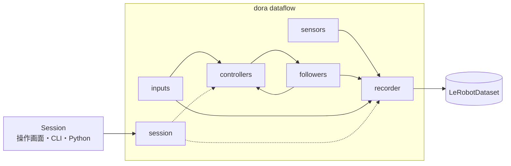
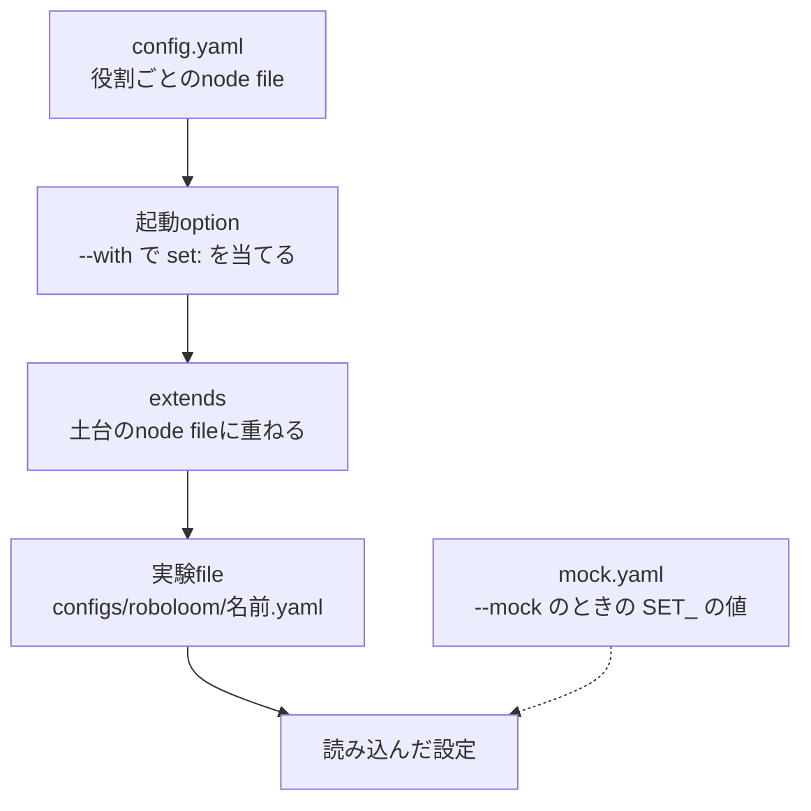
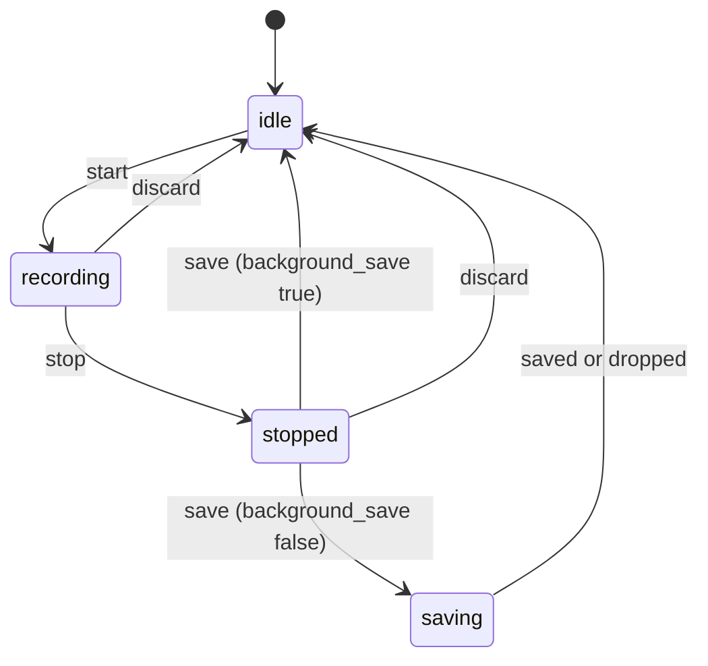
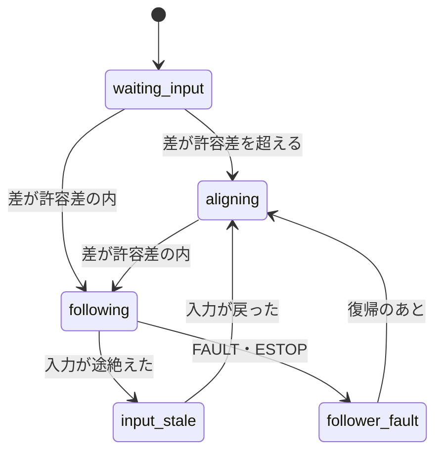

# しくみ

roboloomを使う前に知っておくと読みやすくなる，node，設定，単位，Session，episodeの状態をまとめます．keyの一覧は [設定](../reference/configuration/index.md) にあります．

## node { #nodes }

1つの構成は，役割ごとのnodeの集まりです．各nodeはdora-rsのdataflowの中で別のprocessとして動き，設定を自分で読みます．

| 役割（`config.yaml` のkey） | 何をするか | 例 |
| --- | --- | --- |
| `inputs` | 人が動かす機器を読む | Rakuda-mini（leader），Pika Sense |
| `controllers` | 入力か方策を，followerの目標に変える | `joint`，`policy`，`pose_ik` |
| `followers` | 目標を受けてmotorを動かし，状態を返す | Rakuda2，PiPER，Pika Gripper |
| `sensors` | 観測を取得する | RealSense，DIGIT，音声 |
| `recorder` | 全nodeの出力を記録の行にそろえて保存する | LeRobotDataset |
| `session` | 操作（start，stop，save …）を受けて各nodeへ配る | 操作画面，`roboloom session` |
| `trackers`，`estimators` | 姿勢の追跡，外力の推定 | Lighthouse，`effort` |

## 設定の合成 { #configuration }

機体ごとに `.roboloom/<robot>/config.yaml` が1つあります．nodeごとの設定は `nodes/` のfileに分かれ，起動時に次の順で1つの設定にまとまります．

| 仕組み | 何をするか | 詳しく |
| --- | --- | --- |
| 起動option（`options`） | node fileを置き換え・足し・外す．記録が変わるならdataset名に接尾辞を付ける | [起動option](../reference/configuration/index.md#launch-options) |
| `extends` | 土台のnode fileに，違うところだけを重ねる | [extends](../reference/configuration/index.md#extends) |
| 実験file | 方策，option，保存先，task，長さを1つにまとめる | [実験file](../reference/configuration/index.md#experiments) |
| `mock.yaml` | 模擬のdeviceのときだけ，`SET_...` の代わりの値を与える | [未設定の値と模擬](../reference/configuration/index.md#placeholders) |

## 単位 { #units }

- 関節の位置の単位は，followerと入力が宣言します．Rakuda2とRakuda-miniはDynamixelの生の位置count（`dynamixel_count`），PiPERはradです．
- 指令にも単位が入り，followerは自分の単位と違う指令を受け取りません．
- `max_speed` と `home.tolerance` は，どこに書いてもfollowerの単位（/s）です．
- datasetの `observation.state` と `action` は，followerの単位のまま記録します．方策も同じ単位で目標を返します．

詳しくは [単位](../reference/configuration/index.md#units) にあります．

## Session { #session }

`Session` はdataflowを起動し，episodeの操作を送るPythonのclassです．CLIと操作画面はこれを呼ぶ薄い層です．

| 入口 | 例 |
| --- | --- |
| 操作画面 | `uv run roboloom run` |
| 別の端末 | `uv run roboloom session save` |
| Python | `Session.launch("rakuda2", options=["gravity"])` |

APIは [Session](../reference/python-api/session.md)，操作は [runの操作](../reference/cli.md#run-operations) にあります．

## episodeの状態 { #episode-states }

recorderのepisodeは次のように進みます．操作画面のrecorderの行に，今の状態が出ます．

- `stopped` の間は，`save` か `discard` を選ぶまで次の `start` を拒否します．`background_save: false` では `saving` の間も拒否します．
- 模擬のみ [background保存](../data/recording.md#background-saving) では，`save` がepisodeを保存待ちに入れるとrecorderは `idle` に戻ります．保存中の1件を含む `pending_saves` を報告し，`max_pending_saves` 以上で `start` を拒否します．
- `stop` はfollowerを保持します．脱力はしません．

leaderで動かす `joint` controllerは，episodeとは別に次の状態を持ちます．`aligning` の間は `start` を拒否します．

- `aligning` の間は，関節の差（`worst_joint`，`worst_diff`）が画面に出ます．leaderをfollowerに揃えます．
- 方策のcontrollerは `loading` → `ready` → `running` と進み，`stop` で `ready` に戻ります（[方策が失敗したとき](../policy/custom.md#failures)）．
