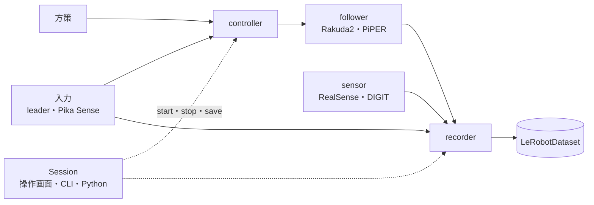

# roboloom

roboloomは，robotのteleoperationで観測と行動を集め，LeRobotDataset（0.7.0）に保存し，学習した方策で同じrobotを動かすPython packageです．

- **収集**：leaderや手に持つ機器でfollowerを動かし，cameraや触覚と一緒に記録する．
- **学習**：記録をそのまま `lerobot-train` や自作のmodelで学習する．
- **推論と評価**：方策でfollowerを動かし，途中で人が介入し，成否を残す．

各nodeはdora-rsのdataflowで別のprocessとして動きます．`Session`（操作画面，CLI，Python）がdataflowを起動し，episodeの開始・停止・保存を送ります．

-   **[Get started](get-started/installation.md)**

    ---

    install，[しくみ](get-started/concepts.md)，[対応表](get-started/support-matrix.md)．

-   **[Tutorials](tutorials/index.md)**

    ---

    装置なしで一周する手順から，Rakuda2の収集・学習・推論まで．

-   **[Robots](robots/index.md)**

    ---

    機体ごとの関節，使えるcontrollerとsensor．

-   **[Policy](policy/index.md)**

    ---

    方策の書き方，LeRobotの方策，介入，評価．

-   **[Reference](reference/configuration/index.md)**

    ---

    設定のkey，CLI，Python API，datasetの列．

## 状態label { #status }

機能ごとに，どこまで確かめたかをlabelで示します：実機検証済み 模擬のみ 開発中 設計のみ．定義は [状態label](reference/status-labels.md) にあります．実機のcommandは，操作者が設定値を照合し，機体ごとに動作を確かめてから使います．模擬の実行やdocsのbuildの成功は，実機の検証ではありません．
