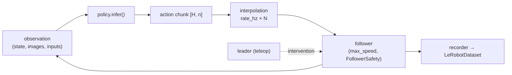

# 方策と推論

`type: policy` のcontrollerは，学習した方策でフォロワを動かします．方策は，自分で書いたものでも，LeRobotのチェックポイントでも，同じ仕組みで読み込みます．

!!! warning "確かめた範囲"
    自作の方策の経路は，Rakuda2の構成と模擬で使っています．LeRobotの方策（`roboloom.policy.lerobot`）は，模擬のPiPER＋Pikaの構成だけで確かめています．模擬で記録したデータを `lerobot-train` でCPUで短く学習したACTで，記録から推論までを通しました．実機と，十分に学習した方策では，まだ確かめていません．

## 全体の流れ { #overview }

- 方策ノードは，フォロワの関節状態と `observe` に挙げた入力・センサーを観測として方策に渡します（[自作の方策](custom.md)）．
- 方策は1手 `[n]` か，まとめた行動 `[H, n]` を返します．方策ノードは `rate_hz` の周期で1手ずつ取り出し，その間を補間して，フォロワの制御周期に近い周期で指令を送ります（[非同期の推論と補間](async.md)）．
- 送る目標は `max_speed` で切り詰め，`FollowerSafety` が可動域と期限を検査します．遠隔操作と同じです．
- `teleop:` のある構成では，エピソードの途中で人がleaderで介入し，また方策に戻せます（[テレオペと介入](intervention.md)）．
- recorderは，フォロワに実際に送った指令を `action` に記録します（[データの形式](../data/format.md)）．

## ページ { #pages }

| ページ | 内容 | 状態 |
| --- | --- | --- |
| [方策を動かす](run.md) | `nodes/policy.yaml`，`roboloom infer`，周期と手数，home，Pythonから，センサー選択 | 模擬のみ（センサー選択），開発中（PiPER＋Pika） |
| [自作の方策](custom.md) | 方策の形，`bind`，観測の選択，失敗したとき，履歴と `hold`，自分のモデル | — |
| [LeRobotの方策](lerobot.md) | チェックポイントを読み込む，`lerobot-train` で学習する | 模擬のみ |
| [方策サーバー](remote.md) | 方策を別のプロセス・別の環境で動かす（`serve-policy`） | 模擬のみ |
| [非同期の推論と補間](async.md) | `inference: async`，行動の補間，`pchip` | 模擬のみ（非同期，`pchip`） |
| [テレオペと介入](intervention.md) | `teleop:`，介入，記録のされ方 | — |
| [評価と再生](evaluation.md) | 評価の成否を残す，記録を再生する | 模擬のみ（再生） |

状態ラベルの意味は [状態ラベル](../reference/status-labels.md) にあります．キーの一覧は [方策の設定](../reference/configuration/policy.md)，コマンドは [CLI](../reference/cli.md#infer) にあります．

## 限界 { #limitations }

- LeRobotのRTCには対応していません．非同期の推論は，行動の列を混ぜずに入れ替えます．
- ACTの時間方向の平均（`temporal_ensemble_coeff`）は，`mode: step` のときだけ働きます．
