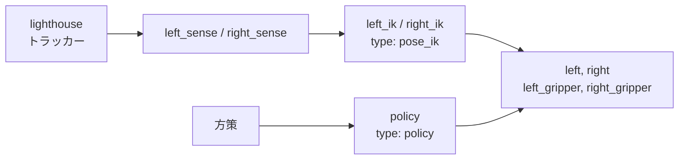

# PiPERのcontroller

!!! warning "状態：開発中"
    <span class="status status--dev">開発中</span> PiPER，Pika Gripper，Pika Senseのドライバは，どれも実機で動かしていません．ここの構成は，リポジトリの模擬の構成 `.roboloom/piper-mock/` で確かめたものです．

PiPER 2台とPika Gripper 2台を動かすcontrollerの一覧です．`roboloom init` のテンプレートはまだないので，`.roboloom/piper-mock/` を写して使います（[PiPER＋Pikaを模擬で](../../tutorials/piper-pika/mock.md)）．

| Controller | 入力 | オプション | 状態 |
| --- | --- | --- | --- |
| [Pika SenseとIK](#pose-ik) | 腕ごとのPika Sense | なし | <span class="status status--dev">開発中</span> |
| [方策](#policy) | 方策 | `policy` | <span class="status status--dev">開発中</span> |

- 方策＋介入（`teleop:`）は使えません．介入に使えるcontrollerは `type: joint` だけで，`pose_ik` は読み込みのときに断ります（[テレオペと介入](../../policy/intervention.md#teleop)）．
- leader（`joint`）で動かす構成はありません．



## Pika SenseとIK { #pose-ik }

<span class="status status--dev">開発中</span>

1つのSenseで，腕1台とグリッパー1台を動かします．Senseの姿勢を逆運動学でPiPERの関節角に，挟みの角度をグリッパーの角度に変えます．

```yaml
# .roboloom/piper-mock/nodes/left_ik.yaml（抜粋）
type: pose_ik
input: left_sense
followers: [left, left_gripper]
arm: left
gripper: left_gripper
tool_offset: {xyz: [0.0, 0.0, 0.19], rpy: [0.0, -1.5708, 0.0]}  # AgileXのグリッパーの値．Pika Gripperでは測る
workspace: {min: [0.05, -0.45, 0.05], max: [0.6, 0.45, 0.6]}  # m
gripper_map: {scale: 1.0, offset: 0.0}
max_speed: {left: 1.0, left_gripper: 3.0}
home: {left: {pose: ../poses/left/ready.yaml, max_speed: 0.5, tolerance: 0.02}}
command_deadline_ms: 100
input_timeout_ms: 150
```

```bash
uv run roboloom run piper-mock
```

- 腕は折りたたんだ姿勢（すべて0）で始まり，そこではIKが手にほとんど追従できません．先に「Move home」で `poses/<arm>/ready.yaml` へ動かします．
- 共通の説明：[Pika SenseとIK](../../controllers/pose-ik.md)．

## 方策 { #policy }

<span class="status status--dev">開発中</span>

オプション `policy` は，SenseとIKのcontrollerを外し，`controllers.policy` を足します．`roboloom infer` が自動で有効にします．

```yaml
# .roboloom/piper-mock/nodes/policy.yaml
type: policy
followers: [left, right, left_gripper, right_gripper]
factory: demo_policy:wave  # 同じディレクトリの確認用の方策
observe: [camera, left_wrist, right_wrist]
rate_hz: 10
action_horizon: 2
max_speed: {left: 1.0, right: 1.0, left_gripper: 3.0, right_gripper: 3.0}
command_deadline_ms: 300
```

```bash
uv run roboloom run piper-mock --with policy
uv run roboloom infer piper-mock --seconds 20 \
  --policy roboloom.policy.lerobot:load --policy-kwargs '{"path": "<checkpoint>"}'
```

- 観測と行動は14要素（腕6＋6，グリッパー1＋1）で，単位はradです（[観測と行動](index.md#observation-and-action)）．
- 推論の構成にはSenseがないので，方策は `observation.left_sense` などを使えません．
- 共通の説明：[方策（controller）](../../controllers/policy.md)，[方策を動かす](../../policy/run.md#piper-pika)．
