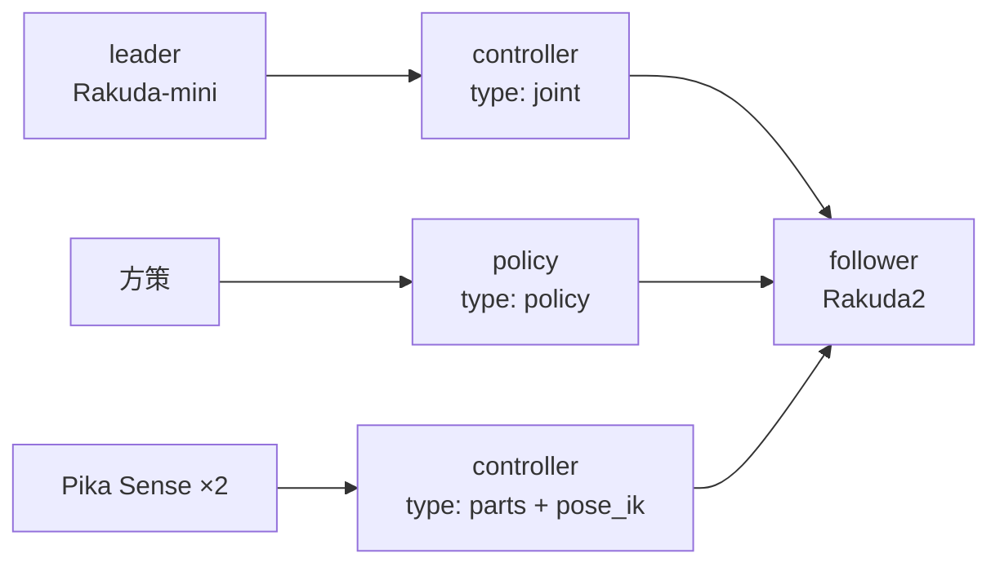

# Rakuda2のcontroller

Rakuda2でfollowerを動かすcontrollerの一覧です．どれを使うかは，`.roboloom/rakuda2/config.yaml` の起動optionで選びます．controllerの共通の説明は [Controllers](../../controllers/index.md) にあります．

| Controller | 入力 | option | 状態 |
| --- | --- | --- | --- |
| [Leader](#leader) | Rakuda-mini（`leader`） | なし | <span class="status status--verified">実機検証済み</span> |
| [重力補償付きleader](#gravity) | Rakuda-mini（`leader`） | `gravity` | <span class="status status--verified">実機検証済み</span> |
| [方策](#policy) | 方策 | `policy` | <span class="status status--verified">実機検証済み</span> |
| [方策＋介入](#policy-teleop) | 方策とRakuda-mini | `policy`，`policy_teleop` | <span class="status status--verified">実機検証済み</span> |
| [Pika SenseとIK](#pika) | 腕ごとのPika Sense | `pika` | <span class="status status--dev">開発中</span> |
| 力の逆送 | Rakuda-mini（`leader`） | `gravity`，`bilateral` | <span class="status status--mock">模擬のみ</span>（中断中．[Rakuda2](index.md)） |



## Leader { #leader }

<span class="status status--verified">実機検証済み</span>

optionを何も有効にしない構成です．leaderの各関節を，同じ名前のfollowerの関節へ写します．leaderの腕・胴体・頭部は脱力し，triggerはばね（`law: spring`）として制御します．

```yaml
# nodes/controller.yaml（抜粋）
type: joint
input: leader
followers: [follower]
alignment_tolerance: 300
max_speed: 2048
command_deadline_ms: 100
input_timeout_ms: 150
couplings: []
```

- 開始前にleaderとfollowerを揃えます．`aligning` の間は開始を拒否し，関節差を表示します．
- leaderの関節の固定（`law: position`）と腰yawの相殺（`couplings`）は <span class="status status--mock">模擬のみ</span> です．
- 詳しい設定：[Leader](../../controllers/leader.md)．手順：[Rakuda2：teleopで収集](../../tutorials/rakuda2/collect.md)．

## 重力補償付きleader { #gravity }

<span class="status status--verified">実機検証済み</span>

option `gravity` は，leaderのnodeを `nodes/leader.yaml` から `nodes/leader_gravity.yaml` に置き換えます．controllerは同じ `joint` です．左右の腕を `gravity_comp` の制御則で動かし，同定した重力model，可動域，調整値を使います．

```bash
uv run roboloom run --with gravity
```

- 測定（`calibrate-joints`，`measure-travel`，`identify-gravity`，`tune-gravity`）が済むまで読み込みを拒否します．手順：[Rakuda2：重力補償](../../tutorials/rakuda2/gravity.md)．
- `policy` と同時には使えません．

## 方策 { #policy }

<span class="status status--verified">実機検証済み</span>

option `policy` は，leaderとcontrollerを外し，`controllers.policy` を足します．`roboloom infer` が自動で有効にします．

```yaml
# nodes/policy.yaml（抜粋）
type: policy
followers: [follower]
factory: roboloom.policy:hold  # 腕をその場に留める．自分の方策に替える
kwargs: {}
observe: [camera]  # digit を有効にしたら digit_left，digit_right も足せる．[] は関節状態のみ
rate_hz: 15
action_horizon: 8
max_speed: {follower: 1024}
command_deadline_ms: 300
```

```bash
uv run roboloom infer --seconds 20 --policy my_lab.policies:load
```

- 観測と行動は17関節のcountです（[観測と行動](index.md#observation-and-action)）．
- 共通の説明：[方策（controller）](../../controllers/policy.md)，[方策を動かす](../../policy/run.md)．手順：[Rakuda2：収集から推論まで](../../tutorials/rakuda2/train-infer.md)．

## 方策＋介入 { #policy-teleop }

<span class="status status--verified">実機検証済み</span>

option `policy_teleop` は `policy` に加えてleaderを戻し，episodeの前と途中にleaderで動かせるようにします．

```yaml
# nodes/policy_teleop.yaml
extends: policy.yaml
teleop: [controller.yaml]  # leaderで動かすときの joint controller
```

```bash
uv run roboloom run --with policy,policy_teleop
```

- 人が動かした行は `action.intervention` が1になります．dataset名は `-eval-teleop` です．
- 共通の説明：[teleopと介入](../../policy/intervention.md)．手順：[Rakuda2：介入しながら評価する](../../tutorials/rakuda2/intervention.md)．

## Pika SenseとIK { #pika }

<span class="status status--dev">開発中</span>

option `pika` は，leaderの代わりに腕ごとのPika Senseで，逆運動学を通して腕とgripperを動かします．模擬のdeviceだけで確かめています．

```yaml
# nodes/controller_pika.yaml
type: parts
followers: [follower]
command_deadline_ms: 100
parts: [pika_right.yaml, pika_left.yaml]  # それぞれ type: pose_ik
```

```bash
uv run roboloom run --with pika --mock
```

- 対応表，零点，gripperの対応はどれも仮の値です．実機の前の確認は [Rakuda2をPika SenseとIKで動かす](pika-sense-ik.md) にあります．
- 共通の説明：[Pika SenseとIK](../../controllers/pose-ik.md)．
