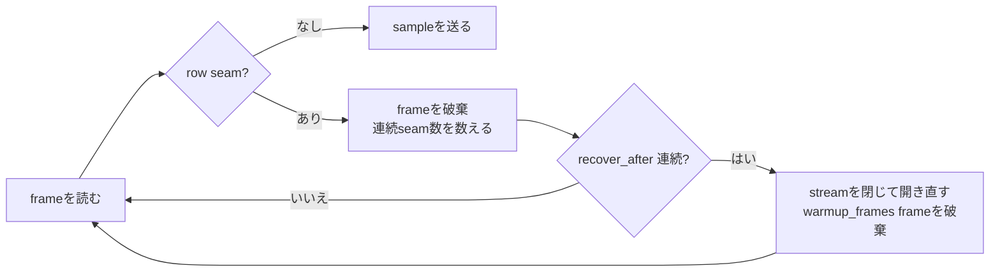

# DIGIT

!!! note "状態：実機検証済み"
    <span class="status status--verified">実機検証済み</span> Rakuda2の実機で，左右のDIGITを含む収集を確かめています．

`DigitSensor` は `digit-interface` を使って触覚画像を取得します．`digit` extraが必要です（[Installation](../get-started/installation.md)）．左右のsensorには異なるserial番号を設定します．

```yaml
type: digit
serial: SET_DIGIT_LEFT_SERIAL
name: left
resolution: QVGA
height: 320
width: 240
fps: 30
```

| `resolution` | `height` | `width` |
| --- | --- | --- |
| `QVGA` | 320 | 240 |
| `VGA` | 640 | 480 |

`digit-interface.get_frame()` が転置済みの画像を返すため，設定の高さ・幅はこの順です．一般的なQVGA/VGAの幅・高さの表記から逆にしないでください．`fps` はSDKの当該解像度の対応値から選び，非対応値は接続時に拒否されます．

取得画像はBGRからRGBへ変換されます．node名が `digit_left` / `digit_right` の場合，`observation.images.digit_left` / `observation.images.digit_right` に記録します．

DIGITのnodeごとに，`nodes/recorder.yaml` の `max_age_ms` の項目も必要です．[Sensors](index.md) の「Recorderの設定」を参照してください．

Rakuda2の対応構成と重力補償との併用方法は [機体ページ](../robots/rakuda2/index.md) にあります．

### 継ぎ目のある frame <span class="status status--mock">模擬のみ</span> { #row-seam }

DIGITのstreamはときどき，sensorの行の途中から始まるframeを返します．画像は行に沿ってずれており（roll），ほとんどの列が一度に大きく変わる継ぎ目の行（row seam）が1行あります．この状態はstreamを開き直すまで続きます．一時的な形では，別の場所の行の帯が1つのframeに貼り付けられます．原因は不明で，同じ症状が上流でも修正なしに報告されています（[digit-interface#10](https://github.com/facebookresearch/digit-interface/issues/10)，[digit-design#39](https://github.com/facebookresearch/digit-design/issues/39)）．

`seam_check`（既定 `true`）では，frameごとに，ほとんどの列が一度に大きく変わる行を1つ探します（`find_seam`）：



- seamのあるframeは破棄します：nodeはsampleを送りません．記録されたdatasetでは，その行は直前の有効なDIGIT画像を繰り返し，`observation.meta.<sensor>.valid` は 0 です（[Recorderの設定](index.md#recorder)）．
- seamのあるframeが `recover_after` 回連続すると，streamを閉じて開き直し，`warmup_frames` frameを破棄します（最初のopenでも同じ）．seamのないframeが来ると連続数は0に戻ります．
- 開き直しが5秒間失敗し続けると，nodeはerrorで停止します．
- `seam_check: false` は従来の動作です：すべてのframeを送り，seamは数えません．

| key | 既定値 | 意味 |
| --- | --- | --- |
| `seam_check` | `true` | frameごとのseam検査．`false` で従来の動作（破棄も開き直しもない） |
| `recover_after` | `3` | 開き直しを起こす連続seam数（1以上の整数） |
| `warmup_frames` | `10` | openのあとに破棄するframe数（0以上の整数） |

keyの一覧は [Configuration](../reference/configuration/sensors.md#digit) にあります．

操作画面のStatus tabでは，sensorの行に `seams N  recoveries M` が強調表示されます（どちらかが0でなくなると表示）．開き直しのたびにnodeのlogに1行出ます：`<name>: row seam at <row>, reopening the DIGIT stream (recovery <n>)`．

ここまでの検証：しきい値は記録済みのRakuda2のDIGIT frame 36,524枚で選びました．rollしたframeと貼り付けられた帯をすべて検出し，seamのないframeは検出しません．開き直しの経路はfake deviceでのみ試験しています．実機で確かめるまで，この機能は模擬のみです．

### Image storage

画像sensorのnode YAML に `storage: video | image` を指定します（RealSense、DIGIT、Pika 手首cameraを含む V4L2）。既定は `video` で、従来の非可逆 MP4 です。`image` は可逆 PNG frameを Parquet に埋め込みます。DIGIT と背景の微小な画素差を使う場合に推奨します。同じdataset内で混在できます。不正な値は `validate` を含む設定読み込み時に拒否します。

PNG は一般に容量と PNG 圧縮・書き込み負荷が増えます。実際の容量と速度は画像内容と機器に依存します。非圧縮 RGB の参考値は 320×240×3、dataset fps 30 でsensorあたり 6.9 MB/s（640×480 は 27.6 MB/s）です。PNG の実測値ではありません。LeRobot 0.7.0 の `image` の PNG 圧縮levelは 6 です。保存形式の変更は feature dtype の変更になるため、別のdataset `output` を指定してください。以前のschemaへの追記は拒否します。

live観測は引き続き HWC uint8 RGB です。LeRobot の読み出しは両形式とも既定で CHW float32、範囲 [0, 1] になり、checkpointの入力型は `VISUAL` のままです。保存形式は mock・合成frameのみで試験し、実機では未検証です。

`video` の MP4 の codec（既定 H.264，または AV1）は recorder の [`video_codec`](../reference/configuration/recorder.md#video-codec) で選びます．

[Configuration](../reference/configuration/sensors.md#image-storage)
