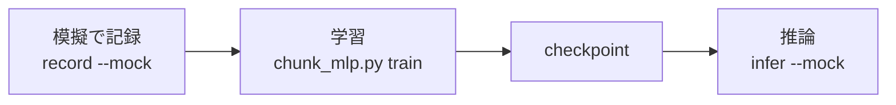

# 自作の方策を動かす

<span class="status status--mock">模擬のみ</span>

- **目的**：見本の方策 `chunk_mlp.py` を模擬の記録で学習し，`roboloom infer` で動かす．自分のmodelに置き換える場所を知る．
- **前提**：Python 3.12〜3.14とuv，roboloomのrepositoryのclone（隣の `../roboloom`）．[Installation](../get-started/installation.md) を読んでいる．実機は使わない．
- **所要**：30分．
- **結果**：模擬のRakuda2で方策が動き，評価のdataset `datasets/rakuda2-eval` に1 episodeが保存される．

!!! warning "試しのprojectを分ける"
    `--mock` でも，保存先は実機と同じ `.roboloom/rakuda2/datasets/` です．実機のdataがあるprojectでは試さず，新しいprojectを作ってください．



## 1. 試しのprojectを作る

```bash
uv init --python '>=3.12,<3.15' my_policy_trial && cd my_policy_trial
uv add git+https://github.com/tetsugo02/roboloom.git --tag v0.2.0 --extra rakuda2 --extra record --extra policy
uv run roboloom init rakuda2
cp ../roboloom/examples/policies/chunk_mlp.py .roboloom/rakuda2/   # cloneしたrepositoryから
```

- `chunk_mlp.py` はrepositoryの `examples/policies/` にあり，installしたpackageには入っていません．入れたroboloomと同じ版のcloneから写します．方策のmoduleは，robotのdirectory（`.roboloom/rakuda2/`）に置けば `PYTHONPATH` なしで読み込めます．
- `policy` extraでtorchとLeRobotが入ります．

## 2. 模擬で記録する

```bash
uv run roboloom record --mock --task demo --seconds 20 --episodes 3 --plain
uv run roboloom check-dataset --mock
```

`episodes: 3, ... fps: 15` と `problems: none` を確かめます．`--mock` がないと，`SET_...` が残っているので読み込みを拒否します．

## 3. 学習する

```bash
uv run python .roboloom/rakuda2/chunk_mlp.py train \
  --dataset .roboloom/rakuda2/datasets/rakuda2 --out outputs/chunk_mlp.pt \
  --history 4 --horizon 8 --stride 3 --exclude torso_yaw head_yaw head_pitch
```

| 引数 | 意味 |
| --- | --- |
| `--history 4` | 過去4 frame（方策の周期ごと）を入力にする |
| `--horizon 8` | 8手をまとめて出す |
| `--stride 3` | 3行おきに学習する．15 fpsの記録で方策は5 Hz |
| `--exclude ...` | 動かさない関節．`hold` としてroboloomが保持する |

`saved outputs/chunk_mlp.pt: 14 of 17 joints, 5 Hz` と出ます．CPUで数秒です．

## 4. 模擬で動かす

`.roboloom/rakuda2/nodes/policy.yaml` の `rate_hz` を `5` にします（`--stride 3` に合わせる）．履歴の長さ，動かさない関節，手数は，方策が `options()` で伝えます．

```bash
uv run roboloom infer --mock --seconds 10 --plain --task "chunk eval" \
  --policy chunk_mlp:load --policy-kwargs "{\"checkpoint\": \"$PWD/outputs/chunk_mlp.pt\"}"
```

- `saved episode 0: 'chunk eval', ... frames` と出れば，記録から推論まで通っています．
- checkpointは絶対pathで渡します．相対pathは，projectのrootからは解決されません（dataflowは一時directoryから起動します）．
- 模擬の記録はほとんど動かないので，方策の出来は確かめられません．経路の確認だけです．

## 5. 自分のmodelに置き換える

`chunk_mlp.py` の `load` が返すobjectを，自分のmodelにします．必要なのは `reset()` と `infer(observation)` だけです．

```python
class MyPolicy:
    def __init__(self, checkpoint: str): ...
    def reset(self): ...
    def infer(self, observation):
        return self.model(observation)  # [n] か [H, n]．関節の絶対目標


def load(checkpoint: str) -> MyPolicy:
    return MyPolicy(checkpoint)
```

| 処理 | 書く場所 |
| --- | --- |
| 正規化，画像の前処理，行動の形の復元 | 方策 |
| 観測の履歴，動かさない関節，補間，速度の制限，安全の検査 | roboloom |

詳しくは [自作の方策](../policy/custom.md) にあります．

## 次へ

- 実機のRakuda2で動かす：[Rakuda2：収集から推論まで](rakuda2/train-infer.md)
- 別の環境で方策を動かす：[別のprocessで動かす](../policy/remote.md)
