# Tutorials

目的ごとの手順です．多くは目的，前提，所要，結果，次へ，の順に書いています．labelの意味は [状態label](../reference/status-labels.md) にあります．

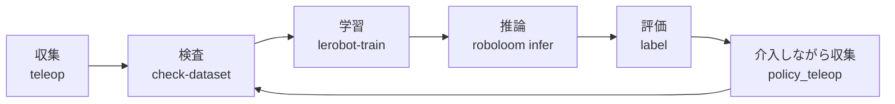

## はじめの一歩 { #first-steps }

-   [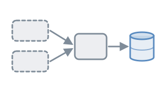](first-run-mock.md)

    **[装置なしで一周する](first-run-mock.md)**

    examples/mockで起動，記録，検査を一周する．

    模擬のRakuda · 15分 · 模擬のみ

-   [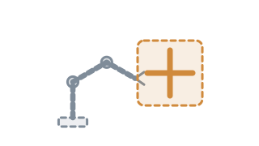](own-robot.md)

    **[自分のrobotを足す](own-robot.md)**

    自分のfollowerのclassとtemplateで，模擬の腕を動かす．

    自分のrobot · 20分 · 模擬のみ

## Rakuda2 { #rakuda2 }

-   [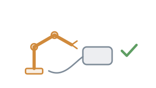](rakuda2-setup.md)

    **[Rakuda2：機体設定と読み取り確認](rakuda2-setup.md)**

    設定を作り，portを読み，torqueを切って経路を一周する．

    Rakuda2 · 1〜2時間 · 実機検証済み

-   [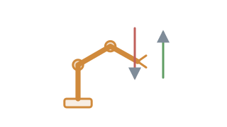](rakuda2-gravity.md)

    **[Rakuda2：重力補償](rakuda2-gravity.md)**

    零点，可動域，重力modelを測り，leaderの補償を調整する．

    Rakuda2 · 1〜2時間 · 実機検証済み

-   [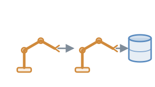](rakuda2-collect.md)

    **[Rakuda2：teleopで収集](rakuda2-collect.md)**

    leaderで動かし，RealSenseとDIGITと一緒に記録する．

    Rakuda2 · 30分〜 · 実機検証済み

## 方策 { #policy }

-   [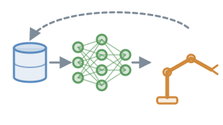](rakuda2-train-infer.md)

    **[Rakuda2：収集から推論まで](rakuda2-train-infer.md)**

    検査，LeRobotで学習，推論，成否の記録までを通す．

    Rakuda2 · 学習＋1時間 · 実機検証済み

-   [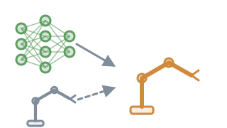](rakuda2-intervention.md)

    **[Rakuda2：介入しながら評価する](rakuda2-intervention.md)**

    方策の途中でleaderに代わり，介入した行を区別して記録する．

    Rakuda2 · 1時間 · 実機検証済み

-   [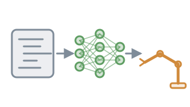](custom-policy.md)

    **[自作の方策を動かす](custom-policy.md)**

    見本のchunk_mlp.pyを模擬の記録で学習し，inferで動かす．

    模擬のRakuda2 · 30分 · 模擬のみ

## 開発中の機体 { #in-development }

-   [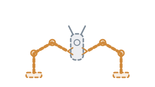](piper-pika-mock.md)

    **[PiPER＋Pikaを模擬で](piper-pika-mock.md)**

    模擬のPika SenseとIKで記録し，LeRobotの方策で動かす．

    PiPER＋Pika · 30分 · 開発中

-   [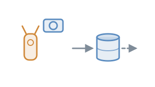](pika-handheld.md)

    **[Pika Senseを手に持った収集](pika-handheld.md)**

    robotなしでSenseを手に持って集め，学習用に変換する．

    Pika Sense · 30分 · 開発中

