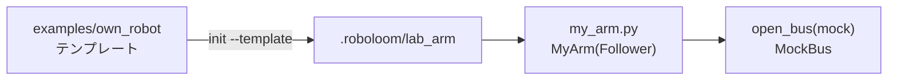

# 自分のロボットを足す

<span class="status status--mock">模擬のみ</span>

- **目的**：roboloomを変えずに，自分のフォロワのクラスとテンプレートからプロジェクトを作り，模擬のバスで方策を動かす．
- **前提**：roboloomのリポジトリをcloneしている（`examples/own_robot/` はcloneした中だけにある）．[装置なしで一周する](first-run-mock.md) の環境がある．
- **所要**：20分．
- **結果**：`.roboloom/lab_arm/` ができ，`infer --mock` で模擬の腕が動いて，`datasets/lab-arm` に1エピソードが保存される．



## 1. テンプレートを見る

| ファイル | 中身 |
| --- | --- |
| `config.yaml` | フォロワ `arm` と，方策のcontroller `policy` だけの構成 |
| `my_arm.py` | フォロワのクラス `MyArm`．関節 `shoulder`，`elbow`，単位 `rad` |
| `nodes/follower.yaml` | `type: my_arm:MyArm`（`module:Class`），`address`，`limits` |
| `nodes/policy.yaml` | `factory: roboloom.policy:hold`（その場に留める），`observe: []` |
| `mock.yaml` | `--mock` のときの `SET_ARM_ADDRESS` の値 |

```python
# examples/own_robot/my_arm.py（抜粋）
class MyArm(Follower):
    model = "my_arm"
    keys = (*FOLLOWER_KEYS, "address")
    safety_traits = SafetyTraits(torque_off="falls", unattended="holds")

    def __init__(self, name: str, cfg: dict):
        super().__init__(name, cfg, JOINTS, "rad")
        self.address = str(cfg.get("address"))

    def open_bus(self, mock: bool) -> JointBus:
        if mock:
            return MockBus(initial=0.0, dimension=len(JOINTS))
        raise NotImplementedError(f"{self.name}: connect to {self.address} here")
```

- `keys` は，YAMLで読むキーです．それ以外のキーは読み込みのときに拒否します．
- `safety_traits` は必ず宣言します．脱力したとき（`torque_off`）と指令が来なくなったとき（`unattended`）の性質で，確かめていないものは `unknown` にします．

## 2. プロジェクトを作る

```bash
uv run roboloom init lab_arm --template examples/own_robot
```

`created .roboloom/lab_arm (7 files)` と出ます．クラスのモジュール `my_arm.py` もロボットのディレクトリに写るので，各ノードのプロセスがそこから読み込みます．

## 3. 模擬で動かす

```bash
uv run roboloom infer lab_arm --mock --seconds 5 --plain
uv run roboloom infer lab_arm --mock --seconds 5 --plain --task hold
uv run roboloom check-dataset lab_arm --mock
```

- 1行目は保存しません（`discarded 'inference'`）．2行目は `--task` があるので保存します．
- `check-dataset` で `episodes: 1` と `problems: none` を確かめます．

## 4. 実機につなぐ

1. `open_bus` の `mock` でない側で，自分の機器のバス（`read_positions`，`write_positions`，`enable_torque`，`close`）を返します．
2. `nodes/follower.yaml` の `SET_ARM_ADDRESS` を実際の値にし，`limits` を実測した安全な範囲にします．
3. 入力機器（leader）を足すなら，`roboloom.inputs.base.JointInput` を継承したクラスと `joint` controllerを足します．

ほかの役割（センサー，controller）を足す規則は [自分のパッケージから足す](../contribution/index.md#own-types) にあります．

## 次へ

- 方策を書く：[自作の方策を動かす](custom-policy.md)
- roboloom本体に機体を足す：[新しいフォロワを足す](../contribution/index.md#adding-a-follower)
