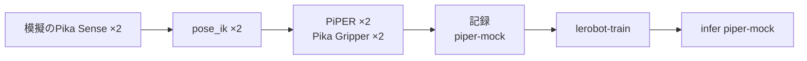

# PiPER＋Pikaを模擬で

!!! warning "状態：開発中"
    <span class="status status--dev">開発中</span> PiPER，Pika Gripper，Pika Senseのドライバは，どれも実機で動かしていません．ここの手順は模擬のデバイスだけで確かめたものです．値（`tool_offset` など）を実機に使い回さないでください．

- **目的**：PiPER 2台とPika Gripper 2台の構成を，模擬のPika Senseで動かして記録し，LeRobotで学習した方策で動かす．
- **前提**：roboloomのリポジトリをcloneしている（`.roboloom/piper-mock/` はcloneした中だけにある）．実機は使わない．
- **所要**：30分（学習の時間を除く）．
- **結果**：`.roboloom/piper-mock/datasets/piper-mock` に記録ができ，学習した方策の回が `piper-mock-policy` に保存される．



## 1. 環境を作る

```bash
git clone https://github.com/tetsugo02/roboloom.git
cd roboloom
uv sync --extra piper --extra pika --extra record --extra policy --extra train
```

構成のファイルは [PiPERのcontroller](../robots/piper/controllers.md) にあります．

## 2. 操作画面で動かす

```bash
uv run roboloom run piper-mock
```

1. Launch（Ctrl-S）で起動します．
2. 「Move home」で腕を `poses/<arm>/ready.yaml` へ動かします．腕は折りたたんだ姿勢（すべて0）で始まり，そのままではIKが手に追従できません．
3. 模擬のSenseは，開いてから2 s後に開始し，その後10 s開始・2 s停止を繰り返します．画面のcontrollerの行が `following` になります．
4. Start episodeで記録を始め，Stop，Saveで保存します．

## 3. 長さを決めて記録する

```bash
uv run roboloom record piper-mock --task "pick" --seconds 15 --episodes 5 --home --plain
uv run roboloom check-dataset piper-mock
```

`--home` は毎回，腕を開始の姿勢へ動かしてから始めます．

## 4. LeRobotで学習する

```bash
uv run lerobot-train \
  --dataset.repo_id=local/piper-mock \
  --dataset.root=.roboloom/piper-mock/datasets/piper-mock \
  --policy.type=act --policy.device=cpu --policy.push_to_hub=false \
  --wandb.enable=false --steps=200 --batch_size=8 \
  --output_dir=outputs/train/act_piper_mock
```

経路の確認だけなので，CPUで短く学習します．GPUを使うときは，`labstatus` で空きを確かめます．

## 5. 方策で動かす

まず，同じディレクトリの確認用の方策（`demo_policy.py`）で動かします．

```bash
uv run roboloom infer piper-mock --seconds 10 --plain
```

次に，学習したチェックポイントで動かし，`--task` で評価の回として保存します．

```bash
uv run roboloom infer piper-mock --seconds 20 --task "pick" \
  --policy roboloom.policy.lerobot:load \
  --policy-kwargs "{\"path\": \"$PWD/outputs/train/act_piper_mock/checkpoints/last/pretrained_model\"}"
uv run roboloom check-dataset piper-mock --with policy
```

- 推論の構成にはSenseがないので，方策は `observation.left_sense` などを使えません．
- 介入（`teleop:`）は使えません．`pose_ik` は介入に対応していません．

## 次へ

- 実機の前に確かめること：[PiPERフォロワ](../robots/piper/index.md)，[Pika Gripperフォロワ](../robots/pika/index.md)，[Pika SenseとIK](../controllers/pose-ik.md)
- Senseを手に持って集める：[Pika Senseを手に持った収集](pika-handheld.md)
