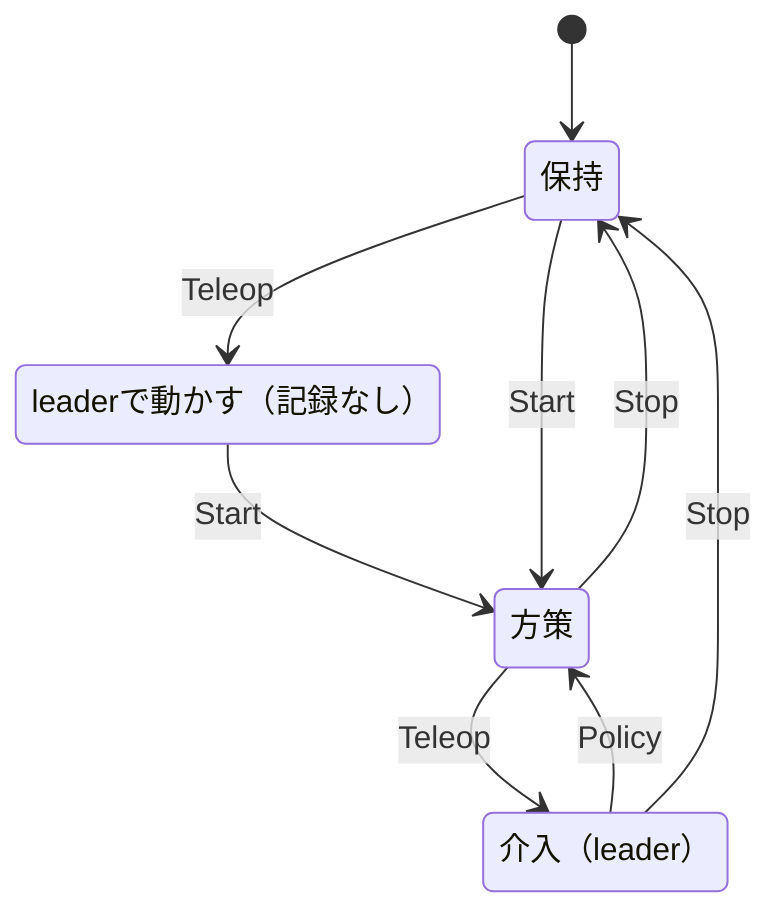

# Rakuda2：介入しながら評価する

<span class="status status--verified">実機検証済み</span>

- **目的**：方策でRakuda2を動かし，失敗しそうなときにleaderで代わり，また方策に戻す．介入した行を区別して記録する．
- **前提**：[Rakuda2：収集から推論まで](rakuda2-train-infer.md) で方策が動く．leaderとfollowerを支えられる．
- **所要**：1時間．
- **結果**：`datasets/rakuda2-eval-teleop` に，`action.intervention` と `observation.leader` を含むエピソードが保存される．

!!! note "確かめた範囲"
    Rakuda2の実機で確かめたのは，方策の推論と介入（`policy_teleop`）です．例に使うLeRobotの方策の読み込み（`roboloom.policy.lerobot:load`）と実験ファイルは <span class="status status--mock">模擬のみ</span> です．



## 1. 実験ファイルを書く

方策とオプションを，プロジェクトの `configs/roboloom/<名前>.yaml` にまとめます．`policy_teleop` は `policy` を必要とするので，両方が有効になります．

```yaml
# configs/roboloom/cup-teleop.yaml
help: カップの方策の評価．leaderで介入できる
robot: rakuda2
options: [policy_teleop]
nodes:
  controllers.policy:
    factory: roboloom.policy.lerobot:load
    kwargs: {path: /home/me/my_project/outputs/train/act_rakuda2/checkpoints/last/pretrained_model}
task: pick up the cup
```

- `kwargs` のパスは絶対パスにします．
- `nodes/policy_teleop.yaml` は `nodes/policy.yaml` に `teleop: [controller.yaml]` を足したものです．介入のときは `controller.yaml` の `joint` controllerでleaderが動かします．
- 書き方は [実験ファイル](../reference/configuration/index.md#experiments) にあります．

```bash
uv run roboloom validate --experiment cup-teleop
```

`options: policy, policy_teleop; dataset: local/rakuda2-eval-teleop` と出ることを確かめます．

## 2. 起動して評価する

```bash
uv run roboloom run --experiment cup-teleop
```

| 操作 | キー | 動き |
| --- | --- | --- |
| Teleop（エピソードの外） | `t` | 記録せずに，leaderでフォロワを開始姿勢へ動かす |
| `start pick up the cup` | — | 方策と記録を始める．Teleopの後ならそこから方策が引き継ぐ |
| Teleop（エピソード中） | `t` | 方策を止め，leaderに切り替える（介入） |
| Policy | `p` | leaderから方策に戻す．方策は `reset()` から始め直す |
| `stop`，`save success` | — | 止めて，成否を付けて保存する |

- Teleopを押すと，フォロワの関節はすべて今の目標で止まります．leaderの関節が近づくか値をまたぐと，その関節から順に追従します．画面の方策の行に，まだつかまえていない関節と差（`pickup`）が出ます．
- グリッパーは，トリガーをフォロワの開き具合まで握り込むまで動きません．
- 別の端末からは `uv run roboloom session teleop`，`uv run roboloom session policy` で同じ操作を送れます．
- 詳しい動きは [テレオペと介入](../policy/intervention.md) にあります．

## 3. 記録を確かめる

```bash
uv run roboloom check-dataset --experiment cup-teleop
```

| feature | 中身 |
| --- | --- |
| `action.intervention` | 人がleaderで動かした行は1 |
| `observation.leader` | leaderの関節位置（17） |

- エピソードの外のTeleopは記録しません．
- エピソードの最初の1〜2行は，`start` の直前の人の指令が残り，`action.intervention` が1になることがあります．
- leaderも記録するので，`policy` だけのデータセット（`rakuda2-eval`）とは別になります．

## 次へ

- 介入した行を学習でどう扱うか：[データの形式](../data/format.md#valid)
- 成否の集計：[評価と再生](../policy/evaluation.md)
