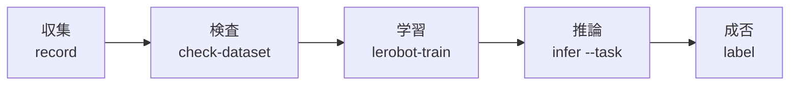

# Rakuda2：収集から推論まで

<span class="status status--verified">実機検証済み</span>

- **目的**：teleopで集めたdataを検査し，LeRobotで学習した方策でRakuda2を動かし，各回の成否を残す．
- **前提**：[Rakuda2：teleopで収集](collect.md) で収集できる．学習にGPUを使うなら，`labstatus` で空きを確かめる．
- **所要**：収集と学習の時間に加えて1時間ほど．
- **結果**：評価のdataset `datasets/rakuda2-eval` に，成否の付いたepisodeが並ぶ．

!!! note "確かめた範囲"
    Rakuda2の実機で確かめたのは，teleopの収集と方策の推論（`roboloom infer`）です．LeRobotのcheckpointを読む `roboloom.policy.lerobot:load` は，模擬のPiPER＋Pikaだけで確かめています <span class="status status--mock">模擬のみ</span>．`check-dataset` と `label` も <span class="status status--mock">模擬のみ</span> です．



## 1. 収集する

[Rakuda2：teleopで収集](collect.md) の手順で，同じtaskのepisodeを集めます．

```bash
uv run roboloom record --task "pick up the cup" --seconds 30 --episodes 20 --with gravity
```

- `gravity` はdataset名を変えません．保存先は `.roboloom/rakuda2/datasets/rakuda2` です．
- DIGITも学習に使うなら `--with gravity,digit` にします．保存先は `rakuda2-digit` に分かれます．

## 2. 記録を検査する

```bash
uv run roboloom check-dataset
```

- `problems` が `none` で，`notes` の `action.valid is 0` の割合が小さいことを確かめます．
- 悪いepisodeを除くときは [悪いepisodeを除く](../../data/check-and-train.md#excluding-episodes) の方法を使います．

## 3. LeRobotで学習する

<span class="status status--mock">模擬のみ</span>

```bash
uv add git+https://github.com/tetsugo02/roboloom.git --tag v0.2.2 --extra policy --extra train
uv run lerobot-train \
  --dataset.repo_id=local/rakuda2 \
  --dataset.root=.roboloom/rakuda2/datasets/rakuda2 \
  --policy.type=act --policy.device=cuda --policy.push_to_hub=false \
  --trackio.enable=false \
  --output_dir=outputs/train/act_rakuda2
```

- `--dataset.repo_id` は設定の `repo_id`，`--dataset.root` はrobotのdirectoryから見た `output` です．
- checkpointは `outputs/train/act_rakuda2/checkpoints/last/pretrained_model` にできます．
- 経路だけを試すなら `--policy.device=cpu --steps=200 --batch_size=8` で数分です（[LeRobotで学習する](../../policy/lerobot.md#training)）．

## 4. 方策で動かす

まず，templateの既定の方策 `roboloom.policy:hold`（腕をその場に留める）で，推論の経路を確かめます．`--task` がないので保存しません．

```bash
uv run roboloom infer --seconds 10
```

次に，学習したcheckpointで動かします．`--task` を付けると，各回を評価のdatasetに保存します．

```bash
uv run roboloom infer --seconds 30 --episodes 10 --task "pick up the cup" \
  --policy roboloom.policy.lerobot:load \
  --policy-kwargs "{\"path\": \"$PWD/outputs/train/act_rakuda2/checkpoints/last/pretrained_model\"}"
```

- `infer` はoption `policy` を自動で有効にします．leaderは使わないので `gravity` とは同時に使えません．
- checkpointのpathは絶対pathで渡します．相対pathは，projectのrootからは解決されません（dataflowは一時directoryから起動します）．
- `nodes/policy.yaml` の `rate_hz`（15）は，学習したdatasetの `dataset_fps`（15）と同じにします．
- 既定の `mode: step` では方策が1手ずつ返すので，`action_horizon` は効きません（[LeRobotの方策](../../policy/lerobot.md#loading)）．
- 観測は既定で関節状態と `camera` です．DIGITで学習したなら `--with digit` を足し，`observe` を `[camera, digit_left, digit_right]` にします（[観測を選ぶ](../../policy/custom.md#observations)）．
- 毎回同じ姿勢から始めるときは，`nodes/policy.yaml` に `home:` を書いて `--home` を付けます（[home](../../policy/run.md#home)）．

## 5. 成否を残す

保存のときに，操作画面の入力欄で `save success` か `save failure` と入れるか，あとから付けます．

```bash
uv run roboloom label --with policy 3 failure --note "つかみ損ねた"
uv run roboloom check-dataset --with policy
```

`check-dataset` が `labels: 7 success, 3 failure, ...` のように数を表示します．成否はdatasetの `meta/roboloom_episodes.jsonl` に残り，LeRobotの学習には影響しません（[評価と再生](../../policy/evaluation.md)）．

## 次へ

- 方策が失敗しそうなときに人が代わる：[Rakuda2：介入しながら評価する](intervention.md)
- 自分のmodelを書く：[自作の方策を動かす](../custom-policy.md)
